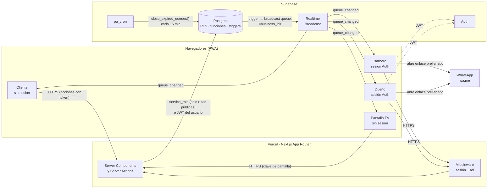
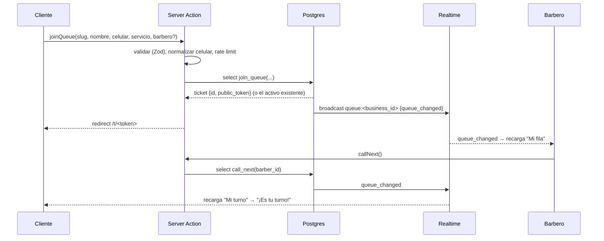
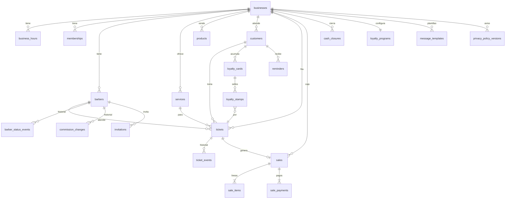
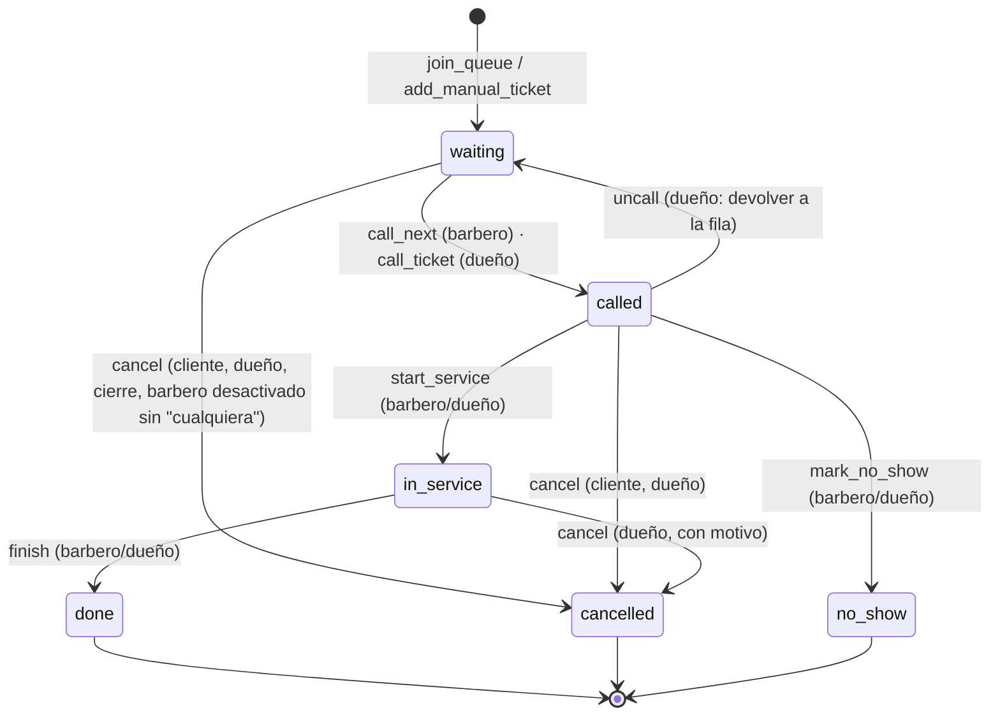
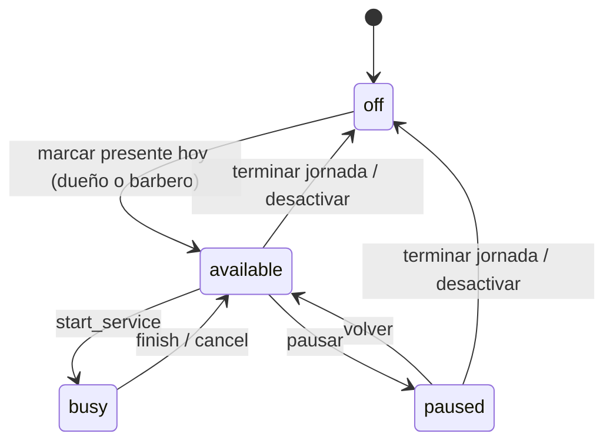

# TurnOS — Diseño técnico

> Estado: **APROBADO v1.0** (Henry, 2026-10-23)
> Fecha: 2026-10-23
> Depende de: `constitution.md` v1.0, `requirements.md` v1.0, `decisions.md` ADR-001…ADR-015
> Cada sección indica los REQ que cubre. Si algo aquí contradice un REQ, gana el REQ y se corrige
> este documento de forma explícita (P7).

## Índice

1. Arquitectura general y flujo de datos
2. Modelo de datos (tablas, índices, RLS)
3. Máquina de estados del turno
4. Algoritmo de posición y tiempo estimado
5. Comisiones y cierre de caja (con ejemplos)
6. Rutas, server actions, funciones SQL y Realtime
7. Pantallas por rol
8. Estrategia de pruebas
9. Estructura del repositorio
10. Cobertura REQ → sección
11. Hito 5 — Experiencia del cliente
12. Hito 6 — Aviso automático por WhatsApp
13. Hito 7 — Membresía familiar
15. Hito 9 — Tarjetas de regalo (§14 es del Hito 8)

---

## 1. Arquitectura general y flujo de datos

Cubre: NFR-001, NFR-003, NFR-004, NFR-011, NFR-013, ADR-001, ADR-008, ADR-009.



Principios de la arquitectura:

- **Dos caminos de acceso a datos.** El personal (dueño, barbero) consulta Postgres con su JWT y
  las políticas RLS deciden qué ve. Los anónimos (cliente, pantalla) nunca tocan Postgres
  directamente: pasan por server actions que usan `service_role` en el servidor, validan la
  entrada y llaman funciones SQL que encapsulan las reglas (ADR-009).
- **Lectura por relectura.** Realtime solo transporta una señal `queue_changed` por negocio; cada
  pantalla recarga su vista completa (ADR-008). Así la reconexión y los eventos perdidos se
  resuelven con el mismo código (REQ-011.2).
- **Reglas en la base de datos.** Transiciones de estado, unicidad de turno activo por celular,
  cálculo de comisión y cierre de caja son funciones SQL con pruebas (ADR-011).
- **Lógica pura en TypeScript** para lo que se calcula al vuelo y se muestra: posición, tiempo
  estimado, formato de COP, normalización de celular. Vive en `src/lib/domain/` sin dependencias
  de framework para probarse con Vitest (ADR-013).

Flujo típico "tomar turno → atender":



---

## 2. Modelo de datos

Cubre: REQ-003, REQ-007.7, REQ-012, REQ-015, REQ-016, REQ-017, REQ-018, REQ-019, REQ-020,
REQ-023…REQ-027, REQ-030, REQ-031, REQ-033, REQ-034, NFR-004, NFR-005, NFR-010, §8 (fuera de
alcance soportado).

Convenciones: nombres en inglés, `snake_case`; `id uuid default gen_random_uuid()`; `created_at
timestamptz default now()`; todas las tablas de negocio tienen `business_id uuid not null
references businesses(id)`; montos `integer` en COP; estados como `enum` de Postgres; fechas de
negocio (`business_day`) como `date` calculada en `America/Bogota`.

### 2.1 Diagrama entidad-relación



### 2.2 Tablas

**`businesses`** — el tenant.

| Columna | Tipo | Notas |
|---|---|---|
| id | uuid PK | |
| name | text | nombre público |
| slug | text unique | URL pública `/<slug>`; `[a-z0-9-]{3,40}` |
| address | text | |
| timezone | text default 'America/Bogota' | |
| chairs_count | int default 5 | REQ-016.2 |
| default_commission_pct | int default 50 | 0–100, check |
| grace_minutes | int default 5 | REQ-008.1 |
| inactive_days | int default 21 | REQ-020.1 |
| reminder_cooldown_days | int default 7 | REQ-020.4 |
| queue_override | enum('auto','open','closed') default 'auto' | REQ-012.4, REQ-017.2 |
| queue_override_day | date null | el override vale solo ese día |
| screen_key | text | clave de la pantalla TV, 16 chars aleatorios (REQ-013.1) |
| pwa_name | text null | nombre de la app instalada (PA-22); null → `name` |
| created_at | timestamptz | |

**`business_hours`** (business_id, weekday 0–6, opens_at time, closes_at time, is_closed bool).
PK (business_id, weekday). REQ-017.1.

**`memberships`** (user_id uuid → auth.users, business_id, role enum('owner','barber'),
barber_id uuid null → barbers, created_at). PK (user_id, business_id). Un dueño que atiende tiene
`role='owner'` y `barber_id` no nulo (REQ-012.5). Soporta varios negocios por usuario
(REQ-031.3).

**`barbers`**

| Columna | Tipo | Notas |
|---|---|---|
| id, business_id | | |
| user_id | uuid null | null hasta aceptar la invitación |
| display_name | text | |
| phone_e164 | text | |
| commission_pct | int | 0–100 (REQ-025.1) |
| is_active | bool default true | REQ-016.3 |
| status | enum('available','busy','paused','off') default 'off' | `off` = no está hoy |
| present_day | date null | día en que se marcó presente (REQ-016.4); `status='off'` si ≠ hoy |
| sort_order | int | |
| duration_factor | numeric null | reservado (PA-09), no usado en el MVP |

**`invitations`** (id, business_id, barber_id, token text unique, expires_at, accepted_at null).
REQ-030.2.

**`services`** (id, business_id, name, duration_min int check (>0 and %5=0), price int check
(≥0), is_active bool, counts_for_loyalty bool default true, sort_order). REQ-015.

**`barber_services`** (business_id, barber_id, service_id, primary key (barber_id, service_id);
FK compuestas con `business_id` para que barbero y servicio sean del mismo negocio). REQ-035,
ADR-023. Qué servicios hace cada barbero. La migración llena todas las combinaciones existentes
(REQ-035.4); triggers `after insert` en `barbers` y en `services` agregan la fila con todos los
servicios activos / barberos activos (REQ-035.1–35.2: "todos marcados"), y las pantallas guardan
después la selección con `set_barber_services(barber_id, service_ids[])` /
`set_service_barbers(service_id, barber_ids[])`, que reemplazan el conjunto y fallan con
`NO_SERVICES` si un barbero activo queda sin ninguno (REQ-035.3). Helper
`barber_does_service(barber_id, service_id) returns bool` (stable).

**`products`** (id, business_id, name, price int, is_active bool, sort_order). REQ-024.1.

**`customers`**

| Columna | Tipo | Notas |
|---|---|---|
| id, business_id | | |
| phone_e164 | text | unique (business_id, phone_e164) |
| name | text | |
| preferred_barber_id | uuid null | REQ-018.1 (recalculado por trigger, editable) |
| first_visit_at, last_visit_at | timestamptz null | solo turnos `done` |
| visits_count | int default 0 | solo turnos `done` |
| notes | text null | |
| privacy_accepted_at | timestamptz null | REQ-002.3 |
| privacy_version | int null | REQ-002.3 |
| do_not_contact | bool default false | REQ-020.5 |
| referred_by | uuid null | reservado (referidos) |
| anonymized_at | timestamptz null | REQ-018.6: name='Cliente eliminado', phone_e164='deleted:<uuid>' |

**`privacy_policy_versions`** (id, business_id, version int, body text, published_at).
Unique (business_id, version). REQ-002.5.

**`tickets`** — el turno.

| Columna | Tipo | Notas |
|---|---|---|
| id, business_id | | |
| business_day | date | día de negocio en Bogotá |
| sequence | bigint | número correlativo por negocio y día (trigger) |
| queue_order | bigint | = sequence × 1000 al crear; reordenable (ADR-012) |
| display_number | int | número visible "Turno 14" = sequence |
| customer_id | uuid null | null para "cliente sin registro" (REQ-012.3) |
| customer_name | text | copia al momento de crear |
| customer_phone_e164 | text null | copia; null sin registro |
| service_id | uuid | |
| service_name, service_duration_min, service_price | text, int, int | copia (REQ-015.3) |
| preferred_barber_id | uuid null | null = "el que esté libre" |
| assigned_barber_id | uuid null | se fija al llamar |
| status | enum('waiting','called','in_service','done','cancelled','no_show') | §3 |
| public_token | text unique | 22 chars base64url (128 bits) |
| created_at, called_at, started_at, finished_at | timestamptz | |
| cancel_reason | enum('customer','business','closing','barber_removed') null | |
| notified_at, notified_by | timestamptz null, uuid null | REQ-009.3 |
| payment_status | enum('n/a','pending','paid','unpaid') default 'n/a' | REQ-023.6; `pending` al pasar a done |
| scheduled_at | timestamptz null | reservado (reservas con hora) |
| source | enum('qr','link','manual') | |

Índices: `(business_id, business_day, status)`, `(business_id, status, queue_order)`,
`(public_token)`, unique parcial **`(business_id, customer_phone_e164) where status in
('waiting','called','in_service') and customer_phone_e164 is not null`** (REQ-003.5, CB-04,
CB-21).

**`ticket_events`** (id, business_id, ticket_id, from_status null, to_status, actor_type
enum('customer','barber','owner','system'), actor_user_id null, reason text null, at). Índice
(ticket_id, at). REQ-007.7, NFR-012.

**`barber_status_events`** (id, business_id, barber_id, status, at). Fuente de los minutos en
servicio para ocupación (REQ-028.2).

**`loyalty_programs`** (business_id PK, enabled bool, visits_required int default 10,
reward_type enum('free_service','discount'), reward_service_id uuid null, reward_amount int null).
REQ-019.1. Qué servicios suman: `services.counts_for_loyalty`.

**`loyalty_cards`** (id, business_id, customer_id, stamps int default 0, status
enum('active','completed','redeemed'), completed_at, redeemed_at, redeemed_sale_id null). Índice
único parcial: un `active` o `completed` por cliente. REQ-019.2–19.6.

**`loyalty_stamps`** (id, business_id, card_id, ticket_id unique, at). Un sello por turno.

**`sales`**

| Columna | Tipo | Notas |
|---|---|---|
| id, business_id | | |
| business_day | date | |
| ticket_id | uuid null unique | REQ-023.4: null para venta sin turno |
| barber_id | uuid null | null en venta solo de productos |
| customer_id | uuid null | |
| services_total | int | suma de líneas de servicio después de descuento |
| products_total | int | |
| discount_total | int | incluye el premio de fidelidad |
| total | int | services_total + products_total |
| commission_pct | int | copia del barbero en ese momento |
| commission_base | int | ver §5 (precio de lista cuando hay premio, REQ-025.4) |
| commission_amount | int | |
| business_amount | int | commission_base − commission_amount |
| loyalty_card_id | uuid null | si se aplicó premio |
| status | enum('active','voided') | REQ-026 |
| voided_reason, voided_by, voided_at | | |
| created_by | uuid | |
| created_at | timestamptz | |

**`sale_items`** (id, business_id, sale_id, kind enum('service','product'), ref_id uuid, name,
qty int, unit_price int, discount int default 0, line_total int, is_reward bool default false).

**`sale_payments`** (id, business_id, sale_id, method enum('cash','nequi','transfer','card'),
amount int). Suma de `amount` = `sales.total` (check por trigger). El MVP escribe una fila; el
modelo ya soporta pago dividido (REQ-023.5).

**`cash_closures`** (id, business_id, business_day, totals jsonb, cash_expected int, cash_counted
int, difference int, closed_by, closed_at, status enum('active','voided'), reopen_reason null,
voided_at null). Índice único parcial (business_id, business_day) where status='active'.
REQ-027. `totals` guarda la foto completa (por medio de pago, por barbero, servicios/productos).

**`commission_changes`** (id, business_id, barber_id, old_pct, new_pct, changed_by, at).
REQ-025.3.

**`message_templates`** (business_id, key enum('notify_2_turns','reminder_inactive','share_queue'),
body text). PK (business_id, key). REQ-033.

**`reminders`** (id, business_id, customer_id, kind enum('inactive'), sent_by, sent_at).
REQ-020.4.

**`rate_limits`** (key text, window_start timestamptz, count int). PK (key, window_start). Sin
`business_id`: es infraestructura. ADR-009.

### 2.3 Funciones auxiliares de seguridad

```sql
-- Negocios a los que pertenece el usuario autenticado
create function auth_business_ids() returns setof uuid language sql stable security definer as $$
  select business_id from memberships where user_id = auth.uid()
$$;
create function is_owner_of(b uuid) returns boolean ...   -- role = 'owner'
create function my_barber_id(b uuid) returns uuid ...     -- memberships.barber_id
```

### 2.4 Políticas RLS por tabla y rol

RLS **activado y forzado** en todas las tablas excepto `rate_limits` (solo `service_role`). La
clave `anon` **no tiene ninguna política**: las páginas públicas pasan por server actions con
`service_role` (ADR-009). `service_role` salta RLS; por eso sus funciones de entrada
(`join_queue`, `get_ticket_by_token`, `get_public_queue`, `get_screen_queue`) reciben el
identificador público y devuelven solo columnas seguras.

| Tabla | Dueño (owner) | Barbero (barber) | Notas |
|---|---|---|---|
| businesses | select, update (sus negocios) | select | insert vía función `create_business()` que también crea la membresía |
| business_hours | all | select | |
| memberships | select (de sus negocios); insert/delete solo por función `accept_invitation` / `remove_barber` | select propia | |
| barbers | all | select todos del negocio; update **solo** `status` de su propia fila (trigger valida que no cambie otra columna) | REQ-010 |
| invitations | all | — | aceptación vía función con `service_role` |
| services, products | all | select | REQ-015, REQ-024 |
| barber_services | all (cambios vía `set_barber_services` / `set_service_barbers`) | select | REQ-035 |
| customers | all | select de su negocio; update `notes` y `preferred_barber_id` | REQ-018.4: la ficha es visible, los montos se filtran en `sales` |
| privacy_policy_versions | all | select | |
| tickets | select/update de su negocio; insert vía `add_manual_ticket`; nunca delete | select de su negocio; cambios de estado **solo** vía `transition_ticket` / `call_next` (no update directo) | Las funciones son `security definer` y validan `my_barber_id` |
| ticket_events | select | select | insert solo por funciones |
| barber_status_events | select | select propias | insert por trigger |
| loyalty_programs | all | select | |
| loyalty_cards, loyalty_stamps | select, update (canje manual REQ-019.5) | select | inserts por trigger/función |
| sales, sale_items, sale_payments | select, insert (vía `register_sale`), update solo `status` (anular, vía `void_sale`) | select **where barber_id = my_barber_id()**; insert vía `register_sale` solo con su `barber_id` | REQ-029.1, REQ-023.7 |
| cash_closures | all (vía funciones `close_cash_day`, `reopen_cash_day`) | — | REQ-027 |
| commission_changes | select; insert por trigger | select propias | |
| message_templates | all | select | |
| reminders | all | — | |

Prueba obligatoria (REQ-031.4): con el JWT de un barbero del negocio A, `select`/`insert`/
`update` sobre `tickets`, `customers`, `sales` del negocio B devuelve 0 filas / error.

### 2.5 Triggers

| Trigger | Tabla | Hace |
|---|---|---|
| `tickets_before_insert` | tickets | asigna `business_day`, `sequence`, `queue_order`, `display_number`, `public_token`, copia precio/duración del servicio |
| `tickets_after_change` | tickets | `realtime.send()` a `queue:<business_id>` con `{type:'queue_changed'}` (ADR-008); si `status→done`: actualiza `customers` (visits, last_visit, preferred) y agrega sello de fidelidad si aplica; `payment_status='pending'` |
| `barbers_after_status_change` | barbers | inserta `barber_status_events`; broadcast `queue_changed` |
| `barbers_commission_change` | barbers | inserta `commission_changes` cuando cambia `commission_pct` |
| `sale_payments_check` | sale_payments | al confirmar venta, suma = total |
| `sales_block_closed_day` | sales | impide insertar/anular en un día con cierre `active` (REQ-027.3, REQ-026.2) |

### 2.6 Ficha de cliente: fusión y alcance del barbero (ADR-016)

**`merge_customers(keep_id, merge_id)`** (solo dueño; REQ-018.5). `keep` es la ficha cuyo nombre
y celular quedan (el dueño la elige; la UI preselecciona la de visita más reciente):

1. Valida: mismo negocio, distintas, ninguna anonimizada; si las dos tienen tarjeta `completed`
   → error `BOTH_REWARDS_PENDING` (P0004).
2. `tickets`, `reminders` y `loyalty_cards` `redeemed` de `merge` pasan a `keep`.
3. Tarjetas abiertas (`active`/`completed`): si solo una existe, pasa a `keep`. Si existen dos, la
   destino es la `completed` (si hay) o la de `keep`; los `loyalty_stamps` de la otra se mueven a
   la destino, `stamps` = suma, se borra la otra; si el programa está activo y
   `stamps ≥ visits_required`, la destino pasa a `completed` (`completed_at = now()`).
4. `keep`: `visits_count` = suma; `first_visit_at` = mín; `last_visit_at` = máx; `notes` =
   unión (`keep` primero); `privacy_version`/`privacy_accepted_at` = los de versión más alta;
   `do_not_contact` = OR; `preferred_barber_id` recalculado con los últimos 5 turnos `done` de la
   ficha unida (salvo `preferred_barber_manual`).
5. Se borra `merge`. Los turnos conservan `customer_name`/`customer_phone_e164` congelados.

Ejemplo: `keep` 3 sellos, `merge` 8 sellos, programa de 10 → una tarjeta con 11 sellos,
`completed` (premio disponible); al canjear se abre una tarjeta nueva en 0.

**`barber_customers(q)`** (barbero; REQ-018.4): clientes con turno activo hoy que eligieron a su
silla o a "el que esté libre", más los que tienen algún turno con `assigned_barber_id` = su
silla; filtro opcional `q` igual que `search_customers`. Devuelve `id, name, phone_last4,
last_visit_at, visits_count, in_queue_today`. `getCustomer` usa la misma regla para decidir si
el barbero puede abrir una ficha.

**Historial** (REQ-018.2): por turno, fecha (`business_day`), servicio, barbero asignado, estado
(`done` → "Terminado", `no_show` → "No llegó", `cancelled` → "Cancelado"; los activos →
"En la fila"), valor = `service_price` solo si `done` (hasta T-043, luego el cobrado en
`sales`) y medio de pago (desde H3). Al barbero se le oculta el valor de turnos que no atendió
él (PA-10). La regla vive en `toHistoryRows` (`src/lib/domain/customer-history.ts`).

---

## 3. Máquina de estados del turno

Cubre: REQ-005, REQ-007, REQ-008, REQ-010, REQ-011.4, REQ-012.2, REQ-014, REQ-016.3, ADR-011.



Tabla de transiciones (la única fuente; `transition_ticket` la consulta):

| De → A | Actor permitido | Efectos |
|---|---|---|
| waiting → called | barbero (solo el primero de su lista, vía `call_next`), dueño (cualquiera, vía `call_ticket`) | `assigned_barber_id`, `called_at`; barbero sigue `available` hasta iniciar |
| called → in_service | barbero asignado, dueño | `started_at`; barbero → `busy` |
| called → no_show | barbero asignado, dueño | barbero → `available`; evento |
| called → waiting | dueño | limpia `assigned_barber_id`, `called_at`; conserva `queue_order` |
| called → cancelled | cliente (token), dueño | barbero → `available` |
| waiting → cancelled | cliente (token), dueño, sistema (cierre) | motivo obligatorio |
| in_service → done | barbero asignado, dueño | `finished_at`; barbero → `available`; `payment_status='pending'`; trigger de cliente/fidelidad |
| in_service → cancelled | dueño | barbero → `available`; motivo |

Reglas adicionales que `transition_ticket` aplica:

- **Idempotencia** (REQ-011.4): si el turno ya está en `to_status` y la petición trae el mismo
  `actor`, devuelve el turno sin error y sin evento nuevo.
- **Un turno a la vez por barbero** (REQ-007.5): `call_next` falla con `BARBER_BUSY` si el
  barbero tiene un turno `called` o `in_service`.
- **Carrera** (REQ-007.2): `call_next` hace `select … from tickets where status='waiting' and
  (preferred_barber_id = $barber or (preferred_barber_id is null and
  barber_does_service($barber, service_id))) order by queue_order for update skip locked limit 1`.
  Dos barberos simultáneos obtienen turnos distintos. El filtro por servicio es REQ-035.9; un
  turno con `preferred_barber_id = $barber` entra aunque el barbero ya no haga el servicio
  (REQ-035.12).
- **Servicio por barbero** (REQ-035.8, REQ-035.11): `join_queue`, `add_manual_ticket`,
  `transition_ticket` (llamar con un barbero, reasignar) y `reorder`/reasignar fallan con
  `BARBER_CANT_DO_SERVICE` si el barbero elegido no hace el servicio; `join_queue` falla con
  `NO_BARBER_FOR_SERVICE` si hay barberos presentes y ninguno lo hace (REQ-035.7; con nadie
  presente no aplica). `register_sale` no
  valida esto (REQ-035.13).
- **Pausa** (REQ-010): `set_barber_status(paused, reassign boolean)`: falla con `BARBER_BUSY` si
  tiene turno `called`/`in_service`; si `reassign=true`, pone `preferred_barber_id=null` a sus
  `waiting` conservando `queue_order` y escribe un evento `reassigned` por turno.
- **Barbero desactivado** (REQ-016.3, CB-20): igual que pausa con `reassign=true`, más
  `status='off'`, `is_active=false`, y revocación de la sesión (borrar membresía).
- **Cierre** (REQ-014): `close_expired_queues()` cancela `waiting` y `called` con
  `cancel_reason='closing'` para negocios cuyo `closes_at + 60 min` (hoy, Bogotá) ya pasó o cuyo
  `queue_override='closed'` para hoy. También lo invoca "Cerrar fila por hoy". Con
  `queue_override='open'` para hoy (REQ-017.2) no cancela por horario; los turnos de días
  anteriores se cancelan siempre (REQ-014.2). Migración 0029.

Estado del barbero (`barbers.status`):



---

## 4. Algoritmo de posición y tiempo estimado

Cubre: REQ-004.1, REQ-004.5, REQ-006.1, REQ-009.1, REQ-010.1, REQ-017.3, ADR-012, ADR-013.

Función pura `estimateQueue(input): Estimate[]` en `src/lib/domain/queue-estimate.ts`.

**Entrada**

```ts
type BarberState = { id: string; status: 'available'|'busy'|'paused'|'off';
                     busyUntil?: Date /* started_at + duration, o called_at + duration */ };
type WaitingTicket = { id: string; queueOrder: number; durationMin: number;
                       preferredBarberId: string | null;
                       capableBarberIds: string[] /* REQ-035: quienes hacen su servicio */ };
type Input = { now: Date; barbers: BarberState[]; waiting: WaitingTicket[] /* status waiting, ordenado por queueOrder */ };
```

**Definiciones**

- Barberos **activos** `A` = los que están `available` o `busy` (no `paused`, no `off`).
- `freeAt[b]` = `now` si `available`; `max(now, busyUntil)` si `busy`. Para un turno `called` sin
  iniciar, `busyUntil = called_at + duración` (se asume que empieza ya).
- **Lista del barbero b** (REQ-006.1) = turnos `waiting` con `preferredBarberId = b`, o
  `preferredBarberId = null` y `b ∈ capableBarberIds` (REQ-035.9), en orden de `queueOrder`.
- `puede(W)` = `{W.preferred}` si tiene preferido, si no `W.capableBarberIds` (REQ-035).

**Posición** (REQ-004.1), para el turno T:

- `posición = 1 + |{ W : W.queueOrder < T.queueOrder y puede(W) ∩ puede(T) ≠ ∅ }|`: cuenta los
  que están delante y podrían ocupar a alguno de los barberos que pueden atender a T. Sin
  restricciones (todos hacen todo) se reduce a la regla original: con preferido b cuenta los de b
  y los de "cualquiera"; sin preferido cuenta a todos (REQ-035.10).
- "Personas delante" = posición − 1. "Eres el siguiente" cuando posición = 1.
- La etiqueta **"Avisar"** (REQ-009.1) se muestra cuando `personas delante = 2`.

**Tiempo estimado** por simulación:

```
para cada W en waiting (orden queueOrder):
  candidatos = puede(W) ∩ A
  si candidatos vacío → W.estimate = null: con preferido, "tu barbero no está disponible"
    (REQ-010.3); sin preferido, "Esperando a que haya quién te atienda" (REQ-035.10)
  b* = argmin freeAt[b] sobre candidatos (empate: menor id)
  W.startAt = freeAt[b*]
  freeAt[b*] = W.startAt + W.durationMin
  W.waitMin = ceil5( (W.startAt − now) en minutos )      // ceil5 redondea hacia arriba a múltiplo de 5
```

Si `A` está vacío, todos los estimados son `null` y la UI muestra "No hay barberos atendiendo en
este momento". El estimado para el formulario del cliente (REQ-017.3) se calcula simulando un
turno ficticio al final con la duración del servicio elegido.

**Ejemplo numérico** (REQ-004.5). `now = 10:00`. Barberos: Juan `busy` hasta 10:10, Pedro
`available`, Luis `paused`. Fila (orden): T1 corte 20 min pref=null; T2 barba 15 min pref=Juan;
T3 corte 20 min pref=Luis; T4 corte 20 min pref=null.

| Turno | Candidatos | Empieza | Barbero | Espera | Posición |
|---|---|---|---|---|---|
| T1 | {Juan 10:10, Pedro 10:00} | 10:00 | Pedro (hasta 10:20) | 0 → "Eres el siguiente" | 1 |
| T2 | {Juan 10:10} | 10:10 | Juan (hasta 10:25) | 10 min | 2 (T1 es "cualquiera" y está delante, así que cuenta en la lista de Juan) |
| T3 | {} (Luis en pausa) | — | — | null → "Tu barbero está en pausa" | 2 (T1 es "cualquiera" y está delante; corregido en T-016: antes decía 1) |
| T4 | {Juan 10:25, Pedro 10:20} | 10:20 | Pedro | 20 min | 4 |

Nota: la **posición** es un conteo determinista de quién está delante en la lista relevante; el
**tiempo** es la simulación. Para T2 la posición es 2 (T1 está delante y Juan podría tomarlo) y la
espera 10 min. Mostrar ambos es coherente: "Eres el 2.º · ≈ 10 min".

Complejidad O(|waiting| × |A|): despreciable (fila < 100, barberos ≤ 10).

---

## 5. Comisiones y cierre de caja

Cubre: REQ-019.4, REQ-023, REQ-024, REQ-025, REQ-026, REQ-027, REQ-028, REQ-029, ADR-005,
ADR-007 (PA-15, PA-18, PA-19, PA-20).

### 5.1 Comisión por venta (`register_sale`)

Entradas: líneas de servicio (precio unitario = precio de lista copiado al turno o al catálogo,
descuento ≥ 0, `is_reward`), líneas de producto, `barber_id`, pagos.

```
services_list     = Σ unit_price × qty            (servicios, sin descuentos)
services_discount = Σ discount                    (incluye el valor del premio de fidelidad)
services_total    = services_list − services_discount
products_total    = Σ unit_price × qty            (productos)
discount_total    = services_discount
total             = services_total + products_total

commission_base   = services_total + Σ discount de líneas con is_reward   // = precio de lista del servicio gratis (REQ-025.4)
commission_amount = round( commission_base × commission_pct / 100 )        // redondeo al peso; .5 hacia arriba
business_amount   = commission_base − commission_amount
```

Los productos no entran en la comisión (PA-17). Un descuento que no es premio sí reduce la base
(PA-18). Todo se guarda en la venta; cambiar `commission_pct` después no la altera (REQ-025.3).

**Ejemplo A — corte normal.** Corte $ 25.000, barbero Juan 60 %, pago Nequi.
`services_total = 25.000`, `commission_base = 25.000`, `commission_amount = 15.000`,
`business_amount = 10.000`, `total = 25.000`.

**Ejemplo B — corte + gaseosa.** Corte $ 25.000 + gaseosa $ 4.000, Juan 60 %, efectivo.
`services_total = 25.000`, `products_total = 4.000`, `total = 29.000`,
`commission_amount = 15.000`, `business_amount = 10.000`. La gaseosa queda 100 % para el negocio
(se ve en el cierre como "productos").

**Ejemplo C — décimo corte gratis.** Corte $ 25.000 con premio (`is_reward`, descuento 25.000),
Juan 60 %. `services_total = 0`, `total = 0` (no entra plata), `commission_base = 25.000`
(precio de lista, REQ-025.4), `commission_amount = 15.000`, `business_amount = 10.000`.
Interpretación: `business_amount` es la parte del negocio **sobre la base de comisión**, no el
ingreso real. El cierre muestra las dos cosas por separado: ingreso real = Σ `total` (0) y
comisión a pagar = Σ `commission_amount` (15.000); el costo del premio aparece en la línea
"Premios de fidelidad: $ 25.000" y lo asume el negocio (PA-19).

**Ejemplo D — redondeo.** Servicio $ 12.500 al 33 %: `12.500 × 0,33 = 4.125` → 4.125. Servicio
$ 10.000 al 33 %: `3.300`. Servicio $ 7.500 al 45 %: `3.375`. Servicio $ 9.999 al 50 %:
`4.999,5 → 5.000`.

### 5.2 Cierre de caja diario (`close_cash_day(business_day, cash_counted)`)

Sobre las ventas `active` del día (Bogotá):

```
por medio de pago m:        ingreso[m] = Σ sale_payments.amount where method = m
total_vendido             = Σ sales.total
servicios / productos     = Σ services_total / Σ products_total
premios_fidelidad         = Σ discount de líneas is_reward
por barbero b:            servicios_atendidos[b] = nº de ventas con barber_id = b y ≥1 línea de servicio
                          vendido[b]              = Σ services_total
                          comision[b]             = Σ commission_amount
                          negocio[b]              = Σ business_amount
efectivo_esperado         = ingreso['cash']
diferencia                = cash_counted − efectivo_esperado
```

`totals` (jsonb) guarda todo lo anterior; el cierre es inmutable. "Reabrir" (solo dueño, con
motivo) pone `status='voided'` y permite ventas/anulaciones del día de nuevo (REQ-027.3, PA-20).

**Ejemplo de cierre.** Día con 4 ventas:

| Venta | Barbero (%) | Servicios | Productos | Pago | Comisión | Negocio |
|---|---|---|---|---|---|---|
| 1 | Juan 60 | 25.000 | 0 | Nequi 25.000 | 15.000 | 10.000 |
| 2 | Juan 60 | 25.000 | 4.000 | Efectivo 29.000 | 15.000 | 10.000 |
| 3 | Pedro 50 | 40.000 (corte+barba) | 0 | Tarjeta 40.000 | 20.000 | 20.000 |
| 4 | Pedro 50 | 0 (premio, lista 25.000) | 3.000 | Efectivo 3.000 | 12.500 | 12.500 |

Cierre: Efectivo 32.000 · Nequi 25.000 · Transferencia 0 · Tarjeta 40.000 · **Total 97.000**
(servicios 90.000, productos 7.000, premios 25.000). Juan: 2 servicios, $ 50.000 vendidos,
comisión 60 % = **$ 30.000**. Pedro: 2 servicios, $ 40.000 vendidos, comisión = **$ 32.500**.
Efectivo esperado 32.000; si contó 30.000, diferencia **−2.000**. Comprobación manual: Pedro
cobró 40.000 reales y la comisión sobre el corte gratis (12.500) la asume el negocio, tal como
dice PA-19.

### 5.3 Resumen semanal (`weekly_summary(week_start)`)

Semana lunes–domingo (PA-21). Clientes nuevos = clientes cuya `first_visit_at` cae en la semana;
que repiten = clientes con turno `done` en la semana y `first_visit_at` anterior a la semana
(REQ-021). Turnos perdidos = `no_show` + `cancelled` de la semana.

**Ocupación** (REQ-028.2): `minutos_en_servicio = Σ` intervalos `busy` de
`barber_status_events` (desde el evento `busy` hasta el siguiente evento del mismo barbero), para
todos los barberos, dentro de la semana. `minutos_apertura = Σ (closes_at − opens_at)` de los
días no cerrados de `business_hours`. `ocupación = minutos_en_servicio ÷ (minutos_apertura ×
chairs_count)`.

Ejemplo: semana con 6 días × 11 h = 3.960 min de apertura × 5 sillas = 19.800 min-silla.
Minutos en servicio sumados: 7.920 → ocupación **40 %**. Detalle por día y por barbero con la
misma fórmula restringida.

---

## 6. Rutas, server actions, funciones SQL y Realtime

Cubre: REQ-001, REQ-002, REQ-003, REQ-004, REQ-005, REQ-006, REQ-009, REQ-011, REQ-012,
REQ-013, REQ-030, REQ-032, REQ-033, NFR-002, NFR-004.

### 6.1 Rutas (App Router)

| Ruta | Quién | Qué | REQ |
|---|---|---|---|
| `/` | público | Landing mínima + "Entrar" | — |
| `/[slug]` | cliente | Estado del negocio + "Tomar turno" | REQ-001 |
| `/[slug]/turno` | cliente | Formulario (aviso de privacidad incluido) | REQ-002, REQ-003 |
| `/t/[token]` | cliente | "Mi turno" en vivo + cancelar + fidelidad | REQ-004, REQ-005, REQ-019.7 |
| `/[slug]/pantalla?k=<screen_key>` | TV | Pantalla pública | REQ-013 |
| `/[slug]/privacidad` | público | Texto completo del aviso vigente | REQ-002.1 |
| `/entrar` | personal | Login: correo+contraseña o celular+PIN | REQ-030 |
| `/invitacion/[token]` | barbero | Crear PIN y vincularse | REQ-030.2 |
| `/app` | personal | Redirige según rol | |
| `/app/fila` | barbero (y dueño como barbero) | "Mi fila" + acciones | REQ-006…REQ-010 |
| `/app/mis-numeros` | barbero | Mis ventas y comisiones | REQ-025.5, REQ-029 |
| `/app/clientes`, `/app/clientes/[id]` | barbero, dueño | Lista/ficha (barbero sin montos) | REQ-018 |
| `/admin` | dueño | Inicio: fila del negocio y estado de barberos | REQ-012 |
| `/admin/fila` | dueño | Fila completa + intervenciones + abrir/cerrar | REQ-012 |
| `/admin/qr` | dueño | QR, enlace, compartir | REQ-001.2–1.3 |
| `/admin/servicios`, `/admin/productos` | dueño | CRUD | REQ-015, REQ-024.1 |
| `/admin/barberos`, `/admin/barberos/[id]` | dueño | CRUD, invitación, comisión, presente hoy | REQ-016, REQ-025 |
| `/admin/horario` | dueño | Horario semanal | REQ-017 |
| `/admin/fidelidad` | dueño | Configuración de tarjeta | REQ-019 |
| `/admin/recordar` | dueño | Clientes inactivos + WhatsApp | REQ-020 |
| `/admin/caja` | dueño | Caja de hoy, nueva venta, anular, cerrar | REQ-023, REQ-024, REQ-026, REQ-027 |
| `/admin/caja/[fecha]` | dueño | Cierre pasado | REQ-027.4 |
| `/admin/semana` | dueño | Resumen semanal | REQ-028 |
| `/admin/mensajes` | dueño | Plantillas | REQ-033 |
| `/admin/privacidad` | dueño | Versiones del aviso | REQ-002.5 |
| `/admin/negocio` | dueño | Datos del negocio, sillas, parámetros | REQ-016.2 |
| `/crear-negocio` | dueño nuevo | Asistente 3 pasos | REQ-030.1 |
| `/salud` | público | `{ok, db:true}` | NFR-012 |

`middleware.ts` protege `/app/*` y `/admin/*` (sesión y rol vía `memberships`).

### 6.2 Server actions (públicas, usan `service_role` + funciones SQL)

| Action | Entrada (Zod) | Función SQL | Salida |
|---|---|---|---|
| `getPublicBusiness(slug)` | slug | `get_public_business` | nombre, abierto?, próximo horario, personas en fila, servicios activos (cada uno con los ids de barberos que lo hacen, REQ-035.6–35.7), barberos presentes (con estado), versión del aviso |
| `joinQueue(slug, {name, phone, serviceId, preferredBarberId?, privacyAccepted})` | validación + `normalizePhoneCO` + rate limit | `join_queue` | `{token}` o `{existingToken}` (REQ-003.5) |
| `getTicketByToken(token)` | token | `get_ticket_by_token` | turno (sin celulares de otros), posición, estimado, barbero, fidelidad |
| `cancelTicketByToken(token)` | token | `transition_ticket(..., 'cancelled', 'customer')` | ok |
| `getScreenQueue(slug, key)` | | `get_screen_queue` | nombres abreviados por barbero |
| `acceptInvitation(token, pin)` | | crea usuario Auth + `accept_invitation` | sesión |

### 6.3 Server actions / RPC del personal (usan el JWT del usuario; RLS aplica)

| Action | Rol | Función SQL | REQ |
|---|---|---|---|
| `getMyQueue()` | barbero | `get_barber_queue(my_barber_id)` | REQ-006 |
| `callNext()` | barbero | `call_next` | REQ-007.1–7.2 |
| `startService(ticketId)`, `finishService(ticketId)`, `markNoShow(ticketId)` | barbero/dueño | `transition_ticket` | REQ-007.3–7.4, REQ-008 |
| `setMyStatus(status, reassign?)` | barbero | `set_barber_status` | REQ-010 |
| `markNotified(ticketId)` | barbero/dueño | update `notified_at` | REQ-009.3 |
| `getBusinessQueue()` | dueño | `get_business_queue` | REQ-012.1 |
| `callTicket`, `uncallTicket`, `cancelTicket`, `reassignTicket`, `moveTicket(ticketId, afterTicketId)` | dueño | `transition_ticket`, `reorder_ticket` | REQ-012.2 |
| `addManualTicket({name, phone?, serviceId, preferredBarberId?})` | dueño/barbero | `add_manual_ticket` | REQ-012.3, REQ-035.8 |
| `setBarberServices(barberId, serviceIds)`, `setServiceBarbers(serviceId, barberIds)` | dueño | `set_barber_services`, `set_service_barbers` | REQ-035.1–35.3 |
| `setQueueOverride('open'|'closed'|'auto')` | dueño | update + `close_expired_queues` si `closed`; "Abrir fila hoy" usa `open` | REQ-012.4, REQ-017.2 |
| `setBarberPresent(barberId, present)` | dueño (o barbero propio) | `set_barber_status('available'|'off')` | REQ-016.4 |
| CRUD servicios, productos, barberos, horario, plantillas, fidelidad, negocio | dueño | inserts/updates con RLS | REQ-015…017, 019, 024, 033 |
| `inviteBarber(barberId)` | dueño | insert `invitations` | REQ-030.2 |
| `searchCustomers(q)`, `getCustomer(id)`, `updateCustomer`, `mergeCustomers`, `anonymizeCustomer` | dueño (barbero: `barber_customers`, ficha de ese conjunto, edita notas y preferido) | `search_customers` (índice trigram), `barber_customers`, `merge_customers`, `anonymize_customer` | REQ-018, §2.6 |
| `getInactiveCustomers()`, `logReminder(customerId)` | dueño | `inactive_customers` | REQ-020 |
| `registerSale(input)` | barbero (propio) / dueño | `register_sale` | REQ-023, REQ-024, REQ-019.4 |
| `voidSale(saleId, reason)` | dueño | `void_sale` | REQ-026 |
| `getCashDay(date)`, `closeCashDay(date, cashCounted)`, `reopenCashDay(date, reason)` | dueño | `cash_day_summary`, `close_cash_day`, `reopen_cash_day` | REQ-027 |
| `getWeeklySummary(weekStart)` | dueño | `weekly_summary` | REQ-028 |
| `getMyNumbers(range)` | barbero | select `sales` (RLS filtra) | REQ-025.5, REQ-029 |

### 6.4 Realtime

Un único canal por negocio: `queue:<business_id>`, tipo Broadcast, público (sin RLS; no
transporta datos personales). Mensajes:

| `type` | Emitido por | Lo consumen |
|---|---|---|
| `queue_changed` | trigger en `tickets` (insert/update de estado, orden, barbero) y en `barbers` (status) | `/t/[token]`, `/app/fila`, `/admin/fila`, `/[slug]`, `/[slug]/pantalla` |

Hook `useQueueSubscription(businessId, reload)`: se suscribe, llama `reload()` al recibir
`queue_changed` (con *debounce* de 300 ms), y al detectar `CHANNEL_ERROR`/`TIMED_OUT` muestra la
franja "Sin conexión" (REQ-011.1) y al reconectar (`SUBSCRIBED`) llama `reload()` (REQ-011.2).
Además, *polling* de respaldo cada 30 s en `/t/[token]` (NFR-003).

### 6.5 Notificaciones (REQ-009.5)

```ts
interface NotificationChannel {
  readonly kind: "wa.me" | "cloud-api";
  buildLink(input: { phoneE164: string; template: string; vars: TemplateVars }): string | null;
}
// MVP: WaMeChannel → `https://wa.me/${phone}?text=${encodeURIComponent(render(template, vars))}`
// Hito 6: CloudApiChannel (envío servidor a servidor, `buildLink` devuelve null), ver §12.3.
```

Plantillas por defecto (editables, REQ-033):

- `notify_2_turns`: "Hola {nombre}, te saluda {negocio}. Faltan 2 turnos para el tuyo (≈ {tiempo}). Ve saliendo. Sigue tu turno aquí: {enlace}"
- `reminder_inactive`: "Hola {nombre}, en {negocio} te extrañamos. ¿Te apartamos un turno? Toma el tuyo sin filas aquí: {enlace}"
- `share_queue`: "Toma tu turno en {negocio} sin esperar en el local: {enlace}"

### 6.6 Seguridad en rutas públicas

- Tokens: `public_token` = 16 bytes aleatorios en base64url; `screen_key` igual (NFR-004).
- Rate limiting en `joinQueue`: función `check_rate_limit(key, limit, window)` sobre
  `rate_limits`; claves `phone:<e164>` (5/h) e `ip:<ip>` (30/h). Supera → error "Demasiados
  intentos, espera un momento".
- Cabeceras: `Cache-Control: no-store` en `/t/*`; `X-Robots-Tag: noindex` en `/[slug]/pantalla`.

---

## 7. Pantallas por rol

Cubre: REQ-001…REQ-013, REQ-018…REQ-020, REQ-023…REQ-029, REQ-032, NFR-007, NFR-008.

Diseño móvil, una columna, acción principal como botón grande inferior fijo, fuente base 16 px,
Tailwind con una paleta sobria (fondo claro, un color de acento, estados con color + icono + texto,
nunca solo color).

### Cliente

**`/[slug]` — Portada de la fila**
```
┌──────────────────────────────┐
│ ✂ Barbería La 33             │
│ Abierto · cierra 8:00 p. m.  │
│                              │
│   4 personas en la fila      │
│   ≈ 35 min de espera         │
│                              │
│ Barberos hoy: Juan · Pedro · │
│ Luis (en pausa)              │
│                              │
│ [     Tomar turno     ]      │  ← botón inferior fijo
└──────────────────────────────┘
```

**`/[slug]/turno` — Formulario** (4 campos + aviso): Nombre · Celular · Servicio (lista con
duración y precio; en gris "Hoy no hay quién lo haga" si ningún barbero presente lo hace,
REQ-035.7) · Barbero (chips: "El que esté libre" seleccionado, luego **los barberos que hacen el
servicio escogido**, REQ-035.6; en pausa o ausentes deshabilitados con etiqueta) · casilla de privacidad con enlace · botón "Confirmar
turno". Si el estimado supera el tiempo hasta el cierre: franja amarilla "Es posible que no
alcancemos a atenderte hoy" (REQ-017.3).

**`/t/[token]` — Mi turno**
```
┌──────────────────────────────┐
│ Barbería La 33 · Turno 14    │
│                              │
│        Eres el 3.º           │
│     2 personas delante       │
│        ≈ 25 min              │
│                              │
│ Corte · con Juan             │
│ Tarjeta: 7 de 10 cortes ●●●●●●●○○○ │
│                              │
│ [ Cancelar mi turno ]        │
│ Actualizado hace 5 s         │
└──────────────────────────────┘
```
Estados: `called` → fondo de acento, "¡Es tu turno! Pasa a la silla de Juan" + vibración;
`in_service` → "Te están atendiendo"; `done` → "¡Gracias por venir!"; `no_show` → "Te llamamos y
no estabas. Puedes tomar un turno nuevo [Tomar turno]"; `cancelled` → motivo en español.

### Barbero

**`/app/fila` — Mi fila**
```
┌──────────────────────────────┐
│ Juan · Disponible  [Pausar]  │
├──────────────────────────────┤
│ AHORA                        │
│ (nadie)                      │
├──────────────────────────────┤
│ SIGUEN (5)                   │
│ 1 Camilo R. · Corte 20' · 8' │
│   te eligió                  │
│ 2 Sara M. · Barba 15' · 12'  │
│   cualquiera                 │
│ 3 Andrés P. · Corte · 15'    │
│   te eligió · [📲 Avisar]     │  ← a 2 de distancia
│ ...                          │
├──────────────────────────────┤
│ [   Llamar al siguiente   ]  │
└──────────────────────────────┘
```
Con turno `called`: tarjeta "Llamado: Camilo R. · hace 3 min" con botones **[Ya está en la
silla]** y **[No llegó]** (este último resaltado al pasar 5 min). Con `in_service`: cronómetro y
botón **[Terminado]** → abre el panel de cobro (Hito 3). Pausar con clientes propios en espera →
hoja inferior con las dos opciones (REQ-010.2). Franja superior "Sin conexión. Reintentando…"
cuando aplica.

**`/app/clientes`**: buscador (nombre o últimos dígitos) y lista. Dueño: todos los clientes.
Barbero: "Hoy en tu fila" y "Atendidos por ti" (§2.6). Cada fila: nombre, `···1234`, visitas,
última visita. **`/app/clientes/[id]`**: datos de la ficha, notas y preferido editables,
historial (§2.6); dueño además: editar nombre y **[Fusionar con otra ficha]** → buscar la otra →
elegir qué celular queda → confirmar.

**`/app/mis-numeros`**: Hoy / Esta semana: servicios, vendido, mi comisión; lista de ventas
propias.

### Dueño

**`/admin` + `/admin/fila`**: estado de cada barbero (chips), lista completa con número, nombre,
servicio, preferido/asignado, estado, espera; menú por turno (Llamar con…, Devolver a la fila,
No llegó, Cancelar, Reasignar, Subir/Bajar); botones "Agregar cliente", "Cerrar fila por hoy" /
"Abrir fila".

**`/admin/caja`**: tarjetas Efectivo / Nequi / Transferencia / Tarjeta / Total; lista de ventas
del día (anular); tabla por barbero (servicios, vendido, comisión, negocio); **[Nueva venta]**;
**[Cerrar caja]** → pide efectivo contado → muestra diferencia → confirma → modo lectura con
**[Compartir por WhatsApp]** y **[Reabrir]**.

**Panel de cobro** (desde "Terminado" o "Nueva venta"): servicio(s) con precio (cambiar/agregar),
productos (+/−), premio disponible → **[Aplicar premio]**, total grande, medio de pago (4 botones),
**[Registrar $ 29.000]**.

**`/admin/recordar`**: parámetro N; lista "Camilo R. · 24 días · 6 visitas · Juan · [📲]";
"No contactar" por cliente.

**`/admin/semana`**: selector de semana; tarjetas Nuevos / Repiten / Servicios / Vendido /
Ocupación %; tabla por barbero; "turnos perdidos".

### Pantalla TV (`/[slug]/pantalla`)

Tres o cinco columnas (una por barbero presente) con "AHORA: Camilo R." y "SIGUEN: Sara M.,
Andrés P."; bloque "El que esté libre: …"; QR en la esquina inferior; letra ≥ 32 px; al llamar,
la tarjeta parpadea 30 s con "Pasa a la silla de Juan".

---

## 8. Estrategia de pruebas

Cubre: NFR-009, NFR-010, REQ-031.4, P8.

| Nivel | Herramienta | Qué cubre | Ejemplos de casos (CA) |
|---|---|---|---|
| **Unit** (TS puro) | Vitest | `src/lib/domain/*`: estimado y posición, normalización de celular, formato COP, cálculo de comisión (espejo en TS para la UI), render de plantillas, redondeo a 5 min | REQ-004.5, REQ-003.2, REQ-025.2, REQ-009.2, NFR-006 |
| **Unit SQL** | pgTAP (en `supabase/tests/`) | funciones: `transition_ticket` (todas las transiciones válidas e inválidas, idempotencia), `call_next` (carrera con dos sesiones), `join_queue` (turno activo único), `register_sale` (fórmulas, ejemplos A–D), `close_cash_day`, `weekly_summary`, `close_expired_queues`, triggers de cliente/fidelidad | REQ-007, REQ-008, REQ-011.4, REQ-014, REQ-019, REQ-023, REQ-025, REQ-027, REQ-028 |
| **Integración** | Vitest + Supabase local (`supabase start`) + seed | server actions contra base real; **aislamiento RLS** con JWT de cada rol (negocio A vs B, barbero vs dueño, columnas prohibidas); rate limiting | REQ-031, REQ-029, NFR-004 |
| **E2E** | Playwright (viewport Pixel 7 e iPhone 13; dos contextos para realtime) | flujos completos: tomar turno → ver posición → barbero llama → cliente ve "es tu turno" → terminado → cobro → cierre; cancelación; no llegó; pausa con reasignación; pérdida de conexión (offline del contexto) ; PWA instalable (manifest) ; pantalla TV | REQ-001…REQ-013, REQ-020, REQ-023, REQ-027, REQ-032, NFR-002 |
| **Lint de textos** | script | ningún texto visible en inglés; todos los montos pasan por `formatCOP` | NFR-006 |
| **Lighthouse CI** | `@lhci/cli` móvil | rendimiento ≥ 80, PWA instalable, accesibilidad ≥ 90 | NFR-001, NFR-008, REQ-032 |

Convención de trazabilidad: cada prueba lleva en su nombre el CA que cubre, p. ej.
`it('REQ-003.5 no duplica turno activo por celular', …)`. Un script `scripts/traceability.ts`
genera la matriz REQ → tareas → pruebas → estado a partir de `tasks.md` y de los nombres de las
pruebas, y falla si un CA de un hito cerrado no tiene prueba.

CI (GitHub Actions): `lint` → `typecheck` → `unit` (+ cobertura del dominio, NFR-009) → pgTAP +
`integration` (Postgres 16 + shim, `scripts/ci-db.sh`) → `e2e` y `lighthouse` contra `supabase
start` dentro del CI, **nunca contra producción** (ADR-022). Merge bloqueado si algo falla.

---

## 9. Estructura del repositorio

```
turnos/
  specs/                      ← esta carpeta
  src/
    app/
      (public)/[slug]/…        /[slug], /turno, /pantalla, /privacidad
      (public)/t/[token]/
      (auth)/entrar, invitacion/[token], crear-negocio
      (staff)/app/…            barbero
      (staff)/admin/…          dueño
      salud/route.ts
      manifest.ts
    components/                ui/ (botones, hojas, franjas), queue/, cash/, customers/
    lib/
      domain/                  queue-estimate.ts, phone.ts, money.ts, commission.ts, templates.ts
      supabase/                client.ts, server.ts (JWT), admin.ts (service_role, solo server)
      notifications/           channel.ts, wa-me.ts
      realtime/                use-queue-subscription.ts
      actions/                 public.ts, queue.ts, cash.ts, customers.ts, admin.ts
    middleware.ts
  supabase/
    migrations/                0001_init.sql, 0002_queue.sql, …
    functions/                 (Edge Functions, si llegan a necesitarse)
    seed.sql
    tests/                     pgTAP
  tests/
    unit/, integration/, e2e/
  scripts/traceability.ts
```

---

## 10. Cobertura REQ → sección

| REQ | Secciones |
|---|---|
| REQ-001 | 6.1, 6.2, 7 (portada), 6.6 |
| REQ-002 | 2.2 (customers, privacy_policy_versions), 6.1, 7 |
| REQ-003 | 2.2 (tickets, índice único parcial), 6.2 `joinQueue`, 6.6, 7 |
| REQ-004 | 4, 6.2 `getTicketByToken`, 6.4, 7 |
| REQ-005 | 3, 6.2 `cancelTicketByToken` |
| REQ-006 | 4 (lista del barbero), 6.3 `getMyQueue`, 7 |
| REQ-007 | 3 (transiciones, carrera, un turno a la vez), 6.3 |
| REQ-008 | 3, 2.2 `grace_minutes`, 7 |
| REQ-009 | 4 (etiqueta Avisar), 6.5, 2.2 `notified_at` |
| REQ-010 | 3 (`set_barber_status`), 4 (barberos activos), 7 |
| REQ-011 | 1, 3 (idempotencia), 6.4, 2.2 índice único |
| REQ-012 | 3 (transiciones del dueño), 6.3, 7, ADR-012 |
| REQ-013 | 6.1, 6.2 `getScreenQueue`, 7 (TV), 6.6 |
| REQ-014 | 3 (`close_expired_queues`), ADR-014 |
| REQ-015 | 2.2 services, 2.5 trigger de copia |
| REQ-016 | 2.2 barbers/memberships, 3 (desactivar), 6.3 |
| REQ-017 | 2.2 business_hours/queue_override, 4 (estimado en formulario) |
| REQ-018 | 2.2 customers, 2.4 RLS, 6.3 |
| REQ-019 | 2.2 loyalty_*, 2.5 trigger, 5.1 ejemplo C, 6.3 `registerSale` |
| REQ-020 | 2.2 reminders/do_not_contact, 6.3, 7 |
| REQ-021 | 5.3 |
| REQ-022 | 2.2 preferred_barber_id, 6.2 `getPublicBusiness` (prellenado desde localStorage + ficha) |
| REQ-023 | 2.2 sales/sale_items/sale_payments, 5.1, 6.3, 7 (panel de cobro) |
| REQ-024 | 2.2 products, 5.1 ejemplo B |
| REQ-025 | 5.1, 2.2 commission_changes, 2.5 |
| REQ-026 | 2.2 sales.status, 2.5 `sales_block_closed_day`, 6.3 |
| REQ-027 | 5.2, 2.2 cash_closures, 7 |
| REQ-028 | 5.3, 2.2 barber_status_events |
| REQ-029 | 2.4 RLS en sales |
| REQ-030 | ADR-010, 2.2 invitations/memberships, 6.1, 6.2 |
| REQ-031 | 2.3, 2.4, 8 (integración) |
| REQ-032 | 6.1 `manifest.ts`, 8 (Lighthouse) |
| REQ-033 | 2.2 message_templates, 6.5 |
| REQ-034 | 9 `supabase/seed.sql`, 8 |
| REQ-035 | 2.2 `barber_services`, 2.4, 3 (servicio por barbero, carrera), 4 (`puede(W)`), 6.2 `getPublicBusiness`, 6.3, 7 (formulario), ADR-023 |
| REQ-036 | 11.1 `businesses.google_review_url`, 11.4 `get_ticket_by_token`, 11.5 |
| REQ-037 | 11.1 `customers.birthday_*`, 11.2, 11.4 `join_queue`/`birthdays_this_week`, 11.5 |
| REQ-038 | 11.1 `products`/`tickets.courtesy_*`, 11.4, 11.5 |
| REQ-039 | 11.1 `barber_photos`, 11.2, 11.3 Storage, 11.4, 11.5 |
| REQ-040 | 12.1, 12.2 `claim_notification`, 12.3, 12.4 |
| REQ-041 | 12.1 `customers.whatsapp_*`, 12.2 `join_queue`, 12.6 |
| REQ-042 | 12.2, 12.5, 12.6 |
| REQ-043 | 12.1, 12.2, 12.3, 12.5, 12.6 |
| NFR-001…013 | 1, 2.4, 6.4, 6.6, 8 |

---

## 11. Hito 5 — Experiencia del cliente (REQ-036…REQ-039, ADR-025)

Una sola migración `0033_customer_experience.sql` con su pgTAP. Las funciones nuevas siguen
ADR-019 (permisos explícitos: `revoke` de `public`/`anon`, `grant` a quien corresponda).

### 11.1 Datos

| Tabla | Cambio | REQ |
|---|---|---|
| `businesses` | `google_review_url text null check (google_review_url ~ '^https://')` | 036.1 |
| `customers` | `birthday_month smallint null check (1..12)`, `birthday_day smallint null check (1..31)`; `check` de fecha posible con año bisiesto (`make_date(2000, m, d)` no falla); ambos null o ambos con valor | 037.1, 037.3 |
| `products` | `for_sale bool not null default true`, `is_courtesy bool not null default false`, `photo_path text null` | 038.1 |
| `tickets` | `courtesy_product_id uuid null` (FK compuesta con `business_id` a `products`), `courtesy_served_at timestamptz null`, `courtesy_served_by uuid null` | 038.3–038.5 |
| `barber_photos` (nueva) | `id, business_id, barber_id, path text, created_at`; FK compuesta (business_id, barber_id) | 039 |
| enum `message_template_key` | agrega `'birthday'` con plantilla por defecto: "¡Feliz cumpleaños, {nombre}! En {negocio} te deseamos un gran día." (negocios nuevos: `create_business`; los que ya existen: `0034_birthday_template.sql`, porque un valor nuevo de enum no se usa en la misma transacción que lo agrega) | 037.4 |

Los productos existentes quedan `for_sale = true`, `is_courtesy = false` (nada cambia en caja).
El texto por defecto del aviso de privacidad (seed y `/crear-negocio`) agrega el cumpleaños como
dato opcional (REQ-037.6); publicar la versión nueva usa REQ-002.5 sin cambios.

### 11.2 RLS

| Tabla | Dueño | Barbero | REQ |
|---|---|---|---|
| `barber_photos` | all en su negocio | select en su negocio; insert/delete solo con `barber_id` = el suyo | 039.1 |
| `customers.birthday_*` | update (ya tiene) | update con alcance de ficha (ADR-016; el trigger que restringe al barbero admite las dos columnas) | 037.1 |
| `tickets.courtesy_served_*` | vía `mark_courtesy_served` | vía `mark_courtesy_served` (el barbero no tiene update directo sobre `tickets`, igual que 0010) | 038.5 |

Trigger `barber_photos_limit` (`before insert`): más de 12 por barbero → `PHOTO_LIMIT` (P0013),
REQ-039.2. El límite vive en la base, no solo en la UI.

Al anonimizar una ficha (REQ-018.6) un trigger borra también `birthday_month/day` (T-058). Al
fusionar fichas (REQ-018.5) queda el cumpleaños de la que se conserva; si no tiene, el de la otra
(`0035_merge_customers_birthday.sql`, T-060).
`set_ticket_courtesy` fuera de espera → `TICKET_NOT_WAITING` y `mark_courtesy_served` sin bebida →
`NO_COURTESY`, ambos con código P0004 (como `INVALID_TRANSITION`).

### 11.3 Almacenamiento (primer uso de Supabase Storage)

- Bucket `media`, **lectura pública** (las fotos se muestran en páginas públicas sin sesión),
  escritura con políticas de `storage.objects` por ruta: `<business_id>/barbers/<barber_id>/<uuid>.webp`
  (dueño del negocio o ese barbero) y `<business_id>/products/<uuid>.webp` (dueño).
- El celular reduce y convierte a WebP antes de subir (`src/lib/media/resize.ts`, canvas: lado
  mayor ≤ 1080 px, calidad hasta quedar ≤ 300 KB), REQ-039.4. Safari no codifica WebP: ahí sale
  JPEG con el `Content-Type` real, en la misma ruta `.webp` que exigen las políticas (T-061). El
  servidor rechaza tipos que no sean `image/*` y más de 300 KB (límite del bucket).
- Foto de producto (T-061): el navegador la sube al escogerla, con la sesión del dueño, y
  `saveProduct` guarda solo la ruta tras validar que sea del negocio. Quitar o reemplazar la foto
  borra el objeto anterior al guardar; subida y sin guardar queda un huérfano inofensivo.
- Foto de barbero (T-062): el navegador la reduce y `uploadBarberPhoto` la sube desde el servidor
  con la sesión del usuario (mismas políticas), tras revisar permiso (REQ-039.3), tipo y peso y
  contar las 12. Si el trigger la rechaza igual, borra el objeto.
- Borrar una foto borra la fila y el objeto (la acción hace las dos cosas; si falla el objeto,
  la fila igual se borra y queda un huérfano inofensivo).
- Barbero desactivado (REQ-039.6): las lecturas públicas filtran por `barbers.is_active`; las
  fotos no se borran.

### 11.4 Funciones SQL

| Función | Quién | Qué | REQ |
|---|---|---|---|
| `join_queue(..., p_birthday_month, p_birthday_day, p_courtesy_product_id)` | service_role | Guarda el cumpleaños solo si la ficha no tiene (`coalesce`); valida la cortesía (activa, `is_courtesy`, mismo negocio) → `COURTESY_INVALID` (P0012) | 037.2, 038.3, 038.6 |
| `set_ticket_courtesy(p_token, p_product_id null)` | service_role | Solo con el turno en `waiting`; si no → `TICKET_NOT_WAITING`; misma validación | 038.4, 038.6 |
| `mark_courtesy_served(p_ticket_id)` | dueño, barbero | Pone hora y quién; idempotente (si ya está servida no cambia) | 038.5 |
| `birthdays_this_week(p_business_id, p_today null)` | dueño | Clientes con cumpleaños entre hoy y hoy+6 (`business_day_bogota()`), 29-feb → 28-feb en año no bisiesto, sin `do_not_contact` ni anonimizados; devuelve `celebrates_on`. Recibe el negocio como `inactive_customers`; `p_today` solo para pruebas (T-058) | 037.4, 037.5 |
| `customer_has_birthday(p_slug, p_phone)` | service_role | Si la ficha ya tiene cumpleaños, para no volver a pedirlo en el formulario (T-058: `get_preferred_barber` devuelve un uuid y no se cambió su firma) | 037.2 |
| `get_public_business` | service_role | Agrega `products` (a la venta, activos, con `photoPath`), `courtesies` (de cortesía, activos) y `photoCounts` (`{barberId: n}` de los barberos activos con fotos). Las fotos van como ruta del bucket `media`; la URL pública la arma la app (T-058) | 038.2, 038.3, 039.5 |
| `get_barber_photos(p_slug, p_barber_id)` | service_role | Fotos de un barbero activo, de la más nueva a la más vieja | 039.5 |
| `get_ticket_by_token` | service_role | Agrega `courtesy` (nombre, servida?) y `googleReviewUrl` si el turno está `done` | 036.2–036.4, 038.4 |
| Filas del barbero y del dueño | personal | Cada turno trae la bebida y si está servida. No hay funciones `get_*_queue`: las filas leen `tickets` con RLS y `barber_queue_tickets` devuelve `setof tickets`, así que las columnas `courtesy_*` llegan sin cambios (T-058) | 038.5 |

Cada cambio de cortesía (`set_ticket_courtesy`, `mark_courtesy_served`) emite `queue_changed`
(ADR-008), así la fila del barbero y "Mi turno" se releen solos.

### 11.5 Server actions y pantallas

- Públicas (`src/lib/actions/public.ts`): `joinQueue` recibe `birthday` y `courtesyProductId`;
  nuevas `setTicketCourtesy(token, productId|null)` y `getBarberPhotos(slug, barberId)`. Errores
  P0012 → "Esa bebida ya no está disponible" en el campo; P0013 → texto de REQ-039.2.
- Personal: `saveGoogleReviewUrl` (dueño, `/admin/negocio`), `updateCustomer` con día y mes de
  cumpleaños (la ficha guarda todo con un solo botón, T-060), `getBirthdaysThisWeek`
  (`/admin/recordar`, sección "Cumplen esta semana" encima de los clientes inactivos),
  `saveProduct` con `forSale`, `isCourtesy` y foto (`/admin/productos`), `markCourtesyServed`
  (filas), `uploadBarberPhoto` / `deleteBarberPhoto` (`src/lib/actions/photos.ts`; `/app/mis-fotos`
  para el barbero y desde `/admin/barberos` para el dueño).
- Cliente: portada `/[slug]` con "Lo que vendemos" (REQ-038.2); formulario con cumpleaños
  (`customerHasBirthday`, con el celular prellenado o escrito; el campo aparece solo cuando se
  sabe que la ficha no lo tiene, T-060),
  "Bebida de cortesía" y "Ver cortes" (hoja inferior con las fotos, REQ-039.5); "Mi turno" con
  cambio de bebida en espera (las opciones salen de `getPublicBusiness`, releídas al abrir; ya
  servida no se ofrece el cambio, T-061) y, al terminar, "¡Gracias por venir!" + botón de reseña.
- Barbero y dueño: en cada turno, una línea "🥤 <bebida>" con botón "Servida ✓" (≥ 48 px).

### 11.6 Pruebas

- pgTAP `0033_customer_experience.sql`: columnas y checks (fecha imposible, 29-feb válido, URL sin
  `https`), `join_queue` no reemplaza cumpleaños, cortesía inválida (inactiva, no cortesía, otro
  negocio), cambio fuera de `waiting`, `mark_courtesy_served` por barbero e idempotente, límite de
  12 fotos, RLS de `barber_photos` (barbero ajeno no sube ni borra; otro negocio no ve),
  `birthdays_this_week` (borde de semana, 29-feb, no contactar, anonimizado), permisos (ADR-019).
- Unitarias: validación de día/mes, `resize` (cálculo de dimensiones), armado del texto de la
  plantilla de cumpleaños.
- Integración: `joinQueue` con cumpleaños y cortesía contra Postgres local; `setTicketCourtesy`.
- E2E (Pixel 7 + iPhone 13): tomar turno con bebida → el barbero la ve y la marca servida; Mi turno
  terminado muestra reseña; subir foto con confirmación y verla en "Ver cortes".

---

## 12. Hito 6 — Aviso automático por WhatsApp (REQ-040…REQ-043, ADR-027)

Migraciones `0036_whatsapp_notifications.sql`, `0037_notification_queue.sql`, `0038_whatsapp_inbound.sql`,
`0039_whatsapp_screens.sql` y `0040_whatsapp_allowed.sql` con su pgTAP y permisos explícitos (ADR-019).

### 12.1 Datos

| Tabla | Cambio | REQ |
|---|---|---|
| `businesses` | `whatsapp_auto_enabled bool not null default false`, `whatsapp_contact_phone text null` (número que da la respuesta automática) | 043.3, 042.4 |
| `businesses` (`0040`) | `whatsapp_allowed bool not null default false`; `check (not whatsapp_auto_enabled or whatsapp_allowed)` | 043.6 |
| `customers` | `whatsapp_opt_in_at timestamptz null`, `whatsapp_opt_out_at timestamptz null`. Permiso vigente: `opt_in_at` no nulo y (`opt_out_at` nulo o anterior a `opt_in_at`) | 041.2, 042.3 |
| `ticket_notifications` (nueva) | `id, business_id, ticket_id, kind enum('two_left','called'), status enum('skipped','claimed','sent','delivered','failed'), meta_message_id text null, error_code text null, created_at, updated_at`; `unique (ticket_id, kind)`; índices por `meta_message_id` y por `(business_id, created_at)` | 040.3, 040.5, 043.2 |

`unique (ticket_id, kind)` es lo que garantiza "una sola vez": dos ejecuciones simultáneas compiten
por el mismo insert y solo una gana. `skipped` deja constancia de REQ-040.2.

`ticket_notifications` tiene RLS forzada: el dueño lee las de su negocio; nadie escribe por RLS, solo
las funciones `security definer` de abajo.

Las dos fechas de la ficha solo cambian con `service_role` o dentro de una función interna: el trigger
`customers_whatsapp_consent_guard` rechaza al personal, dueño incluido, porque el permiso lo da solo
el cliente (REQ-041.4). Eliminar la ficha borra ambas (REQ-018.6). `merge_customers` deja la fecha más
nueva de cada una, así una baja de la ficha fusionada no se pierde (REQ-042.3).

`whatsapp_allowed` lo cambia solo `service_role` (el operador, con SQL o una migración): el trigger
`businesses_whatsapp_allowed_guard` rechaza al personal, dueño incluido (REQ-043.6, ADR-029). El
`check` impide encender el aviso en un negocio no habilitado aunque el dueño escriba la columna por
la API, así que las funciones de §12.2 que leen `whatsapp_auto_enabled` no cambian. `0040` habilita
a Filo (`slug = 'filo'`); en local no hace nada porque el seed no lo trae.

### 12.2 Funciones SQL

| Función | Quién | Qué | REQ |
|---|---|---|---|
| `join_queue(..., p_whatsapp_opt_in bool)` | service_role | Si viene `true` y el negocio tiene el aviso activo, pone `whatsapp_opt_in_at = now()` en la ficha, también si devuelve un turno que ya existía | 041.2, 043.3 |
| `set_whatsapp_opt_out(p_token)` | service_role | Baja desde "Mi turno" | 042.1, 042.3 |
| `whatsapp_opt_out_by_phone(p_business_id, p_phone)` | service_role | Baja por respuesta "PARAR" | 042.2, 042.3 |
| `claim_notification(p_ticket_id, p_kind)` | service_role | Revisa negocio activo, permiso vigente y tope del mes; inserta `claimed` con `on conflict do nothing`; pone `tickets.notified_at = now()` salvo que el turno ya tenga un aviso manual (`notified_by` no nulo), que se conserva. Devuelve `claimed`, `duplicate`, `no_consent`, `disabled` o `cap_reached` | 040.3, 040.6, 041.5, 043.1, 043.3 |
| `skip_two_left(p_ticket_id)` | service_role | Inserta `skipped` para el turno recién creado | 040.2 |
| `set_notification_status(p_status, p_id, p_meta_message_id, p_error)` | service_role | Actualiza estado por `p_id` o, sin él, por `p_meta_message_id`. Solo avanza (`claimed` → `sent` → `delivered` o `failed`) y devuelve si hubo cambio. Con `failed` limpia `notified_at` solo si `notified_by` es nulo (no borra un aviso manual) | 040.7 |
| `get_notification_queue(p_business_id)` | service_role | Con el aviso activo: negocio, `queue_snapshot`, turnos `waiting` y `called` de hoy con celular, nombre y token, avisos registrados en cualquier estado y `staleClaims`. Apagado: solo `{enabled: false}` | 040.1, 040.3, 040.5, 040.7, 043.3 |
| `notification_id(p_ticket_id, p_kind)` | service_role | Id del aviso recién reclamado, porque `claim_notification` devuelve solo texto | 040.7 |
| `notification_month_stats(p_business_id)` | dueño | `{sent, failed, capReached}`, mes de Bogotá. Recibe el negocio como `birthdays_this_week` | 043.2 |
| `whatsapp_inbound_context(p_phone)` | service_role | `{optOutBusinessIds, contactPhone}` de un mensaje entrante (`0038`, §12.5) | 042.2, 042.4, 042.5 |
| `claim_whatsapp_reply(p_phone)` | service_role | Ventana móvil de 24 h de la respuesta automática (`0038`, §12.5) | 042.4 |
| `customer_has_whatsapp_consent(p_slug, p_phone)` | service_role | ¿La ficha de ese celular tiene permiso vigente? (`0039`, §12.6) | 041.1, 041.3 |
| `get_public_business`, `get_ticket_by_token` | service_role | Agregan `whatsappAutoEnabled` y `whatsappConsent` (activo y con permiso vigente) (`0039`) | 042.1, 043.3 |

El tope cuenta las filas que no son `skipped` del mes, dentro de `claim_notification` con un bloqueo
por negocio (`pg_advisory_xact_lock`) para que no se pase por concurrencia.

Auxiliares de `service_role`: `whatsapp_consent_active(opt_in, opt_out)` (regla de permiso vigente),
`set_whatsapp_opt_in(negocio, celular)` y `notification_cap_reached(negocio)`.

### 12.3 Canal

`NotificationChannel` (§6.5) gana `CloudApiChannel` en `src/lib/notifications/cloud-api.ts`:

- `sendTemplate({ phoneE164, template, params })` → `POST /{phone_number_id}/messages` de la Graph
  API con `fetch`, timeout de 5 s y sin reintentos en línea. Devuelve `{ ok, messageId }` o
  `{ ok: false, code }`. Nunca lanza. `code` es el de Meta o uno de `http_<estado>`,
  `invalid_response`, `timeout` y `network`. El timeout cubre también la lectura del cuerpo. Plantillas
  con idioma `es`, que debe coincidir con el aprobado en Meta.
- `sendText({ phoneE164, body })` para la respuesta automática y la confirmación de baja (dentro de la ventana de 24 h
  que abrió el cliente al escribir).
- Variables de entorno de solo servidor: `WHATSAPP_ACCESS_TOKEN`, `WHATSAPP_PHONE_NUMBER_ID`,
  `WHATSAPP_APP_SECRET`, `WHATSAPP_VERIFY_TOKEN`. Las pone Henry en Vercel. Sin cualquiera de las cuatro
  `cloudApiChannelFromEnv()` devuelve null y el canal queda inactivo (REQ-043.3): sin las del webhook
  no llegarían los estados ni "PARAR".
- En pruebas se inyecta un canal falso; ninguna prueba toca la red (REQ-043.4). Los E2E corren el
  servidor real con `WHATSAPP_FAKE_CHANNEL=1`: `cloudApiChannelFromEnv()` devuelve el mismo canal con un
  `fetch` falso, gana sobre las credenciales y se ignora en Vercel (`VERCEL` definido).

Plantillas de utilidad a registrar en Meta (idioma español):

- `turno_faltan_dos`: "Hola {{1}}, en {{2}} ya casi es tu turno (≈ {{3}}). Ve saliendo. Sigue tu turno aquí: {{4}}"
- `turno_te_llaman`: "{{1}}, te están llamando en {{2}}. Tienes {{3}} minutos para llegar. Tu turno: {{4}}"

### 12.4 Quién decide y cuándo se envía

No hay pg_net ni un proceso aparte. El estimado vive en TypeScript (§4), así que la decisión también:

- `pickNotifications(input)` en `src/lib/domain/queue-notifications.ts`, función pura y probada con
  unitarias: recibe el resultado de `estimateQueue`, el celular de los turnos en espera, los turnos
  `called` y los avisos ya registrados en cualquier estado; devuelve qué enviar, primero los llamados.
  No revisa permiso, activación ni tope: eso lo hace `claim_notification`. Regla de "faltan 2": `ahead <= 2`, `waitMin` no nulo y sin motivo de bloqueo
  (`reason` vacío), lo que cubre barbero en pausa y "Esperando a que haya quién te atienda" (REQ-040.4).
- `dispatchQueueNotifications(businessId, deps)` en `src/lib/notifications/dispatch.ts`, con `deps`
  (gateway, canal, `appUrl`) inyectados: si el negocio no tiene el aviso activo sale de una; si no,
  lee `get_notification_queue`, llama `pickNotifications`, hace `claim_notification` y envía solo si
  devolvió `claimed`. Si Meta rechaza, `set_notification_status` con `failed`.
- Se llama con `after()` de Next.js al final de **toda** acción que cambia la fila: tomar turno,
  turno manual, llamar, llamar con barbero, deshacer llamado, iniciar, terminar, no llegó, cancelar,
  reasignar, mover, cambio de estado del barbero y cancelar desde "Mi turno". Va después de responder:
  una falla o demora de Meta no afecta la acción (REQ-040.7). Se centraliza en un helper
  `afterQueueChange(businessId)` (`src/lib/notifications/after-queue-change.ts`) y una prueba revisa
  que cada acción lo use. Usa `cloudApiChannelFromEnv()`: sin credenciales no agenda nada ni toca la
  base (REQ-043.3). `getChannel()` sigue siendo wa.me para el botón manual.
- Tomar turno y turno manual llaman antes `skip_two_left` si el turno quedó con `ahead <= 2` (REQ-040.2),
  con `registerNewTicket(gw, token, existing)` en `src/lib/queue/public-queue.ts`. Una falla ahí no
  hace fallar el turno. Un turno que ya existía no se marca.
- `{tiempo}` de `turno_faltan_dos` es `waitMin` con mínimo 5 ("≈ 0 min" no se entiende).
- La función de cierre automático (`close_expired_queues`) no pasa por aquí y no hace falta: solo
  cancela turnos.
- **Autocorrección**: si una ejecución muere antes de enviar, el `claimed` queda sin mensaje. Una fila
  `claimed` de más de 2 minutos sin `meta_message_id` se marca `failed` (`error_code = stale_claim`)
  al siguiente `dispatchQueueNotifications` y vuelve al botón manual.

### 12.5 Webhook

`src/app/api/whatsapp/webhook/route.ts`:

- `GET`: verificación de Meta con `WHATSAPP_VERIFY_TOKEN`.
- `POST`: valida `X-Hub-Signature-256` (HMAC-SHA256 del cuerpo crudo con `WHATSAPP_APP_SECRET`,
  comparación en tiempo constante); firma inválida → 401 (REQ-043.5). Responde 200 rápido y procesa
  con `after()`. Meta puede repetir eventos, así que todo es idempotente.
- Estados de mensaje: `sent`, `delivered`, `failed` → `set_notification_status` por
  `meta_message_id` (un `delivered` no retrocede a `sent`).
- Mensajes entrantes: `normalizeOptOut(text)` (quita tildes, espacios y mayúsculas) igual a `PARAR` →
  baja y confirmación. Cualquier otro → respuesta automática, como máximo una vez en 24 h por celular
  (REQ-042.4). El contenido del mensaje no se guarda ni se registra.
- `src/proxy.ts` deja pasar esta ruta sin sesión: su `matcher` no incluye `/api`.
- Lógica pura en `src/lib/domain/whatsapp-webhook.ts` (firma, lectura del cuerpo, textos) y eventos en
  `src/lib/notifications/webhook.ts`, con gateway y canal inyectados.

**De qué negocio es un mensaje entrante** (ADR-028). La instalación tiene un solo número (variables de
entorno globales): el `phone_number_id` del evento no distingue negocios y nada liga un celular a uno
solo, porque `customers` es único por `(business_id, phone_e164)`. Migración `0038_whatsapp_inbound`
(solo `service_role`):

- **Baja en todos los negocios.** El cliente no elige negocio al responder "PARAR" a un número
  compartido, así que se retira el permiso en cada ficha de ese celular con permiso vigente, tenga el
  negocio el aviso activo o no. `whatsapp_inbound_context(p_phone)` devuelve
  `{optOutBusinessIds, contactPhone}` y el webhook llama `whatsapp_opt_out_by_phone` por cada negocio.
  Se confirma solo si alguno cambió.
- **Número de contacto.** `contactPhone` sale del negocio que le envió el aviso más reciente a ese
  celular (`sent` o `delivered`). Si nunca recibió uno, del único negocio con `whatsapp_auto_enabled`.
  Si son varios o ninguno, null, y la respuesta omite el número (REQ-042.5).
- **Ventana móvil de 24 h.** `check_rate_limit` usa ventanas fijas que cortan a las 19:00 de Bogotá y
  dejaría pasar dos respuestas a las 18:59 y a las 19:01. `claim_whatsapp_reply(p_phone)` guarda en
  `rate_limits` con la clave `wa-reply:<celular>` y solo devuelve `true` si no hay registro de esa
  clave en las últimas 24 h. `check_rate_limit` deja de limpiar esas claves, porque borra al azar lo
  que tenga más de 2 horas; las vencidas las limpia `claim_whatsapp_reply`.
- **Eventos repetidos.** La baja también gasta la ventana de 24 h: un "PARAR" repetido ya no encuentra
  permiso y sin esto recibiría la respuesta automática. Quien escribe "PARAR" sin tener permiso recibe
  la respuesta automática como cualquier otro mensaje.
- **Supresión.** `anonymize_customer` borra también `wa-reply:<celular>` (REQ-018.6).

El celular llega como `from` sin `+` y se normaliza con `normalizePhoneCO`. Un número no colombiano no
tiene ficha: se ignora, sin respuesta. Límite conocido: un `failed` que llegue antes de que el envío
guarde `meta_message_id` no encuentra la fila y se pierde.

### 12.6 Pantallas

- Formulario de turno: casilla o línea de REQ-041.1/041.3. El estado sale de una acción pública
  análoga a `customerHasBirthday` (`customerHasWhatsappConsent`); `getPublicBusiness` agrega
  `whatsappAutoEnabled` (requiere flag y credenciales). Igual que el cumpleaños, aparece cuando hay un
  celular válido. La casilla marcada vale para ese celular: otro celular la encuentra sin marcar.
- "Mi turno": "No quiero avisos por WhatsApp" (REQ-042.1) con confirmación, también en `in_service`
  (turno activo según REQ-003.5).
- Filas del barbero y del dueño: "Avisado ✓" igual que hoy; el botón sigue (REQ-040.8).
- `/admin/mensajes`: textos automáticos de solo lectura y contadores del mes (REQ-040.9, REQ-043.2),
  solo con el aviso activo y credenciales. Los textos viven en `src/lib/notifications/auto-messages.ts`.
- `/admin/negocio`: interruptor del aviso y número de contacto (REQ-043.3, REQ-042.4). Sin credenciales
  del servidor la sección no aparece y `saveWhatsAppSettings` no deja activar: no habría qué activar.
  Tampoco aparece si el negocio no está habilitado (`whatsapp_allowed`, REQ-043.6), y la acción no
  deja activar.
- Aviso de privacidad por defecto: párrafo de WhatsApp (REQ-041.6) en `default_privacy_text`. Rige para
  negocios nuevos; los que ya existen publican una versión nueva (REQ-002.5).

### 12.7 Pruebas

- pgTAP `0036`: permiso vigente con sus fechas; `claim_notification` en cada resultado, duplicado,
  tope 3.000 y mes siguiente; `failed` no borra un aviso manual; RLS y permisos (ADR-019).
- pgTAP `0038`: a quién se le retira el permiso, número de contacto en cada caso, ventana móvil de
  24 h, que `check_rate_limit` no la borre y supresión.
- pgTAP `0037`: lecturas con el aviso apagado y activo, `claimed` vencidos y permisos (ADR-019).
- pgTAP `0039`: permiso de la ficha, campos nuevos apagado y activo, aviso por defecto y permisos.
- pgTAP `0040`: el dueño no cambia `whatsapp_allowed`, no enciende el aviso sin habilitación y
  `service_role` sí; nace en false.
- Unitarias: `pickNotifications` (2, 1 y 0 delante, salto de 4 a 1, sube y baja, pausa, sin tiempo,
  `no_capable`, sin celular), `normalizeOptOut`, firma del webhook, `CloudApiChannel` con `fetch`
  falso, y que cada acción de la fila llame `afterQueueChange`: corre las acciones con Supabase falso
  y una lista exhaustiva obliga a clasificar cualquier acción nueva.
- Integración: `dispatchQueueNotifications` contra Postgres local con canal falso; webhook de estado
  y de "PARAR".
- E2E (Pixel 7 + iPhone 13): casilla, línea con permiso vigente, baja en "Mi turno", y "Avisado ✓" con
  canal falso. Ninguna manda mensajes reales.

## 13. Hito 7 — Membresía familiar (REQ-044…REQ-048, ADR-030)

Migraciones `0041_memberships.sql` (datos y familia), `0042_membership_sales.sql` (cuota, cobro y
anulación), `0043_membership_reports.sql` (caja, semana, "Mi turno", filas y aviso de privacidad) y
`0044_membership_template.sql` (plantilla de renovación para los negocios que ya existen), cada una
con su pgTAP y permisos explícitos (ADR-019). Todo nace apagado: sin activar el plan nada
cambia en la fila ni en la caja.

### 13.1 Datos

| Tabla | Cambio | REQ |
|---|---|---|
| `membership_plans` (nueva) | `business_id` PK, `enabled bool not null default false`, `price int null check (> 0)`, `cuts_per_period int null check (1..100)`, `discount_pct int null check (0..100)`, `updated_at`; `check (not enabled or (price, cuts_per_period, discount_pct) no nulos)` | 044.1, 044.2 |
| `services` | `counts_for_membership bool not null default false`. `0041` lo pone en true para los servicios que se llaman "Corte" (sin importar mayúsculas) | 044.1 |
| `family_memberships` (nueva) | `id, business_id, holder_customer_id, created_at, created_by`; FK compuestas con `business_id` (`customers_business_id_uniq` nueva). Se llama así porque `memberships` ya es el personal del negocio (§2, `0002`); corrección del 2026-11-02 en T-071, aprobada por Henry. Donde §13 dice "membresía" como tabla, es esta | 046.1 |
| `membership_members` (nueva) | `id, business_id, membership_id, customer_id, added_at, removed_at null`; índice único parcial `(membership_id, customer_id) where removed_at is null`. El titular es un miembro más | 046.1, 046.4 |
| `membership_periods` (nueva) | `id, business_id, membership_id, sale_id unique, starts_on date, ends_on date, cuts_total int, price int, discount_pct int, status enum('active','voided')`. `ends_on = starts_on + 29`. Copia del plan al pagar | 044.4, 045.3 |
| `sale_items` | `kind` agrega `'membership'` (la cuota); columnas `membership_period_id uuid null` y `membership_benefit enum('cut','discount') null` en las líneas de servicio | 045.1, 047.1, 047.2 |
| `sales` | `membership_total int not null default 0` (cuotas). `total = services_total + products_total + membership_total` | 045.1, 048.3 |
| enum `message_template_key` | agrega `'membership_renewal'`: "Hola {nombre}, la membresía familiar en {negocio} vence el {fecha}. Renuévala en tu próxima visita." (negocios nuevos en `create_business`; los existentes, en `0044`, porque un valor nuevo de enum no se usa en la misma transacción que lo agrega, como en `0034`) | 048.4 |

Periodo **vigente** de una membresía en la fecha `d`: el periodo `active` con
`starts_on ≤ d ≤ ends_on`. **Cortes usados** = líneas `membership_benefit = 'cut'` de ese periodo en
ventas `active`. Disponibles = `cuts_total − usados`. No se guarda un contador: anular una venta
devuelve el corte solo (REQ-047.8).

Un celular en una sola membresía vigente (REQ-046.3): al agregarlo, si es miembro sin `removed_at`
de otra membresía con periodo vigente o futuro, `MEMBER_IN_OTHER_FAMILY` (P0004); si la otra no
tiene periodo vigente ni futuro, se le pone `removed_at` allí y entra a la nueva. Máximo 5 sin
`removed_at` → `FAMILY_FULL`.

Anonimizar una ficha (REQ-018.6) le pone `removed_at`; si era titular, la membresía queda sin
titular visible pero conserva periodos y ventas. Fusionar fichas (REQ-018.5) pasa las filas de
`membership_members` y la titularidad a la ficha que se conserva. Si las dos fichas están en
familias distintas con periodo vigente o futuro, `merge_customers` rechaza con `BOTH_IN_FAMILIES`
(P0004), como `BOTH_REWARDS_PENDING`: el dueño primero saca a una de su familia (Henry,
2026-11-02, T-071). Si solo una de las familias la retiene, se queda en esa; si ninguna, en la de la
ficha que se conserva.

Celular inválido en `create_membership` / `add_membership_member` → `INVALID_PHONE` (P0004);
agregar a alguien que ya está en esa familia devuelve su fila sin error.

### 13.2 RLS

| Tabla | Dueño | Barbero |
|---|---|---|
| `membership_plans` | select; cambios solo con `save_membership_plan` | sin acceso |
| `family_memberships`, `membership_members`, `membership_periods` | select; cambios solo con funciones | sin acceso directo: lo que necesita sale de `membership_status` |

`services.counts_for_membership` lo cambia el dueño con la política que ya tiene sobre `services`.

### 13.3 Funciones SQL

- `save_membership_plan(p_business_id, p_enabled, p_price, p_cuts, p_discount_pct)`: solo dueño.
  Encender sin valores o sin ningún servicio con `counts_for_membership` → `PLAN_INCOMPLETE`
  (REQ-044.2). Cambiar valores no toca periodos pagados (REQ-044.4).
- `create_membership(p_business_id, p_holder_phone, p_holder_name)`,
  `add_membership_member(p_membership_id, p_phone, p_name)`, `remove_membership_member(p_member_id)`:
  solo dueño. Crean la ficha si no existe (REQ-046.2), sin permiso de WhatsApp ni fecha de aviso de
  privacidad: esos los da el cliente al tomar turno.
- `register_membership_fee(p_membership_id, p_payments jsonb)`: solo dueño (REQ-045.2), plan
  encendido. Crea una venta sin barbero ni turno, con una línea `kind = 'membership'` por el precio
  del plan, `membership_total = price`, comisión 0, y el periodo: `starts_on` = hoy (Bogotá), o el
  día siguiente al `ends_on` del último periodo `active` si ese termina hoy o después (REQ-045.4).
  Respeta `sales_block_closed_day`.
  Implementado en T-072 (2026-11-02): plan apagado → `PLAN_DISABLED` (P0004); familia que no existe →
  `MEMBERSHIP_NOT_FOUND`; pagos que no suman el precio → `PAYMENTS_MISMATCH`. La venta queda a
  nombre del titular (`customer_id`), la línea se llama "Membresía familiar" con
  `ref_id` = la familia y `membership_period_id` = su periodo. El día cerrado lo rechaza
  `sales_guard` (`CASH_DAY_CLOSED`, P0009), que es lo que la spec llama `sales_block_closed_day`.
  `sale_items_discount_reason_ck` ya acepta sin motivo las líneas con `membership_benefit`
  (REQ-047.3). Un periodo `voided` no cuenta para encadenar.
- `membership_status(p_business_id, p_customer_id, p_day date default hoy)` → jsonb `{membershipId,
  periodId, cutsTotal, cutsLeft, endsOn, discountPct}` o null. Null si el plan está apagado
  (REQ-044.5). La usan el cobro, "Mi turno" y las filas.
- `register_sale` (redefinida): una línea de servicio puede traer `"membership": true`. El servidor
  decide: con cortes disponibles, `membership_benefit = 'cut'` y `discount = unit_price`; sin cortes,
  `'discount'` y `discount = round(unit_price × discount_pct / 100)`. Rechazos: servicio que no gasta
  cortes → `NOT_MEMBERSHIP_SERVICE`; sin periodo vigente o plan apagado → `NO_MEMBERSHIP`; dos
  beneficios en la misma venta (membresía + premio, o dos líneas de membresía) →
  `ONE_BENEFIT_PER_SALE` (REQ-047.5). La línea con membresía no necesita `discount_reason` y el
  barbero puede mandarla (REQ-047.3). `kind = 'membership'` no se acepta aquí: la cuota va por su
  función.
  Implementado en T-073 (2026-11-02): `membership_status` exige ser del negocio (`FORBIDDEN` si no)
  y no se abre a `anon`; cortes disponibles nunca bajan de 0. En `register_sale`: la línea con
  membresía va con `qty = 1` (si no, `ONE_BENEFIT_PER_SALE`); el descuento que mande la pantalla se
  ignora; membresía en un producto → `NOT_MEMBERSHIP_SERVICE` (REQ-047.2); `kind = 'membership'` →
  `INVALID_LINE`; venta sin cliente → `NO_MEMBERSHIP`. Para que dos cobros a la vez no gasten el
  mismo corte, los usados se cuentan otra vez con el periodo bloqueado (`for update`). El descuento
  del plan se redondea al peso, .5 hacia arriba (`membershipDiscount` en `commission.ts`).
- Sello (REQ-047.7): el sello se pone cuando el turno pasa a `done`, antes del cobro. Si la venta
  gasta un corte (`'cut'`) y tiene turno, `register_sale` borra el sello de ese turno y descuenta la
  tarjeta; si ese sello la había completado y el premio no se canjeó, la tarjeta vuelve a `active`.
  Con `'discount'` el sello se queda.
- `void_sale` (redefinida): venta de cuota → solo si el periodo no tiene cortes usados en ventas
  `active` (si no, `MEMBERSHIP_IN_USE`), y el periodo pasa a `voided` (REQ-045.7). Venta con corte →
  el corte vuelve solo, por la definición de "usados" (REQ-047.8), y el sello quitado se repone.
  Implementado en T-073: no se guarda qué sello se quitó. Si la venta tiene una línea `'cut'`, turno
  y cliente, y el turno no tiene sello, se le pone con las reglas de `tickets_after_done` (programa
  encendido, servicio que cuenta para fidelidad, sin premio pendiente); si con él la tarjeta llega a
  la meta, vuelve a `completed`. Una venta con `'discount'` nunca tocó el sello, y anularla no lo toca.
- `cash_day_summary` / `close_cash_day` / `weekly_summary` agregan `membershipFees` (Σ
  `membership_total`) y `membershipCuts` `{count, listValue}` (líneas `'cut'`), REQ-048.3.
- `get_ticket_by_token` agrega `membership` (lo de `membership_status`, sin datos de otros miembros,
  REQ-048.1). Las lecturas de las filas agregan `isMember` (REQ-048.2).
  Implementado en T-075 (2026-11-03), en `0043`: `membership` es lo de `membership_status` sin
  `membershipId` ni `periodId` (`{cutsTotal, cutsLeft, endsOn, discountPct}` o null). Las filas leen
  `membership_member_ids(p_business_id, p_customer_ids uuid[])`: de esos clientes, los miembros sin
  `removed_at` con periodo vigente hoy; vacío con el plan apagado; personal del negocio (`FORBIDDEN`
  si no), nunca `anon`.
- `memberships_expiring(p_business_id)`: membresías cuyo último periodo `active` termina en los
  próximos 7 días y no tiene uno siguiente pagado, con titular y celular (REQ-048.4).
  Implementado en T-074 (2026-11-02): `memberships_expiring(p_business_id, p_today default hoy)`,
  solo dueño (`FORBIDDEN`). "Próximos 7 días" = hoy y los 6 siguientes (Bogotá), como
  `birthdays_this_week`; vencidas no salen. Tampoco salen las familias cuyo titular ya no es miembro
  (no hay a quién escribirle), fue eliminado (REQ-018.6) o está marcado "No contactar" (REQ-020.5).
  Devuelve `membership_id, customer_id, name, phone_e164, ends_on`, la más próxima primero. El valor
  `membership_renewal` del enum y `create_business` con la plantilla van en `0043`; `0044` la agrega
  a los negocios existentes. La plantilla usa la variable nueva `{fecha}` ("8 de noviembre").
- `default_privacy_text` agrega el párrafo de la membresía (REQ-048.5).
  Implementado en T-076 (2026-11-03), en `0043`: `cash_day_summary` y `weekly_summary` redefinidas;
  `close_cash_day` no hace falta redefinirla porque guarda la foto de `cash_day_summary` (las dos
  líneas quedan en `cash_closures.totals`). `membershipCuts` cuenta las líneas `'cut'` de ventas
  `active` y su valor de lista (`unit_price × qty`); un descuento de membresía no es un corte. El
  párrafo del aviso: el titular entrega el nombre y el celular de los miembros solo para reconocerlos
  al cobrar y declara que ellos lo autorizaron.

### 13.4 Comisión (cambia §5.1, ADR-030)

```
services_discount = Σ discount                                   (incluye premio y membresía)
commission_base   = services_total + Σ discount de líneas con is_reward o membership_benefit
membership_total  = Σ line_total de líneas kind = 'membership'   (sin comisión)
total             = services_total + products_total + membership_total
```

**Ejemplo E — corte de membresía.** Corte $ 25.000, Juan 60 %, quedan cortes. `discount = 25.000`,
`services_total = 0`, `total = 0`, `commission_base = 25.000`, `commission_amount = 15.000`. El
cierre lo muestra en "Cortes de membresía: 1 · $ 25.000".

**Ejemplo F — agotados, 20 % de descuento.** Corte $ 25.000, Juan 60 %. `discount = 5.000`,
`services_total = 20.000`, `total = 20.000`, `commission_base = 25.000`, `commission_amount = 15.000`
(no 12.000: ADR-030).

**Ejemplo G — cuota.** Plan $ 80.000, efectivo. `membership_total = 80.000`, `total = 80.000`,
comisión 0, sin barbero. El cierre: "Cuotas de membresía: $ 80.000".

### 13.5 Server actions y pantallas

- `/admin/membresias` (nueva, dueño): plan (precio, cortes, %, servicios que cuentan, interruptor);
  lista de familias con titular, miembros, periodo vigente y cortes; crear familia, agregar o quitar
  miembro, "Cobrar cuota" (medio de pago) y "Vencen esta semana" con botón `wa.me`. Acciones en
  `src/lib/actions/memberships.ts`.
  Implementado en T-074: los cortes de cada familia salen de `membership_status` con el primer
  miembro activo (con el plan apagado no se llama y la tarjeta dice "La membresía está apagada");
  "Pagada hasta" muestra el último periodo pagado por adelantado. La cuota se cobra en un solo medio
  de pago, por el precio del plan.
- Panel de cobro (REQ-023): si `membership_status` trae periodo, "Usar membresía" marcado en la línea
  del servicio que cuenta, con "Corte de membresía (quedan X)" o "Descuento de membresía X %". Si el
  cliente también tiene premio, el premio no se ofrece en esa venta.
  Implementado en T-075 (2026-11-03): "Usar membresía" va marcado en la primera línea cuyo servicio
  gasta cortes (también si el servicio se elige después); se puede pasar a otra línea que gaste
  cortes o desmarcar. "quedan X" son los cortes
  que siguen después de este (lo mismo que verá "Mi turno" después del cobro). Mientras la membresía
  está en uso, el botón del premio no sale; si se desmarca, vuelve. La línea con membresía no lleva
  el descuento manual del dueño. **Decisión de Henry (2026-11-02):** en "Nueva venta" hay un campo
  opcional "Celular del cliente" que busca la ficha (sin anonimizar) y su `membership_status`, y se
  manda a `register_sale` como `p_customer_id`; no crea fichas nuevas (acción `findCheckoutCustomer`).
- "Mi turno": "Membresía familiar: quedan X de N cortes · vence el <día>" (REQ-048.1). El <día> se escribe
  como en la plantilla de renovación ("26 de noviembre"); la línea sale mientras haya periodo vigente,
  también con el turno ya terminado.
- Filas del barbero y del dueño: etiqueta "Membresía" (REQ-048.2).
- Caja de hoy, cierre y semana: líneas "Cuotas de membresía" y "Cortes de membresía" (REQ-048.3).
  Implementado en T-076: recuadro aparte (`MembershipTotals`) solo si hubo cuotas o cortes
  ("Cortes de membresía: 1 · $ 25.000"); también en el texto del cierre por WhatsApp. En las ventas
  del día la línea dice "(membresía)" y un corte en $ 0 "Sin pago (membresía)".
- `/admin/mensajes`: plantilla "Membresía por vencer" editable (REQ-033).

### 13.6 Pruebas

- pgTAP `0041`: plan apagado, `PLAN_INCOMPLETE`, familia de 5, `FAMILY_FULL`,
  `MEMBER_IN_OTHER_FAMILY`, liberar de una familia vencida, quitar miembro, RLS (el barbero no ve
  nada) y permisos.
- pgTAP `0042`: cuota (solo dueño, comisión 0, día cerrado), periodo de 30 días y encadenado, corte
  en $ 0 con comisión sobre lista, descuento al agotar con comisión sobre lista, `ONE_BENEFIT_PER_SALE`,
  premio que queda disponible, sello quitado y repuesto, anular corte devuelve el corte, anular cuota
  con y sin cortes usados, cortes perdidos al vencer, plan cambiado no toca periodos pagados.
- pgTAP `0043`: totales de caja y semana con los ejemplos E–G, `membership_status`, "Mi turno",
  `isMember`, `memberships_expiring` y el aviso por defecto.
- Unitarias: `src/lib/domain/commission.ts` con los ejemplos E y F; textos de las pantallas.
- Integración: acciones de membresía contra Postgres local.
- E2E (Pixel 7 + iPhone 13): el dueño activa el plan, crea una familia y cobra la cuota; el barbero
  cobra un corte de membresía; "Mi turno" muestra los cortes que quedan.

---

## 15. Hito 9 — Tarjetas de regalo (REQ-055…REQ-059, ADR-034)

> §14 es del Hito 8 (citas), que se diseña en paralelo. Migraciones `0050_gift_card_enums.sql`
> (valores nuevos de enum, que no se pueden usar en la misma transacción que los agrega, como
> `0043`/`0044`), `0051_gift_cards.sql` (datos, venta, consulta y lista), `0052_gift_card_checkout.sql`
> (pago en `register_sale`, cuota y anulación) y `0053_gift_card_reports.sql` (caja, semana, aviso de
> privacidad y plantilla), cada una con su pgTAP y permisos explícitos (ADR-019). `0054` queda libre.
> Sin vender ninguna tarjeta nada cambia en la caja.

### 15.1 Datos

| Tabla | Cambio | REQ |
|---|---|---|
| enum `payment_method` | agrega `'gift_card'` ("Tarjeta de regalo") | 057.1 |
| enum `sale_item_kind` | agrega `'gift_card'` (la venta de la tarjeta) | 055.2 |
| enum `message_template_key` | agrega `'gift_card'`: "Hola {nombre}, aquí está tu tarjeta de regalo de {negocio} por {valor}: {enlace} Vence el {fecha}." | 056.1 |
| `gift_cards` (nueva) | `id, business_id, code text, token text unique default gen_public_token(16), sale_id uuid unique not null, buyer_customer_id uuid not null, recipient_name text null check (1..40), amount int check (amount between 10000 and 500000 and amount % 1000 = 0), sold_on date, expires_on date, status enum gift_card_status ('active','voided'), created_at, created_by`; `unique (business_id, code)`; `check (code ~ '^[A-HJKMNP-Z2-9]{8}$')`; `check (expires_on = (sold_on + interval '1 year')::date)`; FK compuestas con `business_id` | 055.3–055.6 |
| `sales` | `gift_card_total int not null default 0 check (>= 0)`. `sales_total_ck`: `total = services_total + products_total + membership_total + gift_card_total` | 055.2 |
| `sale_payments` | `gift_card_id uuid null` FK a `gift_cards`; `check ((method = 'gift_card') = (gift_card_id is not null))`; índice por `gift_card_id` | 057.1 |

**Saldo** de una tarjeta = `amount − Σ sale_payments.amount` de sus pagos en ventas `active`. No se
guarda un contador: anular una venta devuelve el saldo solo (REQ-058.2), como los cortes de la
membresía (§13.1). **Estado** que se muestra, en este orden: `voided` → "Anulada"; `expires_on <
hoy` → "Vencida"; saldo 0 → "Agotada"; si no, "Vigente". Se puede usar hasta el `expires_on`
incluido (REQ-055.5): vendida el 2026-11-03 vence el 2027-11-03; vendida el 29 de febrero vence el
28 de febrero (lo que da `interval '1 year'` en Postgres).

**Fusionar fichas** (REQ-018.5): `gift_cards.buyer_customer_id` no deja borrar la ficha de quien
compró. Hoy `merge_customers` ya falla con `SALE_IMMUTABLE` para cualquier ficha con ventas (la FK
`sales.customer_id … on delete set null` intenta cambiar la venta y `sales_guard` lo rechaza), así que
no se redefine en `0051`; el arreglo de ese bug debe mover también las tarjetas (T-090).

**Código** (REQ-055.4): 8 caracteres del alfabeto `ABCDEFGHJKMNPQRSTUVWXYZ23456789` (31 símbolos,
sin `0 O 1 I L`), al azar con `gen_random_bytes`; si choca con otro del negocio, se genera otro. Se
muestra como `K7QM-4XPA`; al escribirlo se pasa a mayúsculas y se quitan espacios y guiones
(`normalizeGiftCardCode` en `src/lib/domain/giftCard.ts`, y lo mismo en SQL). El **token** del
enlace es otro, de 16 bytes, como el de "Mi turno" (P1): saber el código no da el enlace.

### 15.2 RLS

| Tabla | Dueño | Barbero |
|---|---|---|
| `gift_cards` | select; cambios solo con funciones | sin acceso directo: lo que necesita sale de `gift_card_lookup` |
| `sale_payments.gift_card_id` | como hoy (`sale_payments`) | como hoy |

`anon` no tiene acceso; la página pública lee con `service_role` y `get_gift_card_by_token` (ADR-009).

### 15.3 Funciones SQL

- `sell_gift_card(p_business_id, p_amount, p_buyer_phone, p_buyer_name, p_recipient_name,
  p_payments jsonb)` → jsonb `{saleId, giftCardId, code, token, expiresOn}`. Solo dueño (`FORBIDDEN`).
  Valor fuera de rango o no en miles → `INVALID_AMOUNT`; celular inválido → `INVALID_PHONE`; pagos
  que no suman el valor → `PAYMENTS_MISMATCH`; un pago con `'gift_card'` → `INVALID_PAYMENT`
  (REQ-057.7). Busca o crea la ficha del comprador como `create_membership` (sin permiso de WhatsApp
  ni fecha de aviso). Crea la venta sin barbero ni turno, a nombre del comprador, con una línea
  `kind = 'gift_card'` "Tarjeta de regalo" por el valor (`ref_id` = la tarjeta),
  `gift_card_total = amount`, comisión 0, y la tarjeta con `sold_on = business_day` de la venta. El
  día cerrado lo rechaza `sales_guard` (`CASH_DAY_CLOSED`).
- `gift_card_lookup(p_business_id, p_code)` → jsonb `{giftCardId, code, recipientName, balance,
  expiresOn, status}` o null si no existe. Personal del negocio (dueño o barbero; `FORBIDDEN` si no).
  No devuelve datos del comprador. La usa el panel de cobro al escribir el código (REQ-057.1).
- `register_sale` (redefinida): un pago puede ser `{"method": "gift_card", "amount": n, "code":
  "K7QM4XPA"}`. Con la tarjeta bloqueada (`for update`, REQ-057.8) y el saldo recalculado: no existe
  en el negocio → `GIFT_CARD_NOT_FOUND`; anulada → `GIFT_CARD_VOIDED`; vencida (`expires_on <
  business_day`) → `GIFT_CARD_EXPIRED`; `amount` mayor que el saldo (o saldo 0) →
  `GIFT_CARD_INSUFFICIENT`; dos pagos con tarjeta → `ONE_GIFT_CARD_PER_SALE` (todos P0004). El pago
  se guarda con `gift_card_id`. La suma de pagos sigue siendo igual al total (`PAYMENTS_MISMATCH`). La
  comisión no cambia (REQ-057.5): se calcula con las líneas, no con los pagos.
- `register_membership_fee` (redefinida): un pago `'gift_card'` → `INVALID_PAYMENT` (REQ-057.7).
- `void_sale` (redefinida): venta con línea `'gift_card'` → solo si la tarjeta no tiene pagos en
  ventas `active` (si no, `GIFT_CARD_IN_USE`), y la tarjeta pasa a `voided` (REQ-058.1). Venta pagada
  con tarjeta → el saldo vuelve solo por la definición de saldo (REQ-058.2). Las demás reglas de
  REQ-026 (solo del día, motivo, quién) no cambian.
- `gift_cards_list(p_business_id)` → filas `id, code, recipient_name, buyer_name, buyer_phone,
  amount, balance, sold_on, expires_on, status, token` (el estado que se muestra, §15.1), las más
  nuevas primero. Solo dueño. El total "Saldo por usar" = Σ saldo de las vigentes (lo suma la
  pantalla) (REQ-059.3).
- `get_gift_card_by_token(p_token)` → jsonb `{businessName, slug, recipientName, code, amount,
  balance, expiresOn, status}` o null. Solo `service_role`. Sin comprador ni ventas (REQ-056.3).
- `cash_day_summary` / `close_cash_day` / `weekly_summary`: `byMethod.giftCard`, `giftCardsSold`
  (Σ `gift_card_total`), `giftCardsRedeemed` (Σ pagos `'gift_card'`) y `moneyIn` = `total −
  giftCardsRedeemed` (REQ-059.1, REQ-059.2). `cashExpected` sigue siendo solo efectivo. En el detalle
  del día el medio se llama "Tarjeta de regalo". `close_cash_day` guarda la foto de
  `cash_day_summary`, como en T-076.
- `default_privacy_text` agrega el párrafo de la tarjeta (REQ-059.4); `create_business` crea la
  plantilla `'gift_card'`, y `0053` se la agrega a los negocios que ya existen.

### 15.4 Caja y comisión (ejemplos)

La tarjeta no cambia la fórmula de §5.1/§13.4: es un medio de pago más. Venderla es una venta aparte,
como la cuota de la membresía:

```
gift_card_total = Σ line_total de líneas kind = 'gift_card'      (sin comisión, sin barbero)
total           = services_total + products_total + membership_total + gift_card_total
moneyIn (día)   = Σ total − Σ pagos 'gift_card'                  (plata que entró de verdad)
```

**Ejemplo H — vender.** Tarjeta de $ 50.000, pagada por Nequi. `gift_card_total = 50.000`,
`total = 50.000`, comisión 0. Saldo de la tarjeta: 50.000.

**Ejemplo I — usar en parte.** Otro día: corte $ 25.000 con Juan (60 %), pagado $ 20.000 con la
tarjeta y $ 5.000 en efectivo. `services_total = 25.000`, `total = 25.000`, `commission_base =
25.000`, `commission_amount = 15.000`. Saldo: 50.000 − 20.000 = 30.000. Ese día: "Pagado con
tarjeta de regalo $ 20.000", "Entró en plata $ 5.000", efectivo esperado $ 5.000.

**Ejemplo J — mismo día.** Se vende la tarjeta de H (Nequi 50.000) y se usa enseguida para un corte
de $ 25.000 con Juan, todo con la tarjeta. Cierre: total vendido 75.000; tarjetas vendidas 50.000;
pagado con tarjeta 25.000; entró en plata 50.000 (Nequi); efectivo esperado 0; comisión de Juan
15.000. Comprobación a mano: los 50.000 que entraron pagan los 15.000 de Juan y quedan 25.000 de
saldo por usar.

**Ejemplo K — con membresía.** Miembro sin cortes, plan con 20 %: corte $ 25.000 con descuento
5.000 → `services_total = 20.000`, pagado todo con la tarjeta. Comisión sobre la lista (§13.4):
15.000. La tarjeta paga lo que queda después del beneficio (REQ-057.6).

**Ejemplo L — anular.** Se anula la venta de I: la tarjeta vuelve a 50.000 (REQ-058.2). La venta de
H solo se anula si la tarjeta no tiene pagos activos; si I sigue activa → `GIFT_CARD_IN_USE`.

### 15.5 Server actions y pantallas

- `/admin/regalos` (nueva, dueño), chip "Tarjetas de regalo" en el menú: formulario "Vender tarjeta"
  (valor, nombre y celular de quien compra, "Para" opcional, medio de pago); al vender, tarjeta con el
  código y el botón "Enviar por WhatsApp" (plantilla `'gift_card'` al celular del comprador, con el
  enlace `/regalo/<token>`); lista de §15.3 con "Saldo por usar" arriba y el mismo botón en las
  vigentes (REQ-056.4). Acciones en `src/lib/actions/giftCards.ts`; mapeos puros en
  `src/lib/domain/giftCard.ts`.
- `/regalo/[token]` (nueva, pública, sin cuenta): negocio, "Para", código grande, saldo, "Vence el
  <día>" o "Vencida"/"Agotada"/"Anulada", y las condiciones (REQ-056.2). Token desconocido → 404.
  Se agrega a las rutas públicas de `src/proxy.ts` si hace falta.
- Panel de cobro (REQ-023): el selector de medio de pago agrega "Tarjeta de regalo"; al elegirlo
  sale el campo "Código", que llama `gift_card_lookup` y muestra "Saldo $ X · vence el <día>" o el
  error; el monto se llena con el menor entre el saldo y lo que falta por pagar, y el resto va con
  otro medio (pago mixto, REQ-023.5).
- Caja de hoy, cierre (también el texto por WhatsApp) y Semana: recuadro "Tarjetas de regalo" con
  "Vendidas" y "Pagado con tarjeta", y la línea "Entró en plata", solo si hubo alguna de las dos.
- Anular: el mensaje de `GIFT_CARD_IN_USE` es "Esta tarjeta ya se usó: primero anula las ventas que
  la usaron."
- `/admin/mensajes`: plantilla "Tarjeta de regalo" editable (REQ-033), variables `{nombre}`,
  `{negocio}`, `{valor}`, `{enlace}`, `{fecha}`.

### 15.6 Pruebas

- pgTAP `0051`: venta (solo dueño, comisión 0, ficha creada, día cerrado), rango y miles del valor,
  `INVALID_PAYMENT`, código con el alfabeto y único, token distinto del código, vencimiento a un año
  (también 29 de febrero), `gift_card_lookup` sin datos del comprador, lista con estados, RLS (el
  barbero no ve `gift_cards`) y permisos (`anon` nada, `get_gift_card_by_token` solo `service_role`).
- pgTAP `0052`: pago parcial y total (ejemplo I), mixto, cada rechazo, una tarjeta por venta, con
  membresía y con premio (ejemplo K), cuota con tarjeta rechazada, dos cobros a la vez (el segundo
  ve el saldo del primero), anular devuelve el saldo y `GIFT_CARD_IN_USE` (ejemplo L), vencida.
- pgTAP `0053`: cierre y semana con el ejemplo J (`moneyIn`, efectivo esperado), aviso por defecto y
  plantilla en negocios nuevos y existentes.
- Unitarias: `giftCard.ts` (normalizar y formatear el código, estado, texto de WhatsApp, saldo por
  usar); `commission.ts` sin cambios (ejemplo I lo confirma).
- Integración: acciones de tarjetas contra Postgres local.
- E2E (Pixel 7 + iPhone 13): el dueño vende una tarjeta y abre su página; el barbero cobra un corte
  con parte en tarjeta y parte en efectivo; la Caja de hoy muestra las líneas nuevas.
