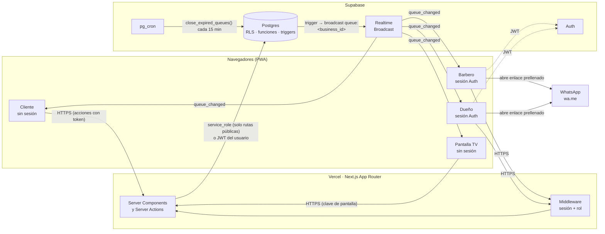
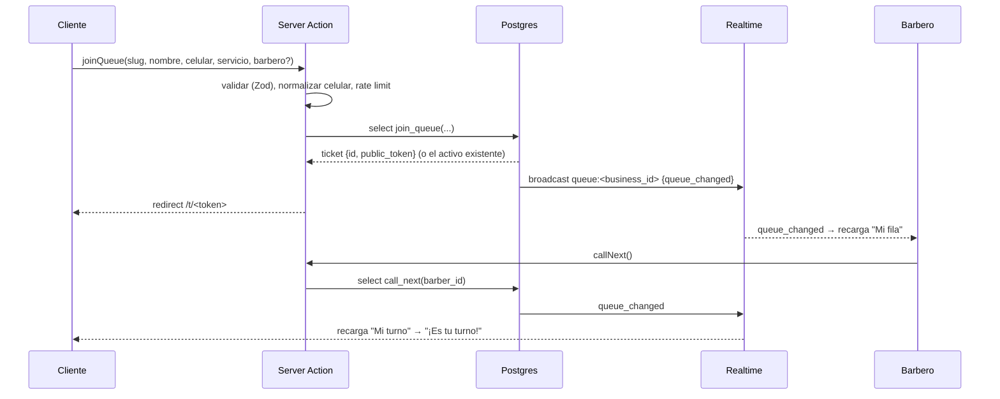
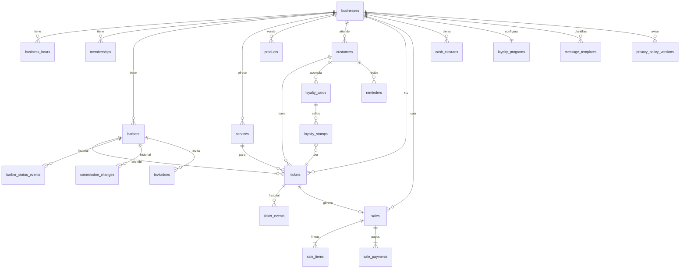
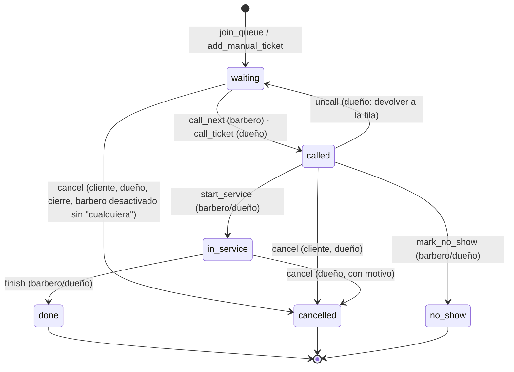
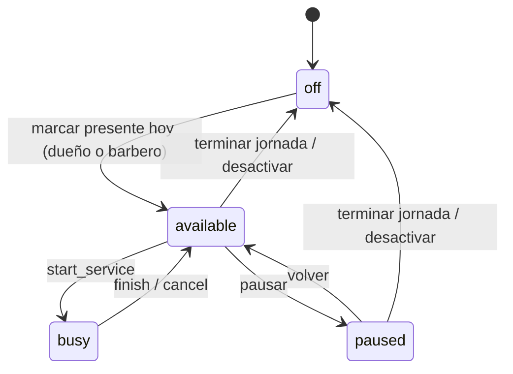

# TurnOS — Diseño técnico

> Estado: **APROBADO v1.0** (Henry, 2026-10-23)
> Fecha: 2026-10-23
> Depende de: `constitution.md` v1.0, `requirements.md` v1.0, `decisions.md` ADR-001…ADR-015
> Cada sección indica los REQ que cubre. Si algo aquí contradice un REQ, gana el REQ y se corrige
> este documento de forma explícita (P7).

## Índice

1. Arquitectura general y flujo de datos
2. Modelo de datos (tablas, índices, RLS)
3. Máquina de estados del turno
4. Algoritmo de posición y tiempo estimado
5. Comisiones y cierre de caja (con ejemplos)
6. Rutas, server actions, funciones SQL y Realtime
7. Pantallas por rol
8. Estrategia de pruebas
9. Estructura del repositorio
10. Cobertura REQ → sección

---

## 1. Arquitectura general y flujo de datos

Cubre: NFR-001, NFR-003, NFR-004, NFR-011, NFR-013, ADR-001, ADR-008, ADR-009.



Principios de la arquitectura:

- **Dos caminos de acceso a datos.** El personal (dueño, barbero) consulta Postgres con su JWT y
  las políticas RLS deciden qué ve. Los anónimos (cliente, pantalla) nunca tocan Postgres
  directamente: pasan por server actions que usan `service_role` en el servidor, validan la
  entrada y llaman funciones SQL que encapsulan las reglas (ADR-009).
- **Lectura por relectura.** Realtime solo transporta una señal `queue_changed` por negocio; cada
  pantalla recarga su vista completa (ADR-008). Así la reconexión y los eventos perdidos se
  resuelven con el mismo código (REQ-011.2).
- **Reglas en la base de datos.** Transiciones de estado, unicidad de turno activo por celular,
  cálculo de comisión y cierre de caja son funciones SQL con pruebas (ADR-011).
- **Lógica pura en TypeScript** para lo que se calcula al vuelo y se muestra: posición, tiempo
  estimado, formato de COP, normalización de celular. Vive en `src/lib/domain/` sin dependencias
  de framework para probarse con Vitest (ADR-013).

Flujo típico "tomar turno → atender":



---

## 2. Modelo de datos

Cubre: REQ-003, REQ-007.7, REQ-012, REQ-015, REQ-016, REQ-017, REQ-018, REQ-019, REQ-020,
REQ-023…REQ-027, REQ-030, REQ-031, REQ-033, REQ-034, NFR-004, NFR-005, NFR-010, §8 (fuera de
alcance soportado).

Convenciones: nombres en inglés, `snake_case`; `id uuid default gen_random_uuid()`; `created_at
timestamptz default now()`; todas las tablas de negocio tienen `business_id uuid not null
references businesses(id)`; montos `integer` en COP; estados como `enum` de Postgres; fechas de
negocio (`business_day`) como `date` calculada en `America/Bogota`.

### 2.1 Diagrama entidad-relación



### 2.2 Tablas

**`businesses`** — el tenant.

| Columna | Tipo | Notas |
|---|---|---|
| id | uuid PK | |
| name | text | nombre público |
| slug | text unique | URL pública `/<slug>`; `[a-z0-9-]{3,40}` |
| address | text | |
| timezone | text default 'America/Bogota' | |
| chairs_count | int default 5 | REQ-016.2 |
| default_commission_pct | int default 50 | 0–100, check |
| grace_minutes | int default 5 | REQ-008.1 |
| inactive_days | int default 21 | REQ-020.1 |
| reminder_cooldown_days | int default 7 | REQ-020.4 |
| queue_override | enum('auto','open','closed') default 'auto' | REQ-012.4, REQ-017.2 |
| queue_override_day | date null | el override vale solo ese día |
| screen_key | text | clave de la pantalla TV, 16 chars aleatorios (REQ-013.1) |
| pwa_name | text null | nombre de la app instalada (PA-22); null → `name` |
| created_at | timestamptz | |

**`business_hours`** (business_id, weekday 0–6, opens_at time, closes_at time, is_closed bool).
PK (business_id, weekday). REQ-017.1.

**`memberships`** (user_id uuid → auth.users, business_id, role enum('owner','barber'),
barber_id uuid null → barbers, created_at). PK (user_id, business_id). Un dueño que atiende tiene
`role='owner'` y `barber_id` no nulo (REQ-012.5). Soporta varios negocios por usuario
(REQ-031.3).

**`barbers`**

| Columna | Tipo | Notas |
|---|---|---|
| id, business_id | | |
| user_id | uuid null | null hasta aceptar la invitación |
| display_name | text | |
| phone_e164 | text | |
| commission_pct | int | 0–100 (REQ-025.1) |
| is_active | bool default true | REQ-016.3 |
| status | enum('available','busy','paused','off') default 'off' | `off` = no está hoy |
| present_day | date null | día en que se marcó presente (REQ-016.4); `status='off'` si ≠ hoy |
| sort_order | int | |
| duration_factor | numeric null | reservado (PA-09), no usado en el MVP |

**`invitations`** (id, business_id, barber_id, token text unique, expires_at, accepted_at null).
REQ-030.2.

**`services`** (id, business_id, name, duration_min int check (>0 and %5=0), price int check
(≥0), is_active bool, counts_for_loyalty bool default true, sort_order). REQ-015.

**`products`** (id, business_id, name, price int, is_active bool, sort_order). REQ-024.1.

**`customers`**

| Columna | Tipo | Notas |
|---|---|---|
| id, business_id | | |
| phone_e164 | text | unique (business_id, phone_e164) |
| name | text | |
| preferred_barber_id | uuid null | REQ-018.1 (recalculado por trigger, editable) |
| first_visit_at, last_visit_at | timestamptz null | solo turnos `done` |
| visits_count | int default 0 | solo turnos `done` |
| notes | text null | |
| privacy_accepted_at | timestamptz null | REQ-002.3 |
| privacy_version | int null | REQ-002.3 |
| do_not_contact | bool default false | REQ-020.5 |
| referred_by | uuid null | reservado (referidos) |
| anonymized_at | timestamptz null | REQ-018.6: name='Cliente eliminado', phone_e164='deleted:<uuid>' |

**`privacy_policy_versions`** (id, business_id, version int, body text, published_at).
Unique (business_id, version). REQ-002.5.

**`tickets`** — el turno.

| Columna | Tipo | Notas |
|---|---|---|
| id, business_id | | |
| business_day | date | día de negocio en Bogotá |
| sequence | bigint | número correlativo por negocio y día (trigger) |
| queue_order | bigint | = sequence × 1000 al crear; reordenable (ADR-012) |
| display_number | int | número visible "Turno 14" = sequence |
| customer_id | uuid null | null para "cliente sin registro" (REQ-012.3) |
| customer_name | text | copia al momento de crear |
| customer_phone_e164 | text null | copia; null sin registro |
| service_id | uuid | |
| service_name, service_duration_min, service_price | text, int, int | copia (REQ-015.3) |
| preferred_barber_id | uuid null | null = "el que esté libre" |
| assigned_barber_id | uuid null | se fija al llamar |
| status | enum('waiting','called','in_service','done','cancelled','no_show') | §3 |
| public_token | text unique | 22 chars base64url (128 bits) |
| created_at, called_at, started_at, finished_at | timestamptz | |
| cancel_reason | enum('customer','business','closing','barber_removed') null | |
| notified_at, notified_by | timestamptz null, uuid null | REQ-009.3 |
| payment_status | enum('n/a','pending','paid','unpaid') default 'n/a' | REQ-023.6; `pending` al pasar a done |
| scheduled_at | timestamptz null | reservado (reservas con hora) |
| source | enum('qr','link','manual') | |

Índices: `(business_id, business_day, status)`, `(business_id, status, queue_order)`,
`(public_token)`, unique parcial **`(business_id, customer_phone_e164) where status in
('waiting','called','in_service') and customer_phone_e164 is not null`** (REQ-003.5, CB-04,
CB-21).

**`ticket_events`** (id, business_id, ticket_id, from_status null, to_status, actor_type
enum('customer','barber','owner','system'), actor_user_id null, reason text null, at). Índice
(ticket_id, at). REQ-007.7, NFR-012.

**`barber_status_events`** (id, business_id, barber_id, status, at). Fuente de los minutos en
servicio para ocupación (REQ-028.2).

**`loyalty_programs`** (business_id PK, enabled bool, visits_required int default 10,
reward_type enum('free_service','discount'), reward_service_id uuid null, reward_amount int null).
REQ-019.1. Qué servicios suman: `services.counts_for_loyalty`.

**`loyalty_cards`** (id, business_id, customer_id, stamps int default 0, status
enum('active','completed','redeemed'), completed_at, redeemed_at, redeemed_sale_id null). Índice
único parcial: un `active` o `completed` por cliente. REQ-019.2–19.6.

**`loyalty_stamps`** (id, business_id, card_id, ticket_id unique, at). Un sello por turno.

**`sales`**

| Columna | Tipo | Notas |
|---|---|---|
| id, business_id | | |
| business_day | date | |
| ticket_id | uuid null unique | REQ-023.4: null para venta sin turno |
| barber_id | uuid null | null en venta solo de productos |
| customer_id | uuid null | |
| services_total | int | suma de líneas de servicio después de descuento |
| products_total | int | |
| discount_total | int | incluye el premio de fidelidad |
| total | int | services_total + products_total |
| commission_pct | int | copia del barbero en ese momento |
| commission_base | int | ver §5 (precio de lista cuando hay premio, REQ-025.4) |
| commission_amount | int | |
| business_amount | int | commission_base − commission_amount |
| loyalty_card_id | uuid null | si se aplicó premio |
| status | enum('active','voided') | REQ-026 |
| voided_reason, voided_by, voided_at | | |
| created_by | uuid | |
| created_at | timestamptz | |

**`sale_items`** (id, business_id, sale_id, kind enum('service','product'), ref_id uuid, name,
qty int, unit_price int, discount int default 0, line_total int, is_reward bool default false).

**`sale_payments`** (id, business_id, sale_id, method enum('cash','nequi','transfer','card'),
amount int). Suma de `amount` = `sales.total` (check por trigger). El MVP escribe una fila; el
modelo ya soporta pago dividido (REQ-023.5).

**`cash_closures`** (id, business_id, business_day, totals jsonb, cash_expected int, cash_counted
int, difference int, closed_by, closed_at, status enum('active','voided'), reopen_reason null,
voided_at null). Índice único parcial (business_id, business_day) where status='active'.
REQ-027. `totals` guarda la foto completa (por medio de pago, por barbero, servicios/productos).

**`commission_changes`** (id, business_id, barber_id, old_pct, new_pct, changed_by, at).
REQ-025.3.

**`message_templates`** (business_id, key enum('notify_2_turns','reminder_inactive','share_queue'),
body text). PK (business_id, key). REQ-033.

**`reminders`** (id, business_id, customer_id, kind enum('inactive'), sent_by, sent_at).
REQ-020.4.

**`rate_limits`** (key text, window_start timestamptz, count int). PK (key, window_start). Sin
`business_id`: es infraestructura. ADR-009.

### 2.3 Funciones auxiliares de seguridad

```sql
-- Negocios a los que pertenece el usuario autenticado
create function auth_business_ids() returns setof uuid language sql stable security definer as $$
  select business_id from memberships where user_id = auth.uid()
$$;
create function is_owner_of(b uuid) returns boolean ...   -- role = 'owner'
create function my_barber_id(b uuid) returns uuid ...     -- memberships.barber_id
```

### 2.4 Políticas RLS por tabla y rol

RLS **activado y forzado** en todas las tablas excepto `rate_limits` (solo `service_role`). La
clave `anon` **no tiene ninguna política**: las páginas públicas pasan por server actions con
`service_role` (ADR-009). `service_role` salta RLS; por eso sus funciones de entrada
(`join_queue`, `get_ticket_by_token`, `get_public_queue`, `get_screen_queue`) reciben el
identificador público y devuelven solo columnas seguras.

| Tabla | Dueño (owner) | Barbero (barber) | Notas |
|---|---|---|---|
| businesses | select, update (sus negocios) | select | insert vía función `create_business()` que también crea la membresía |
| business_hours | all | select | |
| memberships | select (de sus negocios); insert/delete solo por función `accept_invitation` / `remove_barber` | select propia | |
| barbers | all | select todos del negocio; update **solo** `status` de su propia fila (trigger valida que no cambie otra columna) | REQ-010 |
| invitations | all | — | aceptación vía función con `service_role` |
| services, products | all | select | REQ-015, REQ-024 |
| customers | all | select de su negocio; update `notes` y `preferred_barber_id` | REQ-018.4: la ficha es visible, los montos se filtran en `sales` |
| privacy_policy_versions | all | select | |
| tickets | select/update de su negocio; insert vía `add_manual_ticket`; nunca delete | select de su negocio; cambios de estado **solo** vía `transition_ticket` / `call_next` (no update directo) | Las funciones son `security definer` y validan `my_barber_id` |
| ticket_events | select | select | insert solo por funciones |
| barber_status_events | select | select propias | insert por trigger |
| loyalty_programs | all | select | |
| loyalty_cards, loyalty_stamps | select, update (canje manual REQ-019.5) | select | inserts por trigger/función |
| sales, sale_items, sale_payments | select, insert (vía `register_sale`), update solo `status` (anular, vía `void_sale`) | select **where barber_id = my_barber_id()**; insert vía `register_sale` solo con su `barber_id` | REQ-029.1, REQ-023.7 |
| cash_closures | all (vía funciones `close_cash_day`, `reopen_cash_day`) | — | REQ-027 |
| commission_changes | select; insert por trigger | select propias | |
| message_templates | all | select | |
| reminders | all | — | |

Prueba obligatoria (REQ-031.4): con el JWT de un barbero del negocio A, `select`/`insert`/
`update` sobre `tickets`, `customers`, `sales` del negocio B devuelve 0 filas / error.

### 2.5 Triggers

| Trigger | Tabla | Hace |
|---|---|---|
| `tickets_before_insert` | tickets | asigna `business_day`, `sequence`, `queue_order`, `display_number`, `public_token`, copia precio/duración del servicio |
| `tickets_after_change` | tickets | `realtime.send()` a `queue:<business_id>` con `{type:'queue_changed'}` (ADR-008); si `status→done`: actualiza `customers` (visits, last_visit, preferred) y agrega sello de fidelidad si aplica; `payment_status='pending'` |
| `barbers_after_status_change` | barbers | inserta `barber_status_events`; broadcast `queue_changed` |
| `barbers_commission_change` | barbers | inserta `commission_changes` cuando cambia `commission_pct` |
| `sale_payments_check` | sale_payments | al confirmar venta, suma = total |
| `sales_block_closed_day` | sales | impide insertar/anular en un día con cierre `active` (REQ-027.3, REQ-026.2) |

---

## 3. Máquina de estados del turno

Cubre: REQ-005, REQ-007, REQ-008, REQ-010, REQ-011.4, REQ-012.2, REQ-014, REQ-016.3, ADR-011.



Tabla de transiciones (la única fuente; `transition_ticket` la consulta):

| De → A | Actor permitido | Efectos |
|---|---|---|
| waiting → called | barbero (solo el primero de su lista, vía `call_next`), dueño (cualquiera, vía `call_ticket`) | `assigned_barber_id`, `called_at`; barbero sigue `available` hasta iniciar |
| called → in_service | barbero asignado, dueño | `started_at`; barbero → `busy` |
| called → no_show | barbero asignado, dueño | barbero → `available`; evento |
| called → waiting | dueño | limpia `assigned_barber_id`, `called_at`; conserva `queue_order` |
| called → cancelled | cliente (token), dueño | barbero → `available` |
| waiting → cancelled | cliente (token), dueño, sistema (cierre) | motivo obligatorio |
| in_service → done | barbero asignado, dueño | `finished_at`; barbero → `available`; `payment_status='pending'`; trigger de cliente/fidelidad |
| in_service → cancelled | dueño | barbero → `available`; motivo |

Reglas adicionales que `transition_ticket` aplica:

- **Idempotencia** (REQ-011.4): si el turno ya está en `to_status` y la petición trae el mismo
  `actor`, devuelve el turno sin error y sin evento nuevo.
- **Un turno a la vez por barbero** (REQ-007.5): `call_next` falla con `BARBER_BUSY` si el
  barbero tiene un turno `called` o `in_service`.
- **Carrera** (REQ-007.2): `call_next` hace `select … from tickets where status='waiting' and
  (preferred_barber_id = $barber or preferred_barber_id is null) order by queue_order for update
  skip locked limit 1`. Dos barberos simultáneos obtienen turnos distintos.
- **Pausa** (REQ-010): `set_barber_status(paused, reassign boolean)`: falla con `BARBER_BUSY` si
  tiene turno `called`/`in_service`; si `reassign=true`, pone `preferred_barber_id=null` a sus
  `waiting` conservando `queue_order` y escribe un evento `reassigned` por turno.
- **Barbero desactivado** (REQ-016.3, CB-20): igual que pausa con `reassign=true`, más
  `status='off'`, `is_active=false`, y revocación de la sesión (borrar membresía).
- **Cierre** (REQ-014): `close_expired_queues()` cancela `waiting` y `called` con
  `cancel_reason='closing'` para negocios cuyo `closes_at + 60 min` (hoy, Bogotá) ya pasó o cuyo
  `queue_override='closed'` para hoy. También lo invoca "Cerrar fila por hoy".

Estado del barbero (`barbers.status`):



---

## 4. Algoritmo de posición y tiempo estimado

Cubre: REQ-004.1, REQ-004.5, REQ-006.1, REQ-009.1, REQ-010.1, REQ-017.3, ADR-012, ADR-013.

Función pura `estimateQueue(input): Estimate[]` en `src/lib/domain/queue-estimate.ts`.

**Entrada**

```ts
type BarberState = { id: string; status: 'available'|'busy'|'paused'|'off';
                     busyUntil?: Date /* started_at + duration, o called_at + duration */ };
type WaitingTicket = { id: string; queueOrder: number; durationMin: number;
                       preferredBarberId: string | null };
type Input = { now: Date; barbers: BarberState[]; waiting: WaitingTicket[] /* status waiting, ordenado por queueOrder */ };
```

**Definiciones**

- Barberos **activos** `A` = los que están `available` o `busy` (no `paused`, no `off`).
- `freeAt[b]` = `now` si `available`; `max(now, busyUntil)` si `busy`. Para un turno `called` sin
  iniciar, `busyUntil = called_at + duración` (se asume que empieza ya).
- **Lista del barbero b** (REQ-006.1) = turnos `waiting` con `preferredBarberId ∈ {b, null}`,
  en orden de `queueOrder`.

**Posición** (REQ-004.1), para el turno T:

- Si `T.preferredBarberId = b`: `posición = 1 + |{ W : W.queueOrder < T.queueOrder y
  W.preferredBarberId ∈ {b, null} }|`.
- Si `T.preferredBarberId = null`: `posición = 1 + |{ W : W.queueOrder < T.queueOrder }|` (todos
  los que están delante importan, porque cualquiera de ellos puede ocupar al barbero que se libere).
- "Personas delante" = posición − 1. "Eres el siguiente" cuando posición = 1.
- La etiqueta **"Avisar"** (REQ-009.1) se muestra cuando `personas delante = 2`.

**Tiempo estimado** por simulación:

```
para cada W en waiting (orden queueOrder):
  candidatos = A si W.preferred es null, si no {W.preferred} ∩ A
  si candidatos vacío → W.estimate = null ("tu barbero no está disponible")  (REQ-010.3 lo explica)
  b* = argmin freeAt[b] sobre candidatos (empate: menor id)
  W.startAt = freeAt[b*]
  freeAt[b*] = W.startAt + W.durationMin
  W.waitMin = ceil5( (W.startAt − now) en minutos )      // ceil5 redondea hacia arriba a múltiplo de 5
```

Si `A` está vacío, todos los estimados son `null` y la UI muestra "No hay barberos atendiendo en
este momento". El estimado para el formulario del cliente (REQ-017.3) se calcula simulando un
turno ficticio al final con la duración del servicio elegido.

**Ejemplo numérico** (REQ-004.5). `now = 10:00`. Barberos: Juan `busy` hasta 10:10, Pedro
`available`, Luis `paused`. Fila (orden): T1 corte 20 min pref=null; T2 barba 15 min pref=Juan;
T3 corte 20 min pref=Luis; T4 corte 20 min pref=null.

| Turno | Candidatos | Empieza | Barbero | Espera | Posición |
|---|---|---|---|---|---|
| T1 | {Juan 10:10, Pedro 10:00} | 10:00 | Pedro (hasta 10:20) | 0 → "Eres el siguiente" | 1 |
| T2 | {Juan 10:10} | 10:10 | Juan (hasta 10:25) | 10 min | 2 (T1 es "cualquiera" y está delante, así que cuenta en la lista de Juan) |
| T3 | {} (Luis en pausa) | — | — | null → "Tu barbero está en pausa" | 1 en la lista de Luis |
| T4 | {Juan 10:25, Pedro 10:20} | 10:20 | Pedro | 20 min | 4 |

Nota: la **posición** es un conteo determinista de quién está delante en la lista relevante; el
**tiempo** es la simulación. Para T2 la posición es 2 (T1 está delante y Juan podría tomarlo) y la
espera 10 min. Mostrar ambos es coherente: "Eres el 2.º · ≈ 10 min".

Complejidad O(|waiting| × |A|): despreciable (fila < 100, barberos ≤ 10).

---

## 5. Comisiones y cierre de caja

Cubre: REQ-019.4, REQ-023, REQ-024, REQ-025, REQ-026, REQ-027, REQ-028, REQ-029, ADR-005,
ADR-007 (PA-15, PA-18, PA-19, PA-20).

### 5.1 Comisión por venta (`register_sale`)

Entradas: líneas de servicio (precio unitario = precio de lista copiado al turno o al catálogo,
descuento ≥ 0, `is_reward`), líneas de producto, `barber_id`, pagos.

```
services_list     = Σ unit_price × qty            (servicios, sin descuentos)
services_discount = Σ discount                    (incluye el valor del premio de fidelidad)
services_total    = services_list − services_discount
products_total    = Σ unit_price × qty            (productos)
discount_total    = services_discount
total             = services_total + products_total

commission_base   = services_total + Σ discount de líneas con is_reward   // = precio de lista del servicio gratis (REQ-025.4)
commission_amount = round( commission_base × commission_pct / 100 )        // redondeo al peso; .5 hacia arriba
business_amount   = commission_base − commission_amount
```

Los productos no entran en la comisión (PA-17). Un descuento que no es premio sí reduce la base
(PA-18). Todo se guarda en la venta; cambiar `commission_pct` después no la altera (REQ-025.3).

**Ejemplo A — corte normal.** Corte $ 25.000, barbero Juan 60 %, pago Nequi.
`services_total = 25.000`, `commission_base = 25.000`, `commission_amount = 15.000`,
`business_amount = 10.000`, `total = 25.000`.

**Ejemplo B — corte + gaseosa.** Corte $ 25.000 + gaseosa $ 4.000, Juan 60 %, efectivo.
`services_total = 25.000`, `products_total = 4.000`, `total = 29.000`,
`commission_amount = 15.000`, `business_amount = 10.000`. La gaseosa queda 100 % para el negocio
(se ve en el cierre como "productos").

**Ejemplo C — décimo corte gratis.** Corte $ 25.000 con premio (`is_reward`, descuento 25.000),
Juan 60 %. `services_total = 0`, `total = 0` (no entra plata), `commission_base = 25.000`
(precio de lista, REQ-025.4), `commission_amount = 15.000`, `business_amount = 10.000`.
Interpretación: `business_amount` es la parte del negocio **sobre la base de comisión**, no el
ingreso real. El cierre muestra las dos cosas por separado: ingreso real = Σ `total` (0) y
comisión a pagar = Σ `commission_amount` (15.000); el costo del premio aparece en la línea
"Premios de fidelidad: $ 25.000" y lo asume el negocio (PA-19).

**Ejemplo D — redondeo.** Servicio $ 12.500 al 33 %: `12.500 × 0,33 = 4.125` → 4.125. Servicio
$ 10.000 al 33 %: `3.300`. Servicio $ 7.500 al 45 %: `3.375`. Servicio $ 9.999 al 50 %:
`4.999,5 → 5.000`.

### 5.2 Cierre de caja diario (`close_cash_day(business_day, cash_counted)`)

Sobre las ventas `active` del día (Bogotá):

```
por medio de pago m:        ingreso[m] = Σ sale_payments.amount where method = m
total_vendido             = Σ sales.total
servicios / productos     = Σ services_total / Σ products_total
premios_fidelidad         = Σ discount de líneas is_reward
por barbero b:            servicios_atendidos[b] = nº de ventas con barber_id = b y ≥1 línea de servicio
                          vendido[b]              = Σ services_total
                          comision[b]             = Σ commission_amount
                          negocio[b]              = Σ business_amount
efectivo_esperado         = ingreso['cash']
diferencia                = cash_counted − efectivo_esperado
```

`totals` (jsonb) guarda todo lo anterior; el cierre es inmutable. "Reabrir" (solo dueño, con
motivo) pone `status='voided'` y permite ventas/anulaciones del día de nuevo (REQ-027.3, PA-20).

**Ejemplo de cierre.** Día con 4 ventas:

| Venta | Barbero (%) | Servicios | Productos | Pago | Comisión | Negocio |
|---|---|---|---|---|---|---|
| 1 | Juan 60 | 25.000 | 0 | Nequi 25.000 | 15.000 | 10.000 |
| 2 | Juan 60 | 25.000 | 4.000 | Efectivo 29.000 | 15.000 | 10.000 |
| 3 | Pedro 50 | 40.000 (corte+barba) | 0 | Tarjeta 40.000 | 20.000 | 20.000 |
| 4 | Pedro 50 | 0 (premio, lista 25.000) | 3.000 | Efectivo 3.000 | 12.500 | 12.500 |

Cierre: Efectivo 32.000 · Nequi 25.000 · Transferencia 0 · Tarjeta 40.000 · **Total 97.000**
(servicios 90.000, productos 7.000, premios 25.000). Juan: 2 servicios, $ 50.000 vendidos,
comisión 60 % = **$ 30.000**. Pedro: 2 servicios, $ 40.000 vendidos, comisión = **$ 32.500**.
Efectivo esperado 32.000; si contó 30.000, diferencia **−2.000**. Comprobación manual: Pedro
cobró 40.000 reales y la comisión sobre el corte gratis (12.500) la asume el negocio, tal como
dice PA-19.

### 5.3 Resumen semanal (`weekly_summary(week_start)`)

Semana lunes–domingo (PA-21). Clientes nuevos = clientes cuya `first_visit_at` cae en la semana;
que repiten = clientes con turno `done` en la semana y `first_visit_at` anterior a la semana
(REQ-021). Turnos perdidos = `no_show` + `cancelled` de la semana.

**Ocupación** (REQ-028.2): `minutos_en_servicio = Σ` intervalos `busy` de
`barber_status_events` (desde el evento `busy` hasta el siguiente evento del mismo barbero), para
todos los barberos, dentro de la semana. `minutos_apertura = Σ (closes_at − opens_at)` de los
días no cerrados de `business_hours`. `ocupación = minutos_en_servicio ÷ (minutos_apertura ×
chairs_count)`.

Ejemplo: semana con 6 días × 11 h = 3.960 min de apertura × 5 sillas = 19.800 min-silla.
Minutos en servicio sumados: 7.920 → ocupación **40 %**. Detalle por día y por barbero con la
misma fórmula restringida.

---

## 6. Rutas, server actions, funciones SQL y Realtime

Cubre: REQ-001, REQ-002, REQ-003, REQ-004, REQ-005, REQ-006, REQ-009, REQ-011, REQ-012,
REQ-013, REQ-030, REQ-032, REQ-033, NFR-002, NFR-004.

### 6.1 Rutas (App Router)

| Ruta | Quién | Qué | REQ |
|---|---|---|---|
| `/` | público | Landing mínima + "Entrar" | — |
| `/[slug]` | cliente | Estado del negocio + "Tomar turno" | REQ-001 |
| `/[slug]/turno` | cliente | Formulario (aviso de privacidad incluido) | REQ-002, REQ-003 |
| `/t/[token]` | cliente | "Mi turno" en vivo + cancelar + fidelidad | REQ-004, REQ-005, REQ-019.7 |
| `/[slug]/pantalla?k=<screen_key>` | TV | Pantalla pública | REQ-013 |
| `/[slug]/privacidad` | público | Texto completo del aviso vigente | REQ-002.1 |
| `/entrar` | personal | Login: correo+contraseña o celular+PIN | REQ-030 |
| `/invitacion/[token]` | barbero | Crear PIN y vincularse | REQ-030.2 |
| `/app` | personal | Redirige según rol | |
| `/app/fila` | barbero (y dueño como barbero) | "Mi fila" + acciones | REQ-006…REQ-010 |
| `/app/mis-numeros` | barbero | Mis ventas y comisiones | REQ-025.5, REQ-029 |
| `/app/clientes`, `/app/clientes/[id]` | barbero, dueño | Lista/ficha (barbero sin montos) | REQ-018 |
| `/admin` | dueño | Inicio: fila del negocio y estado de barberos | REQ-012 |
| `/admin/fila` | dueño | Fila completa + intervenciones + abrir/cerrar | REQ-012 |
| `/admin/qr` | dueño | QR, enlace, compartir | REQ-001.2–1.3 |
| `/admin/servicios`, `/admin/productos` | dueño | CRUD | REQ-015, REQ-024.1 |
| `/admin/barberos`, `/admin/barberos/[id]` | dueño | CRUD, invitación, comisión, presente hoy | REQ-016, REQ-025 |
| `/admin/horario` | dueño | Horario semanal | REQ-017 |
| `/admin/fidelidad` | dueño | Configuración de tarjeta | REQ-019 |
| `/admin/recordar` | dueño | Clientes inactivos + WhatsApp | REQ-020 |
| `/admin/caja` | dueño | Caja de hoy, nueva venta, anular, cerrar | REQ-023, REQ-024, REQ-026, REQ-027 |
| `/admin/caja/[fecha]` | dueño | Cierre pasado | REQ-027.4 |
| `/admin/semana` | dueño | Resumen semanal | REQ-028 |
| `/admin/mensajes` | dueño | Plantillas | REQ-033 |
| `/admin/privacidad` | dueño | Versiones del aviso | REQ-002.5 |
| `/admin/negocio` | dueño | Datos del negocio, sillas, parámetros | REQ-016.2 |
| `/crear-negocio` | dueño nuevo | Asistente 3 pasos | REQ-030.1 |
| `/salud` | público | `{ok, db:true}` | NFR-012 |

`middleware.ts` protege `/app/*` y `/admin/*` (sesión y rol vía `memberships`).

### 6.2 Server actions (públicas, usan `service_role` + funciones SQL)

| Action | Entrada (Zod) | Función SQL | Salida |
|---|---|---|---|
| `getPublicBusiness(slug)` | slug | `get_public_business` | nombre, abierto?, próximo horario, personas en fila, servicios activos, barberos presentes (con estado), versión del aviso |
| `joinQueue(slug, {name, phone, serviceId, preferredBarberId?, privacyAccepted})` | validación + `normalizePhoneCO` + rate limit | `join_queue` | `{token}` o `{existingToken}` (REQ-003.5) |
| `getTicketByToken(token)` | token | `get_ticket_by_token` | turno (sin celulares de otros), posición, estimado, barbero, fidelidad |
| `cancelTicketByToken(token)` | token | `transition_ticket(..., 'cancelled', 'customer')` | ok |
| `getScreenQueue(slug, key)` | | `get_screen_queue` | nombres abreviados por barbero |
| `acceptInvitation(token, pin)` | | crea usuario Auth + `accept_invitation` | sesión |

### 6.3 Server actions / RPC del personal (usan el JWT del usuario; RLS aplica)

| Action | Rol | Función SQL | REQ |
|---|---|---|---|
| `getMyQueue()` | barbero | `get_barber_queue(my_barber_id)` | REQ-006 |
| `callNext()` | barbero | `call_next` | REQ-007.1–7.2 |
| `startService(ticketId)`, `finishService(ticketId)`, `markNoShow(ticketId)` | barbero/dueño | `transition_ticket` | REQ-007.3–7.4, REQ-008 |
| `setMyStatus(status, reassign?)` | barbero | `set_barber_status` | REQ-010 |
| `markNotified(ticketId)` | barbero/dueño | update `notified_at` | REQ-009.3 |
| `getBusinessQueue()` | dueño | `get_business_queue` | REQ-012.1 |
| `callTicket`, `uncallTicket`, `cancelTicket`, `reassignTicket`, `moveTicket(ticketId, afterTicketId)` | dueño | `transition_ticket`, `reorder_ticket` | REQ-012.2 |
| `addManualTicket({name, phone?, serviceId, preferredBarberId?})` | dueño/barbero | `add_manual_ticket` | REQ-012.3 |
| `setQueueOverride('open'|'closed'|'auto')` | dueño | update + `close_expired_queues` si `closed` | REQ-012.4 |
| `setBarberPresent(barberId, present)` | dueño (o barbero propio) | `set_barber_status('available'|'off')` | REQ-016.4 |
| CRUD servicios, productos, barberos, horario, plantillas, fidelidad, negocio | dueño | inserts/updates con RLS | REQ-015…017, 019, 024, 033 |
| `inviteBarber(barberId)` | dueño | insert `invitations` | REQ-030.2 |
| `searchCustomers(q)`, `getCustomer(id)`, `updateCustomer`, `mergeCustomers`, `anonymizeCustomer` | dueño (barbero: lectura) | `search_customers` (índice trigram), `anonymize_customer` | REQ-018 |
| `getInactiveCustomers()`, `logReminder(customerId)` | dueño | `inactive_customers` | REQ-020 |
| `registerSale(input)` | barbero (propio) / dueño | `register_sale` | REQ-023, REQ-024, REQ-019.4 |
| `voidSale(saleId, reason)` | dueño | `void_sale` | REQ-026 |
| `getCashDay(date)`, `closeCashDay(date, cashCounted)`, `reopenCashDay(date, reason)` | dueño | `cash_day_summary`, `close_cash_day`, `reopen_cash_day` | REQ-027 |
| `getWeeklySummary(weekStart)` | dueño | `weekly_summary` | REQ-028 |
| `getMyNumbers(range)` | barbero | select `sales` (RLS filtra) | REQ-025.5, REQ-029 |

### 6.4 Realtime

Un único canal por negocio: `queue:<business_id>`, tipo Broadcast, público (sin RLS; no
transporta datos personales). Mensajes:

| `type` | Emitido por | Lo consumen |
|---|---|---|
| `queue_changed` | trigger en `tickets` (insert/update de estado, orden, barbero) y en `barbers` (status) | `/t/[token]`, `/app/fila`, `/admin/fila`, `/[slug]`, `/[slug]/pantalla` |

Hook `useQueueSubscription(businessId, reload)`: se suscribe, llama `reload()` al recibir
`queue_changed` (con *debounce* de 300 ms), y al detectar `CHANNEL_ERROR`/`TIMED_OUT` muestra la
franja "Sin conexión" (REQ-011.1) y al reconectar (`SUBSCRIBED`) llama `reload()` (REQ-011.2).
Además, *polling* de respaldo cada 30 s en `/t/[token]` (NFR-003).

### 6.5 Notificaciones (REQ-009.5)

```ts
interface NotificationChannel {
  buildNotifyLink(input: { phoneE164: string; template: string; vars: Record<string,string> }): string;
}
// MVP: WaMeChannel → `https://wa.me/${phone}?text=${encodeURIComponent(render(template, vars))}`
// Futuro: CloudApiChannel (envío servidor a servidor); misma interfaz, selección por configuración del negocio.
```

Plantillas por defecto (editables, REQ-033):

- `notify_2_turns`: "Hola {nombre}, te saluda {negocio}. Faltan 2 turnos para el tuyo (≈ {tiempo}). Ve saliendo. Sigue tu turno aquí: {enlace}"
- `reminder_inactive`: "Hola {nombre}, en {negocio} te extrañamos. ¿Te apartamos un turno? Toma el tuyo sin filas aquí: {enlace}"
- `share_queue`: "Toma tu turno en {negocio} sin esperar en el local: {enlace}"

### 6.6 Seguridad en rutas públicas

- Tokens: `public_token` = 16 bytes aleatorios en base64url; `screen_key` igual (NFR-004).
- Rate limiting en `joinQueue`: función `check_rate_limit(key, limit, window)` sobre
  `rate_limits`; claves `phone:<e164>` (5/h) e `ip:<ip>` (30/h). Supera → error "Demasiados
  intentos, espera un momento".
- Cabeceras: `Cache-Control: no-store` en `/t/*`; `X-Robots-Tag: noindex` en `/[slug]/pantalla`.

---

## 7. Pantallas por rol

Cubre: REQ-001…REQ-013, REQ-018…REQ-020, REQ-023…REQ-029, REQ-032, NFR-007, NFR-008.

Diseño móvil, una columna, acción principal como botón grande inferior fijo, fuente base 16 px,
Tailwind con una paleta sobria (fondo claro, un color de acento, estados con color + icono + texto,
nunca solo color).

### Cliente

**`/[slug]` — Portada de la fila**
```
┌──────────────────────────────┐
│ ✂ Barbería La 33             │
│ Abierto · cierra 8:00 p. m.  │
│                              │
│   4 personas en la fila      │
│   ≈ 35 min de espera         │
│                              │
│ Barberos hoy: Juan · Pedro · │
│ Luis (en pausa)              │
│                              │
│ [     Tomar turno     ]      │  ← botón inferior fijo
└──────────────────────────────┘
```

**`/[slug]/turno` — Formulario** (4 campos + aviso): Nombre · Celular · Servicio (lista con
duración y precio) · Barbero (chips: "El que esté libre" seleccionado, luego barberos; en pausa o
ausentes deshabilitados con etiqueta) · casilla de privacidad con enlace · botón "Confirmar
turno". Si el estimado supera el tiempo hasta el cierre: franja amarilla "Es posible que no
alcancemos a atenderte hoy" (REQ-017.3).

**`/t/[token]` — Mi turno**
```
┌──────────────────────────────┐
│ Barbería La 33 · Turno 14    │
│                              │
│        Eres el 3.º           │
│     2 personas delante       │
│        ≈ 25 min              │
│                              │
│ Corte · con Juan             │
│ Tarjeta: 7 de 10 cortes ●●●●●●●○○○ │
│                              │
│ [ Cancelar mi turno ]        │
│ Actualizado hace 5 s         │
└──────────────────────────────┘
```
Estados: `called` → fondo de acento, "¡Es tu turno! Pasa a la silla de Juan" + vibración;
`in_service` → "Te están atendiendo"; `done` → "¡Gracias por venir!"; `no_show` → "Te llamamos y
no estabas. Puedes tomar un turno nuevo [Tomar turno]"; `cancelled` → motivo en español.

### Barbero

**`/app/fila` — Mi fila**
```
┌──────────────────────────────┐
│ Juan · Disponible  [Pausar]  │
├──────────────────────────────┤
│ AHORA                        │
│ (nadie)                      │
├──────────────────────────────┤
│ SIGUEN (5)                   │
│ 1 Camilo R. · Corte 20' · 8' │
│   te eligió                  │
│ 2 Sara M. · Barba 15' · 12'  │
│   cualquiera                 │
│ 3 Andrés P. · Corte · 15'    │
│   te eligió · [📲 Avisar]     │  ← a 2 de distancia
│ ...                          │
├──────────────────────────────┤
│ [   Llamar al siguiente   ]  │
└──────────────────────────────┘
```
Con turno `called`: tarjeta "Llamado: Camilo R. · hace 3 min" con botones **[Ya está en la
silla]** y **[No llegó]** (este último resaltado al pasar 5 min). Con `in_service`: cronómetro y
botón **[Terminado]** → abre el panel de cobro (Hito 3). Pausar con clientes propios en espera →
hoja inferior con las dos opciones (REQ-010.2). Franja superior "Sin conexión. Reintentando…"
cuando aplica.

**`/app/mis-numeros`**: Hoy / Esta semana: servicios, vendido, mi comisión; lista de ventas
propias.

### Dueño

**`/admin` + `/admin/fila`**: estado de cada barbero (chips), lista completa con número, nombre,
servicio, preferido/asignado, estado, espera; menú por turno (Llamar con…, Devolver a la fila,
No llegó, Cancelar, Reasignar, Subir/Bajar); botones "Agregar cliente", "Cerrar fila por hoy" /
"Abrir fila".

**`/admin/caja`**: tarjetas Efectivo / Nequi / Transferencia / Tarjeta / Total; lista de ventas
del día (anular); tabla por barbero (servicios, vendido, comisión, negocio); **[Nueva venta]**;
**[Cerrar caja]** → pide efectivo contado → muestra diferencia → confirma → modo lectura con
**[Compartir por WhatsApp]** y **[Reabrir]**.

**Panel de cobro** (desde "Terminado" o "Nueva venta"): servicio(s) con precio (cambiar/agregar),
productos (+/−), premio disponible → **[Aplicar premio]**, total grande, medio de pago (4 botones),
**[Registrar $ 29.000]**.

**`/admin/recordar`**: parámetro N; lista "Camilo R. · 24 días · 6 visitas · Juan · [📲]";
"No contactar" por cliente.

**`/admin/semana`**: selector de semana; tarjetas Nuevos / Repiten / Servicios / Vendido /
Ocupación %; tabla por barbero; "turnos perdidos".

### Pantalla TV (`/[slug]/pantalla`)

Tres o cinco columnas (una por barbero presente) con "AHORA: Camilo R." y "SIGUEN: Sara M.,
Andrés P."; bloque "El que esté libre: …"; QR en la esquina inferior; letra ≥ 32 px; al llamar,
la tarjeta parpadea 30 s con "Pasa a la silla de Juan".

---

## 8. Estrategia de pruebas

Cubre: NFR-009, NFR-010, REQ-031.4, P8.

| Nivel | Herramienta | Qué cubre | Ejemplos de casos (CA) |
|---|---|---|---|
| **Unit** (TS puro) | Vitest | `src/lib/domain/*`: estimado y posición, normalización de celular, formato COP, cálculo de comisión (espejo en TS para la UI), render de plantillas, redondeo a 5 min | REQ-004.5, REQ-003.2, REQ-025.2, REQ-009.2, NFR-006 |
| **Unit SQL** | pgTAP (en `supabase/tests/`) | funciones: `transition_ticket` (todas las transiciones válidas e inválidas, idempotencia), `call_next` (carrera con dos sesiones), `join_queue` (turno activo único), `register_sale` (fórmulas, ejemplos A–D), `close_cash_day`, `weekly_summary`, `close_expired_queues`, triggers de cliente/fidelidad | REQ-007, REQ-008, REQ-011.4, REQ-014, REQ-019, REQ-023, REQ-025, REQ-027, REQ-028 |
| **Integración** | Vitest + Supabase local (`supabase start`) + seed | server actions contra base real; **aislamiento RLS** con JWT de cada rol (negocio A vs B, barbero vs dueño, columnas prohibidas); rate limiting | REQ-031, REQ-029, NFR-004 |
| **E2E** | Playwright (viewport Pixel 7 e iPhone 13; dos contextos para realtime) | flujos completos: tomar turno → ver posición → barbero llama → cliente ve "es tu turno" → terminado → cobro → cierre; cancelación; no llegó; pausa con reasignación; pérdida de conexión (offline del contexto) ; PWA instalable (manifest) ; pantalla TV | REQ-001…REQ-013, REQ-020, REQ-023, REQ-027, REQ-032, NFR-002 |
| **Lint de textos** | script | ningún texto visible en inglés; todos los montos pasan por `formatCOP` | NFR-006 |
| **Lighthouse CI** | `@lhci/cli` móvil | rendimiento ≥ 80, PWA instalable, accesibilidad ≥ 90 | NFR-001, NFR-008, REQ-032 |

Convención de trazabilidad: cada prueba lleva en su nombre el CA que cubre, p. ej.
`it('REQ-003.5 no duplica turno activo por celular', …)`. Un script `scripts/traceability.ts`
genera la matriz REQ → tareas → pruebas → estado a partir de `tasks.md` y de los nombres de las
pruebas, y falla si un CA de un hito cerrado no tiene prueba.

CI (GitHub Actions): `lint` → `typecheck` → `unit` → `supabase start` + `db test` (pgTAP) +
`integration` → `e2e` → `lighthouse`. Merge bloqueado si algo falla.

---

## 9. Estructura del repositorio

```
turnos/
  specs/                      ← esta carpeta
  src/
    app/
      (public)/[slug]/…        /[slug], /turno, /pantalla, /privacidad
      (public)/t/[token]/
      (auth)/entrar, invitacion/[token], crear-negocio
      (staff)/app/…            barbero
      (staff)/admin/…          dueño
      salud/route.ts
      manifest.ts
    components/                ui/ (botones, hojas, franjas), queue/, cash/, customers/
    lib/
      domain/                  queue-estimate.ts, phone.ts, money.ts, commission.ts, templates.ts
      supabase/                client.ts, server.ts (JWT), admin.ts (service_role, solo server)
      notifications/           channel.ts, wa-me.ts
      realtime/                use-queue-subscription.ts
      actions/                 public.ts, queue.ts, cash.ts, customers.ts, admin.ts
    middleware.ts
  supabase/
    migrations/                0001_init.sql, 0002_queue.sql, …
    functions/                 (Edge Functions, si llegan a necesitarse)
    seed.sql
    tests/                     pgTAP
  tests/
    unit/, integration/, e2e/
  scripts/traceability.ts
```

---

## 10. Cobertura REQ → sección

| REQ | Secciones |
|---|---|
| REQ-001 | 6.1, 6.2, 7 (portada), 6.6 |
| REQ-002 | 2.2 (customers, privacy_policy_versions), 6.1, 7 |
| REQ-003 | 2.2 (tickets, índice único parcial), 6.2 `joinQueue`, 6.6, 7 |
| REQ-004 | 4, 6.2 `getTicketByToken`, 6.4, 7 |
| REQ-005 | 3, 6.2 `cancelTicketByToken` |
| REQ-006 | 4 (lista del barbero), 6.3 `getMyQueue`, 7 |
| REQ-007 | 3 (transiciones, carrera, un turno a la vez), 6.3 |
| REQ-008 | 3, 2.2 `grace_minutes`, 7 |
| REQ-009 | 4 (etiqueta Avisar), 6.5, 2.2 `notified_at` |
| REQ-010 | 3 (`set_barber_status`), 4 (barberos activos), 7 |
| REQ-011 | 1, 3 (idempotencia), 6.4, 2.2 índice único |
| REQ-012 | 3 (transiciones del dueño), 6.3, 7, ADR-012 |
| REQ-013 | 6.1, 6.2 `getScreenQueue`, 7 (TV), 6.6 |
| REQ-014 | 3 (`close_expired_queues`), ADR-014 |
| REQ-015 | 2.2 services, 2.5 trigger de copia |
| REQ-016 | 2.2 barbers/memberships, 3 (desactivar), 6.3 |
| REQ-017 | 2.2 business_hours/queue_override, 4 (estimado en formulario) |
| REQ-018 | 2.2 customers, 2.4 RLS, 6.3 |
| REQ-019 | 2.2 loyalty_*, 2.5 trigger, 5.1 ejemplo C, 6.3 `registerSale` |
| REQ-020 | 2.2 reminders/do_not_contact, 6.3, 7 |
| REQ-021 | 5.3 |
| REQ-022 | 2.2 preferred_barber_id, 6.2 `getPublicBusiness` (prellenado desde localStorage + ficha) |
| REQ-023 | 2.2 sales/sale_items/sale_payments, 5.1, 6.3, 7 (panel de cobro) |
| REQ-024 | 2.2 products, 5.1 ejemplo B |
| REQ-025 | 5.1, 2.2 commission_changes, 2.5 |
| REQ-026 | 2.2 sales.status, 2.5 `sales_block_closed_day`, 6.3 |
| REQ-027 | 5.2, 2.2 cash_closures, 7 |
| REQ-028 | 5.3, 2.2 barber_status_events |
| REQ-029 | 2.4 RLS en sales |
| REQ-030 | ADR-010, 2.2 invitations/memberships, 6.1, 6.2 |
| REQ-031 | 2.3, 2.4, 8 (integración) |
| REQ-032 | 6.1 `manifest.ts`, 8 (Lighthouse) |
| REQ-033 | 2.2 message_templates, 6.5 |
| REQ-034 | 9 `supabase/seed.sql`, 8 |
| NFR-001…013 | 1, 2.4, 6.4, 6.6, 8 |
