# TurnOS — Plan de tareas

> Estado: **APROBADO v1.0** (Henry, 2026-10-23) — Fase 4 en curso
> Fecha: 2026-10-23
> Depende de: `requirements.md` v1.0, `design.md` v1.0
>
> Reglas:
> - Una tarea = máximo medio día. Se implementa **una a la vez**, en orden; cada una empieza por sus
>   pruebas (derivadas de los CA que cita) y termina cuando pasan.
> - Estado: `[ ]` pendiente · `[~]` en curso · `[x]` terminada (con fecha). Al terminar se marca
>   aquí y se explica cómo probarla desde el celular.
> - "Archivos" son rutas bajo `turnos/` según `design.md` §9. "Terminado" incluye siempre: lint y
>   typecheck limpios, pruebas listadas en verde, textos en español, montos con `formatCOP`.
> - Si una tarea revela que la especificación está incompleta, se detiene y se propone el cambio
>   en `requirements.md` o `design.md` antes de seguir (P7).

## Resumen de hitos

| Hito | Entregable | Tareas | REQ cubiertos |
|---|---|---|---|
| H0 | Cimientos: repo, Supabase local, esquema base, auth, seed, CI | T-001…T-010 | REQ-015, 016, 017, 030, 031, 032, 034, NFR-004/006/009/010/012 |
| H1 | Fila virtual con QR usable por la barbería | T-011…T-030 | REQ-001…REQ-014, REQ-033, NFR-001/002/003/007/008 |
| H2 | Clientes y fidelidad | T-031…T-039 | REQ-018…REQ-022 |
| H3 | Caja y comisiones | T-040…T-050 | REQ-023…REQ-029 |
| H4 | Servicios por barbero (Filo) — **aprobado** (ADR-024) | T-051…T-057 | REQ-035 |
| H5 | Experiencia del cliente — **aprobado** (ADR-026) | T-058…T-063 | REQ-036…REQ-039 |
| H6 | Aviso automático por WhatsApp (ADR-027) | T-064…T-070 | REQ-040…REQ-043 |
| H7 | Membresía familiar (ADR-030) | T-071…T-077 | REQ-044…REQ-048 |
| H9 | Tarjetas de regalo (ADR-034) | T-090…T-097 | REQ-055…REQ-059 |
| H13 | Inventario de insumos y vitrina (ADR-039) | T-120…T-129 | REQ-070…REQ-074 |

Cada hito cierra con su tarea de validación (matriz de trazabilidad).

---

## Hito 0 — Cimientos

### [x] T-001 · Inicializar el proyecto Next.js
- REQ: NFR-006, NFR-009 (base), REQ-032 (preparación)
- Archivos: `package.json`, `next.config.ts`, `tsconfig.json`, `tailwind.config.ts`,
  `src/app/layout.tsx`, `src/app/page.tsx`, `.eslintrc`, `.prettierrc`, `.env.example`,
  `README.md`
- Terminado: `pnpm dev` levanta la app; `pnpm lint && pnpm typecheck` limpios; `<html lang="es">`;
  fuente base 16 px; Vitest configurado con una prueba de humo (`tests/unit/smoke.test.ts`).

### [x] T-002 · Supabase local y estructura de migraciones
- Nota (2026-10-23): sin Docker en el entorno de construcción, la base local es Postgres 16 +
  shim (`supabase/local/0000_supabase_shim.sql`), ver ADR-015. `supabase start` sigue siendo
  válido en una máquina con Docker.
- REQ: NFR-010, NFR-013
- Archivos: `supabase/config.toml`, `supabase/migrations/0001_extensions.sql` (pgcrypto, pg_trgm,
  pg_cron), `supabase/seed.sql` (vacío), `scripts/db-reset.sh`, `src/lib/supabase/{client,server,admin}.ts`
- Terminado: `supabase start` + `supabase db reset` corren limpio; pgTAP instalado y
  `supabase test db` ejecuta una prueba de humo; variables en `.env.example`; `admin.ts` solo
  importable en servidor (guard `server-only`).

### [x] T-003 · Dominio puro: dinero, celular, tiempo
- REQ: REQ-003.2, NFR-006, REQ-004.5 (redondeo)
- Archivos: `src/lib/domain/money.ts` (`formatCOP`), `phone.ts` (`normalizePhoneCO`,
  `maskPhone`), `time.ts` (`ceil5`, `businessDayBogota`, `nowBogota`), pruebas en `tests/unit/`
- Terminado: pruebas `REQ-003.2` (10 dígitos con 3, con/sin +57/espacios, rechazos),
  `NFR-006` (`formatCOP(25000) === '$ 25.000'`, nunca decimales), `businessDayBogota` con casos
  de medianoche UTC vs. Bogotá.

### [x] T-004 · Migración: negocio, horario, membresías, barberos, servicios, productos
- REQ: REQ-015, REQ-016.1–16.2, REQ-017.1, REQ-031.3
- Archivos: `supabase/migrations/0002_core.sql` (tablas `businesses`, `business_hours`,
  `memberships`, `barbers`, `invitations`, `services`, `products`, `message_templates`,
  `privacy_policy_versions`, enums, checks, índices), `supabase/tests/0002_core.sql`
- Terminado: pgTAP verifica columnas/checks (`duration_min % 5`, `price ≥ 0`, `commission_pct`
  0–100, `slug` único); `create_business()` crea negocio + membresía owner + plantillas por
  defecto + aviso v1.

### [x] T-005 · Funciones de seguridad y RLS del núcleo
- REQ: REQ-031.1, REQ-031.4, NFR-004
- Archivos: `supabase/migrations/0003_rls_core.sql` (`auth_business_ids`, `is_owner_of`,
  `my_barber_id`, políticas de `design.md` §2.4 para las tablas de T-004),
  `supabase/tests/0003_rls_core.sql`, `tests/integration/rls-core.test.ts`
- Terminado: prueba `REQ-031.4` con dos negocios y JWT de owner/barber de cada uno: lectura
  cruzada = 0 filas, escritura cruzada = error; barbero no puede cambiar `commission_pct` ni
  `is_active` propios; `anon` sin acceso a ninguna tabla.

### [x] T-006 · Autenticación del personal: login, proxy, roles
- Nota (2026-10-24): E2E en verde en la Mac (2026-10-24) contra `supabase start`, Pixel 7 + iPhone 13, `--workers=1` (`auth.spec.ts`). Desvío en la prueba: `getByRole('alert')` también
  encontraba el anunciador de rutas de Next; se usa `appAlert()` de `tests/e2e/helpers.ts`.
- Nota (2026-10-23): en Next.js 16 `middleware.ts` pasó a llamarse `proxy.ts` (`src/proxy.ts`).
  Código, build y lint listos; el E2E (`tests/e2e/auth.spec.ts`) queda pendiente hasta tener el
  proyecto de Supabase con el seed.
- REQ: REQ-030.1, REQ-030.3, REQ-030.4, REQ-012.5
- Archivos: `src/app/(auth)/entrar/page.tsx`, `src/middleware.ts`, `src/lib/auth/session.ts`
  (`getSessionWithRole`), `src/app/(staff)/app/page.tsx`, `src/app/(staff)/admin/page.tsx`
  (placeholders), `tests/e2e/auth.spec.ts`
- Terminado: dueño entra con correo+contraseña; barbero con celular+PIN (alias ADR-010);
  `/admin/*` rechaza barbero, `/app/*` acepta ambos; sesión persiste tras cerrar el navegador
  (cookie 30 días); E2E `REQ-030.1`, `REQ-030.3`.

### [x] T-007 · Asistente "crear negocio" e invitación de barberos
- Nota (2026-10-24): E2E en verde en la Mac (2026-10-24) contra `supabase start`, Pixel 7 + iPhone 13, `--workers=1` (`onboarding.spec.ts`), sin cambios.
- Nota (2026-10-23): migración, funciones SQL (14 pgTAP), asistente de 3 pasos, aceptación de
  invitación y acciones listas; el E2E (`tests/e2e/onboarding.spec.ts`) espera el proyecto remoto.
  La pantalla /admin/barberos que usa el E2E se construye en T-008.
- REQ: REQ-030.1, REQ-030.2, REQ-016.1, REQ-016.3
- Archivos: `src/app/(auth)/crear-negocio/page.tsx` (3 pasos), `src/app/(auth)/invitacion/[token]/page.tsx`,
  `src/lib/actions/admin.ts` (`createBusiness`, `inviteBarber`, `removeBarber`),
  `src/lib/actions/public.ts` (`acceptInvitation`), migración `0004_invitations.sql`
  (`accept_invitation`, `remove_barber`), pruebas pgTAP + E2E
- Terminado: flujo completo en E2E `REQ-030.2`: dueño crea barbero → copia enlace → barbero abre,
  define PIN, entra a `/app`; enlace vencido (7 días) rechazado; `removeBarber` borra membresía y
  deja historial (pgTAP `REQ-016.3`).

### [x] T-008 · Administración de servicios, productos, barberos, horario y negocio
- Nota (2026-10-24): E2E en verde en la Mac (2026-10-24) contra `supabase start`, Pixel 7 + iPhone 13, `--workers=1` (`admin-config.spec.ts`). Desvío en la prueba: el campo Minutos tiene
  `step=5` y el navegador bloquea 22 antes del servidor; la prueba verifica `stepMismatch` (zod
  sigue validando en `admin.ts`).
- Nota (2026-10-23): páginas, acciones y E2E (`tests/e2e/admin-config.spec.ts`) listos; el E2E
  corre cuando exista el proyecto remoto.
- REQ: REQ-015.1–15.2, REQ-015.4, REQ-016.1–16.2, REQ-016.4, REQ-017.1, REQ-025.1 (campo),
  REQ-033.1
- Archivos: `src/app/(staff)/admin/{servicios,productos,barberos,barberos/[id],horario,negocio,mensajes}/page.tsx`,
  `src/components/admin/*`, `src/lib/actions/admin.ts` (CRUD), E2E `admin-config.spec.ts`
- Terminado: CRUD con validación Zod (duración múltiplo de 5, precio entero); desactivar servicio
  lo oculta de nuevos (prueba de integración `REQ-015.2`); plantillas con vista previa
  (`REQ-033.1`); horario por día (`REQ-017.1`); "presente hoy" por barbero (`REQ-016.4`).

### [x] T-009 · Seed: barbería de ejemplo
- Nota (2026-10-23): hecha antes de T-006–T-008 porque no depende de ellas. Las partes del seed
  que necesitan tablas posteriores (clientes con historial, fila con turnos, ventas) se agregan
  en T-011, T-031 y T-040; la prueba `0009_seed.sql` crece con ellas.
- REQ: REQ-034
- Archivos: `supabase/seed.sql`, `scripts/seed-users.ts` (crea usuarios Auth: dueño +
  5 barberos con PIN)
- Terminado: `supabase db reset` deja "Barbería La 33" (Sabaneta), horario L–S 9–20 y D 10–16,
  5 barberos (comisiones 50/50/60/60/70), servicios (Corte 25.000/20', Barba 15.000/15', Corte +
  barba 40.000/35', Corte niño 20.000/20', Cejas 8.000/10'), productos (helado 3.000, gaseosa
  4.000, agua 2.500, jugo 5.000), 30 clientes con historial y aviso aceptado; prueba
  `REQ-034.1` cuenta filas.

### [~] T-010 · CI, PWA base, `/salud`, lint de textos
- Nota (2026-10-23): todo escrito y probado localmente (manifest, /salud, lint-texts, traceability);
  el workflow de GitHub Actions se valida en el primer push al repo.
- Nota (2026-10-24): primer push hecho. CI en verde en GitHub (run 40098684738): lint →
  typecheck (`next typegen`) → unit → pgTAP → integración (`scripts/ci-db.sh`, Postgres 16 +
  shim) → trazabilidad → build; job **Lighthouse móvil** (run 40100456348) contra `supabase
  start` en el CI: portada 97/100, Mi turno 95/100, Mi fila 96/100. Desde 2026-10-25 el job **E2E móvil** corre en cada push contra `supabase start` en el CI
  (ADR-022): 162/162 en Pixel 7 + iPhone 13 (run 40201883218). Falta solo la regla de protección
  de `main` en GitHub para que bloquee en rojo (configuración de Henry).
- REQ: REQ-032.1, NFR-009, NFR-012, NFR-006
- Archivos: `.github/workflows/ci.yml`, `src/app/manifest.ts`, `public/icons/*`,
  `src/app/salud/route.ts`, `scripts/lint-texts.ts`, `scripts/traceability.ts`,
  `lighthouserc.json`, `playwright.config.ts` (proyectos Pixel 7 / iPhone 13)
- Terminado: CI corre lint → typecheck → unit → pgTAP → integración → E2E → Lighthouse y
  bloquea en rojo; `/salud` responde `{ok:true, db:true}`; manifest válido (Lighthouse "instalable");
  `traceability.ts` genera la matriz desde `tasks.md` y nombres de pruebas.

---

## Hito 1 — Fila virtual con QR

### [x] T-011 · Migración: turnos, eventos, estado de barberos, rate limit
- REQ: REQ-003.3–3.5, REQ-007.7, REQ-011.5, REQ-028.2 (fuente de datos), NFR-004
- Archivos: `supabase/migrations/0005_queue.sql` (`tickets`, `ticket_events`,
  `barber_status_events`, `rate_limits`, enums, índice único parcial de turno activo, trigger
  `tickets_before_insert`, `check_rate_limit`), `supabase/tests/0005_queue.sql`
- Terminado: pgTAP `REQ-003.5` (segundo insert activo mismo celular falla; con `null` no falla),
  `REQ-003.3` (sequence/queue_order/token asignados; token 22 chars), `NFR-004` rate limit
  (6.º intento en la hora falla).

### [x] T-012 · Máquina de estados: `transition_ticket`
- REQ: REQ-005.2, REQ-007.3–7.5, REQ-007.7, REQ-008.2, REQ-011.4, REQ-012.2
- Archivos: `supabase/migrations/0006_transitions.sql` (tabla de transiciones,
  `transition_ticket`, actualización de `barbers.status`, `ticket_events`), pgTAP
- Terminado: pgTAP cubre **cada fila** de la tabla de `design.md` §3 (válidas) y al menos 6
  inválidas; idempotencia `REQ-011.4`; `BARBER_BUSY` `REQ-007.5`; actor no autorizado falla.

### [x] T-013 · `call_next`, `set_barber_status`, `add_manual_ticket`, `reorder_ticket`
- REQ: REQ-007.1–7.2, REQ-007.6, REQ-010.1–10.2, REQ-010.4–10.5, REQ-012.3, ADR-012
- Archivos: `supabase/migrations/0007_queue_ops.sql`, pgTAP (incluye prueba de carrera con dos
  conexiones usando `pg_background` o dos sesiones en el test de integración)
- Terminado: `REQ-007.2` dos llamadas concurrentes obtienen turnos distintos; `REQ-007.6` sin
  turnos devuelve `NO_TICKETS`; `REQ-010.2` reasignación conserva `queue_order`; `REQ-010.5`
  pausa con turno llamado falla; `reorder_ticket` renumera cuando no hay hueco.

### [x] T-014 · `join_queue`, `get_public_business`, `get_ticket_by_token`, cierre automático
- REQ: REQ-001.1, REQ-001.4–1.5, REQ-003.3–3.5, REQ-004.7, REQ-014, REQ-017.2
- Archivos: `supabase/migrations/0008_public_fns.sql` (`join_queue`, `get_public_business`,
  `get_ticket_by_token`, `is_business_open`, `close_expired_queues` + job `pg_cron` cada 15 min),
  pgTAP
- Terminado: `REQ-001.4` cerrado por horario y por override; `REQ-014.1` cancela `waiting`/
  `called` tras cierre + 60 min con motivo `closing` y no toca `in_service`; `REQ-004.7` token
  inexistente → `null`; `get_ticket_by_token` no expone otros celulares.
- Nota (2026-10-24): **arreglo** en `0020_close_expired_midnight.sql`: `closes_at + 60 min` se sumaba
  sobre `time` y daba la vuelta a medianoche (cierre 23:30 → el cron cancelaba todo el día). Ahora
  se compara como timestamp; pgTAP `supabase/tests/0020_close_expired_midnight.sql`.
- Nota (2026-10-26): **arreglo** (REQ-017.2, la apertura manual "prevalece ese día"): el cron
  cancelaba los turnos tras cierre + 60 min aunque el dueño hubiera abierto la fila. Migración
  `0029_close_expired_override_open.sql` + pgTAP `0029_override_open.sql`.

### [x] T-015 · Broadcast Realtime desde triggers y hook de suscripción
- Nota (2026-10-24): NFR-002 medido de punta a punta con Realtime de `supabase start`: el E2E
  `REQ-004.2` ve "¡Es tu turno!" < 3 s después de llamar. E2E en verde en la Mac (2026-10-24) contra `supabase start`, Pixel 7 + iPhone 13, `--workers=1`.
- Nota (2026-10-23): triggers, función de suscripción y pruebas listas; la medición < 3 s contra
  Realtime real (NFR-002) se hace con el proyecto remoto.
- REQ: REQ-004.2, REQ-006.3, REQ-011.1–11.2, NFR-002, ADR-008
- Archivos: `supabase/migrations/0009_realtime.sql` (triggers `tickets_after_change`,
  `barbers_after_status_change` → `realtime.send`), `src/lib/realtime/use-queue-subscription.ts`,
  `src/components/ui/ConnectionBanner.tsx`, pruebas de integración (recibir `queue_changed` tras
  `join_queue`)
- Terminado: integración `NFR-002` mide < 3 s entre cambio y mensaje; hook muestra la franja al
  perder el canal y llama `reload` al reconectar (prueba unitaria con cliente simulado
  `REQ-011.1`, `REQ-011.2`).

### [x] T-016 · Dominio: posición y tiempo estimado (`estimateQueue`)
- REQ: REQ-004.1, REQ-004.5, REQ-006.1, REQ-009.1, REQ-010.1, REQ-017.3, ADR-013
- Archivos: `src/lib/domain/queue-estimate.ts`, `tests/unit/queue-estimate.test.ts`
- Terminado: pruebas con el ejemplo numérico de `design.md` §4 exacto; barbero en pausa excluido;
  sin barberos activos → `null`; preferido en pausa → `null`; "Eres el siguiente"; etiqueta a 2;
  estimado de turno ficticio para el formulario; cobertura 100 % de ramas.

### [x] T-017 · Server actions públicas con validación y rate limiting
- REQ: REQ-001.1, REQ-003.2–3.5, REQ-004.7, REQ-005.2, REQ-011.5, NFR-004, ADR-009
- Archivos: `src/lib/actions/public.ts` (`getPublicBusiness`, `joinQueue`, `getTicketByToken`,
  `cancelTicketByToken`), `src/lib/validation/queue.ts` (Zod), `tests/integration/public-actions.test.ts`
- Terminado: integración `REQ-003.5` devuelve `existingToken`; `REQ-003.2` errores en español;
  rate limit por celular e IP; `cancelTicketByToken` en `in_service` falla.

### [x] T-018 · Página pública del negocio `/[slug]`
- Nota (2026-10-24): E2E en verde en la Mac (2026-10-24) contra `supabase start`, Pixel 7 + iPhone 13, `--workers=1` (`customer-flow.spec.ts`).
- REQ: REQ-001.1, REQ-001.4, REQ-001.5, REQ-017.2
- Archivos: `src/app/(public)/[slug]/page.tsx`, `src/components/queue/PublicHeader.tsx`
- Terminado: E2E `REQ-001.1` muestra nombre, abierto/cerrado, personas en fila, botón; `REQ-001.4`
  cerrado muestra próximo horario y sin botón; `REQ-001.5` slug inexistente → 404 en español;
  se actualiza por Realtime.

### [x] T-019 · Formulario "Tomar turno" con aviso de privacidad
- Nota (2026-10-24): E2E en verde en la Mac (2026-10-24) contra `supabase start`, Pixel 7 + iPhone 13, `--workers=1`. Desvío en las pruebas: en la segunda visita la casilla ya no aparece
  (REQ-002.4), el helper `takeTicket` la marca solo si está.
- REQ: REQ-002.1–2.4, REQ-003.1–3.3, REQ-003.6–3.7, REQ-017.3, REQ-022.1
- Archivos: `src/app/(public)/[slug]/turno/page.tsx`, `src/components/queue/JoinForm.tsx`,
  `src/app/(public)/[slug]/privacidad/page.tsx`, `src/lib/storage/customer-prefs.ts`
  (localStorage con try/catch)
- Terminado: E2E `REQ-002.2` no envía sin aceptar; `REQ-002.4` segunda vez muestra recordatorio;
  `REQ-003.1` "El que esté libre" por defecto, barberos en pausa deshabilitados; `REQ-003.7`
  prellenado; `REQ-017.3` franja de advertencia; redirección a `/t/<token>` < 2 s.

### [x] T-020 · Pantalla "Mi turno" `/t/[token]`
- Nota (2026-10-24): E2E en verde en la Mac (2026-10-24) contra `supabase start`, Pixel 7 + iPhone 13, `--workers=1`. Desvío en la prueba: posición y estimado pueden decir los dos "Eres el
  siguiente" (estimado 0 con barberos libres, REQ-004.5); se toma el primero.
- Nota (2026-10-23): T-018/019/020 construidas; E2E `customer-flow.spec.ts` espera el proyecto remoto.
- REQ: REQ-004.1–4.7, REQ-005.1–5.3, REQ-008.2 (mensaje), REQ-010.3, REQ-011.6, REQ-014.1 (mensaje)
- Archivos: `src/app/(public)/t/[token]/page.tsx`, `src/components/queue/MyTicket.tsx`,
  `src/components/queue/TicketStatus.tsx`, service worker (`public/sw.js` vía `next-pwa` o
  Serwist) con caché del shell
- Terminado: E2E con dos contextos `REQ-004.2`/`REQ-004.3`: barbero llama → cliente ve "¡Es tu
  turno!" < 3 s; `REQ-004.6` recarga tras cerrar; `REQ-005.2` cancelar recalcula la fila del otro
  contexto; `REQ-011.6` offline muestra último estado con hora; textos de todos los estados finales.

### [x] T-021 · Vista "Mi fila" del barbero
- Nota (2026-10-24): E2E en verde en la Mac (2026-10-24) contra `supabase start`, Pixel 7 + iPhone 13, `--workers=1` (`barber-flow.spec.ts`, `hito1-gaps.spec.ts`).
- REQ: REQ-006.1–6.5, REQ-007.6, REQ-009.1
- Archivos: `src/app/(staff)/app/fila/page.tsx`, `src/components/queue/BarberQueue.tsx`,
  `src/lib/actions/queue.ts` (`getMyQueue`)
- Terminado: E2E `REQ-006.1` lista propia + "cualquiera" intercalados por llegada; `REQ-006.5`
  turno tomado por otro desaparece en vivo; etiqueta "Avisar" a 2 de distancia (`REQ-009.1`);
  `REQ-006.4` indicador de estado.

### [x] T-022 · Acciones del barbero: llamar, en la silla, terminado, no llegó
- Nota (2026-10-24): E2E en verde en la Mac (2026-10-24) contra `supabase start`, Pixel 7 + iPhone 13, `--workers=1`. **Arreglo en la app** (`REQ-011.3`): sin red, `run()` mostraba "Revisa tu
  conexión" y luego `reload()` fallaba en el `finally` y Next tumbaba la página; ahora `reload`
  conserva el último estado (BarberQueue y OwnerQueue).
- REQ: REQ-007.1–7.6, REQ-008.1–8.4, REQ-011.3–11.4
- Archivos: `src/components/queue/BarberActions.tsx`, `src/lib/actions/queue.ts` (`callNext`,
  `startService`, `finishService`, `markNoShow`), `src/lib/net/retry.ts`
- Terminado: E2E `REQ-007.1` → `REQ-007.3` → `REQ-007.4` en un celular simulado; `REQ-007.5`
  botón deshabilitado con turno abierto; `REQ-008.1` botón "No llegó" resaltado a los 5 min
  (reloj simulado); `REQ-008.4` cliente marcado vuelve al final; `REQ-011.3` falla de red →
  reintento 3 veces, mensaje y sin cambio de estado (ruta interceptada en Playwright).

### [x] T-023 · Pausa del barbero con reasignación
- Nota (2026-10-24): E2E en verde en la Mac (2026-10-24) contra `supabase start`, Pixel 7 + iPhone 13, `--workers=1`.
- REQ: REQ-010.1–10.5
- Archivos: `src/components/queue/PauseSheet.tsx`, `src/lib/actions/queue.ts` (`setMyStatus`)
- Terminado: E2E `REQ-010.2` hoja con N clientes y dos opciones; opción (b) los pasa a
  "cualquiera" conservando posición y el cliente ve el aviso `REQ-010.3`; `REQ-010.5` bloqueada
  con turno llamado; `REQ-010.1` formulario del cliente lo muestra "En pausa".

### [x] T-024 · Aviso por WhatsApp (`wa.me`) y canal de notificaciones
- Nota (2026-10-24): E2E en verde en la Mac (2026-10-24) contra `supabase start`, Pixel 7 + iPhone 13, `--workers=1`.
- Nota (2026-10-23): T-021..T-024 construidas con `tests/e2e/barber-flow.spec.ts`; E2E pendiente del proyecto remoto.
  Migración 0010_notify.sql (mark_ticket_notified) agregada: el barbero no tiene update directo sobre tickets.
- REQ: REQ-009.2–9.5, REQ-033.1 (uso), REQ-020.5 (respeto a "No contactar")
- Archivos: `src/lib/notifications/{channel,wa-me,render}.ts`, `src/components/queue/NotifyButton.tsx`,
  `src/lib/actions/queue.ts` (`markNotified`), pruebas unitarias
- Terminado: unit `REQ-009.2` URL con celular E.164 sin `+` y texto codificado con variables;
  E2E `REQ-009.3` tras volver, etiqueta "Avisado ✓" y `notified_at` guardado; botón en
  cualquier posición con mensaje adaptado `REQ-009.4`; sin botón si `do_not_contact`.

### [x] T-025 · Vista del dueño sobre la fila e intervenciones
- Nota (2026-10-24): E2E en verde en la Mac (2026-10-24) contra `supabase start`, Pixel 7 + iPhone 13, `--workers=1` (`owner-queue.spec.ts`). Las pruebas preparan su estado: `tests/e2e/global-setup.ts`
  deja La 33 con horario 00:00–23:59 y `resetQueue()` vacía la fila y deja a los barberos
  presentes antes de cada prueba (antes dependían de la hora y de pruebas previas).
- REQ: REQ-012.1–12.5, REQ-010.6, REQ-016.4 (presente hoy desde la fila)
- Archivos: `src/app/(staff)/admin/fila/page.tsx`, `src/components/queue/OwnerQueue.tsx`,
  `src/components/queue/TicketMenu.tsx`, `src/components/queue/ManualTicketSheet.tsx`,
  `src/lib/actions/queue.ts` (`getBusinessQueue`, `callTicket`, `uncallTicket`, `cancelTicket`,
  `reassignTicket`, `moveTicket`, `addManualTicket`, `setQueueOverride`, `setBarberPresent`)
- Terminado: E2E `REQ-012.2` cada acción del menú; `REQ-012.3` turno manual sin celular no crea
  ficha; `REQ-012.4` "Cerrar fila por hoy" cancela y bloquea `/[slug]`; `REQ-012.5` dueño con
  silla opera en `/app/fila`; `REQ-010.6` pausar/reactivar barbero.
- Nota (2026-10-26): **arreglo** (REQ-017.2): "Abrir fila" volvía a `auto`, así que fuera de
  horario la fila seguía cerrada. Ahora, si la fila está cerrada (por horario o a mano), el botón
  es "Abrir fila hoy" y pone `queue_override='open'` por el día. E2E `REQ-017.2` en
  `owner-queue.spec.ts`.

### [x] T-026 · QR, enlace y compartir
- Nota (2026-10-24): E2E en verde en la Mac (2026-10-24) contra `supabase start`, Pixel 7 + iPhone 13, `--workers=1`. Desvío en la prueba: WebKit no admite el permiso `clipboard-write`; en
  iPhone se verifica el botón "Enlace copiado ✓" y en Android también el contenido.
- REQ: REQ-001.2, REQ-001.3
- Archivos: `src/app/(staff)/admin/qr/page.tsx`, `src/components/admin/QrCard.tsx` (librería
  `qrcode`), uso de plantilla `share_queue`
- Terminado: E2E descarga PNG (nombre `qr-<slug>.png`, ≥ 1024 px), "Copiar enlace", botón
  WhatsApp con `wa.me` y texto de la plantilla.

### [x] T-027 · Pantalla pública para el televisor
- Nota (2026-10-24): E2E en verde en la Mac (2026-10-24) contra `supabase start`, Pixel 7 + iPhone 13, `--workers=1` (`screen.spec.ts`; `E2E_SCREEN_KEY` la lee `global-setup.ts` de la base).
- REQ: REQ-013.1–13.5
- Archivos: `src/app/(public)/[slug]/pantalla/page.tsx`, `src/components/queue/ScreenBoard.tsx`,
  `src/lib/actions/public.ts` (`getScreenQueue`), `src/lib/domain/name.ts` (`shortName`)
- Terminado: unit `REQ-013.2` "Juan Pérez" → "Juan P."; E2E clave incorrecta → 404; resaltado
  30 s al llamar; sin login y sin scroll a 1080p; cabecera `noindex`.

### [x] T-028 · Aviso de privacidad: versiones y re-aceptación
- Nota (2026-10-24): E2E en verde en la Mac (2026-10-24) contra `supabase start`, Pixel 7 + iPhone 13, `--workers=1` (`privacy.spec.ts`).
- Nota (2026-10-23): el registro de la versión aceptada en la ficha del cliente (REQ-002.3)
  se completa en T-031 cuando exista `customers`; join_queue ya recibe `p_privacy_version`.
- REQ: REQ-002.3, REQ-002.5
- Archivos: `src/app/(staff)/admin/privacidad/page.tsx`, migración `0010_privacy.sql`
  (`publish_privacy_version`), ajuste de `join_queue` (registra versión), plantilla base del
  aviso marcada "revisar con abogado"
- Terminado: pgTAP `REQ-002.3` guarda fecha y versión; E2E `REQ-002.5` nueva versión → el
  cliente vuelve a ver la casilla.

### [x] T-029 · Pulido móvil, PWA y rendimiento del Hito 1 — 2026-10-25
- REQ: REQ-032.1–32.2, NFR-001, NFR-007, NFR-008
- Archivos: ajustes en componentes; `lighthouserc.json` con presupuestos
- Terminado: Lighthouse móvil ≥ 80 rendimiento y ≥ 90 accesibilidad en `/[slug]`, `/t/[token]`,
  `/app/fila`; botones ≥ 48 px (prueba de Playwright que mide `boundingBox`); instalable en
  Android e iOS (verificación manual documentada en el README); prueba de pasillo con un barbero
  real registrada en `decisions.md`.
- Estado 2026-10-24 — hecho: `pnpm lighthouse` (`scripts/lighthouse.ts`, build de producción,
  `/app/fila` con sesión de barbero): portada 97/100 (LCP 2,6 s), Mi turno 98/100 (2,1 s), Mi fila
  96/100 (2,6 s). `tests/e2e/pwa-usability.spec.ts`: botones ≥ 48 px y abajo (`boundingBox`),
  fuente base ≥ 16 px, zoom 200 % sin scroll horizontal (NFR-008), manifest por negocio e iOS.
  `tests/unit/pwa.test.ts`. Desvíos y arreglos: manifest por negocio
  `/[slug]/manifest.webmanifest` con `pwa_name` o el nombre del negocio (PA-22; antes todo se
  instalaba como "TurnOS") + `apple-touch-icon` 180 px y `apple-mobile-web-app-*`; en "Tomar
  turno" las opciones de servicio con nombres largos desbordaban a zoom 200 % (filas que no
  partían y `fieldset` con ancho mínimo); `LastUpdated` rompía la hidratación de `/t/[token]`
  (ahora el primer render dice "hace un momento"). `lighthouserc.json` queda para `@lhci/cli` en
  CI; la medición local usa `pnpm lighthouse` (incluye `/t/[token]` y `/app/fila`, que lhci no
  cubría). Higiene E2E: `resetQueue` desactiva barberos creados por las pruebas (llenaban la
  pantalla del TV) y privacidad con 60 s.
- Cierre (2026-10-25): prueba de pasillo con un barbero e instalación en Android e iPhone
  hechas por Henry contra producción, sin hallazgos (ADR-021).

### [x] T-030 · Validación Hito 1: matriz de trazabilidad — 2026-10-24
- Nota (2026-10-23): `pnpm tsx scripts/traceability.ts --hito=1` deja solo 3 CA sin prueba
  (REQ-002.3, REQ-003.4, REQ-008.3): dependen de la tabla `customers` que crea T-031 y se cubren
  allí. Migración 0012 refuerza REQ-007.8 en la base (el barbero solo llama al primero).
  Pendiente para cerrar: correr los E2E y Lighthouse contra el proyecto remoto y la demo con Henry.
- Nota (2026-10-24): E2E de H0/H1 en verde en local (90/90, Pixel 7 + iPhone 13). Faltan Lighthouse
  (T-029), la demo en celular real y la aprobación de Henry.
- Cierre (2026-10-24): `--hito=1` → 0 CA sin prueba; CI verde en GitHub (incluye Lighthouse:
  97/95/96 rendimiento, 100 accesibilidad); Henry probó en su celular, contra producción
  (turnos-smoky-nine.vercel.app), el flujo del cliente y del barbero, y **aprobó el hito**
  (ADR-017). Quedan de T-029, sin bloquear el cierre: instalación en Android/iPhone y prueba de
  pasillo con un barbero real (NFR-007).
- REQ: REQ-001…REQ-014, REQ-030…REQ-034, NFR-001/002/003/004/006/007/008/009/012
- Archivos: `specs/traceability.md` (generado por `scripts/traceability.ts` + revisión manual)
- Terminado: ningún CA de REQ-001…REQ-014 sin prueba; CI en verde; demo en celular real con la
  barbería del seed; Henry aprueba el hito.

---

## Hito 2 — Clientes y fidelidad

### [x] T-031 · Migración: clientes (ampliación), fidelidad, recordatorios
- REQ: REQ-018.1, REQ-019.1–19.2, REQ-019.6, REQ-020.4–20.5, REQ-021.1
- Archivos: `supabase/migrations/0011_customers_loyalty.sql` (`loyalty_programs`,
  `loyalty_cards`, `loyalty_stamps`, `reminders`, columnas de `customers`, trigger de `done` →
  visitas/preferido/sello, índice trigram para búsqueda, vista `inactive_customers`), pgTAP
- Terminado: pgTAP `REQ-019.2` sello solo con servicio que suma; `REQ-019.3` al completar →
  `completed`; `REQ-008.3` `no_show` no suma; `REQ-018.1` preferido = más elegido en últimos 5;
  `REQ-021.1` nuevo vs repite.

### [x] T-032 · RLS de clientes, fidelidad y recordatorios
- REQ: REQ-018.4, REQ-031.1
- Archivos: `supabase/migrations/0012_rls_customers.sql`, `tests/integration/rls-customers.test.ts`
- Terminado: barbero lee fichas de su negocio y edita solo `notes`/`preferred_barber_id`; nada
  cruzado entre negocios; `reminders` solo dueño.

### [x] T-033 · Lista y ficha de cliente (dueño y barbero) — 2026-10-24
- REQ: REQ-018.2–18.5
- Archivos: `src/app/(staff)/app/clientes/{page,[id]/page}.tsx`, `src/components/customers/*`,
  `src/lib/actions/customers.ts` (`searchCustomers`, `getCustomer`, `updateCustomer`,
  `mergeCustomers`, `findMergeCandidates`), `src/lib/domain/customer-history.ts`,
  `supabase/migrations/0014_customers_merge.sql`, `supabase/tests/0014_customers_merge.sql`,
  `tests/{unit/customer-history,integration/customers}.test.ts`, `tests/e2e/customers.spec.ts`
- Terminado: integración `REQ-018.3` búsqueda por nombre y últimos 4 dígitos < 1 s con 5.000
  clientes (seed de carga); E2E historial con estados; barbero sin montos de otros
  (`REQ-018.4`); fusión conserva historial (`REQ-018.5`).
- Notas (desvíos explícitos): la spec no definía la fusión ni el alcance del barbero → ADR-016 y
  `design.md` §2.6 (aprobados por Henry antes de implementar). 0014 redefine `merge_customers`
  de 0013 (antes borraba la tarjeta abierta de la ficha absorbida) y agrega `barber_customers` y
  `barber_can_see_customer`. "Valor" = `tickets.service_price` hasta T-043. El menú del dueño
  apuntaba a `/admin/clientes`; ahora va a `/app/clientes` (ruta de design.md §6.1). El seed
  suma a Mateo Londoño un turno de Pedro, un "no llegó" y un cancelado. E2E ejecutados en la Mac
  contra `supabase start` (Pixel 7 + iPhone 13, 10/10); `helpers.ts` espera `/admin/fila` tras el
  login (evitaba navegaciones interrumpidas en WebKit).

### [x] T-034 · Supresión de datos (Ley 1581) — 2026-10-24
- REQ: REQ-018.6, NFR-005
- Archivos: migración `0015_anonymize.sql` (`anonymize_customer`), botón en ficha con doble
  confirmación (`src/components/customers/DeleteCustomer.tsx`, `anonymizeCustomer` en
  `src/lib/actions/customers.ts`), `supabase/tests/0015_anonymize.sql`,
  `tests/e2e/customers-delete.spec.ts`
- Terminado: pgTAP: nombre y celular anonimizados en ficha, turnos y ventas; montos y conteos
  intactos; el celular queda libre para volver a registrarse.
- Notas: `anonymize_customer` ya existía desde 0013 (T-031); 0015 la redefine para borrar también
  el celular de `rate_limits` (`phone:<cel>`) y rechazar una ficha ya eliminada. Con turno activo
  se rechaza (`CUSTOMER_HAS_ACTIVE_TICKET`): la UI pide terminarlo o cancelarlo. **Ventas**: aún
  no existen; T-040 debe extender `anonymize_customer` a `sales` (ver nota allí).

### [x] T-035 · Configuración de la tarjeta de fidelidad — 2026-10-24
- REQ: REQ-019.1, REQ-019.6
- Archivos: `src/app/(staff)/admin/fidelidad/page.tsx`, `src/components/admin/LoyaltyForm.tsx`,
  `src/lib/actions/admin.ts` (`saveLoyaltyProgram`), `src/lib/domain/loyalty.ts`
  (`parseLoyaltyForm`), `supabase/tests/0016_loyalty_config.sql`, `tests/unit/loyalty.test.ts`,
  `tests/e2e/loyalty-config.spec.ts`
- Terminado: E2E activa tarjeta con 10 visitas y premio "Corte"; cambiar a 8 no borra sellos.
- Notas: sin migración (el esquema y el trigger de T-031 ya aplican la regla a sellos futuros; el
  pgTAP 0016 lo deja probado: una tarjeta con 8 sellos no se completa sola al bajar a 8, el
  siguiente sello sí la completa). "Qué servicios suman" edita `services.counts_for_loyalty`
  (el mismo campo de /admin/servicios). La página muestra un resumen (clientes con tarjeta,
  sellos acumulados, premios por canjear) que el E2E usa para verificar REQ-019.6.

### [x] T-036 · Progreso y premio visibles (cliente, barbero, ficha) y canje manual — 2026-10-24
- REQ: REQ-019.3, REQ-019.5, REQ-019.7
- Archivos: `src/components/loyalty/StampCard.tsx`, ajustes en `MyTicket`, `BarberQueue`,
  ficha; `src/lib/actions/customers.ts` (`redeemRewardManually`)
- Terminado: E2E cliente con 9 sellos termina turno → "¡Tu próximo corte es gratis!"; barbero ve
  "Premio disponible" en la fila; canje manual abre tarjeta nueva en cero.
- Notas: migración `0017_loyalty_progress.sql` (`customer_loyalty()` y `get_ticket_by_token` con
  `loyalty`, redefinida desde 0008); textos en `loyaltyText` (`src/lib/domain/loyalty.ts`):
  "N de M cortes"; premio "¡Tu próximo <servicio> es gratis!" o "¡Tienes $ X de descuento en tu
  próxima visita!" si el premio es descuento. El canje manual es **solo del dueño** (RLS de
  design.md §2.4: el barbero solo lee `loyalty_cards`); `redeem_loyalty_card` sigue aceptando
  barberos porque `register_sale` (T-041) la usará. La etiqueta de la fila se calcula en
  `getMyQueue` leyendo `loyalty_cards` (sin migración). El E2E no depende de la hora: usa una
  tarjeta de 2 visitas (en vez de 9 sellos del seed, para poder repetirse) y la restaura a 10.

### [x] T-037 · Clientes para recordar + WhatsApp — 2026-10-24
- REQ: REQ-020.1–20.5
- Archivos: `src/app/(staff)/admin/recordar/page.tsx`, `src/lib/actions/customers.ts`
  (`getInactiveCustomers`, `logReminder`, `setDoNotContact`)
- Terminado: E2E con seed: N=21 lista correcta y orden; enviar → registro y desaparece 7 días
  (reloj simulado); "No contactar" lo excluye aquí y en el botón de la fila.
- Notas: migración `0018_inactive_days.sql` corrige `inactive_customers` (0013): "más de N
  días" ahora se mide en días del negocio, como `days_since` (antes salía un cliente con
  "21 días" cuando N = 21; lo detectó el E2E). Los 7 días de espera se prueban con reloj
  simulado en pgTAP 0018 (recordatorio con `sent_at` de hace 8 días). También
  `saveInactiveDays` (N en la misma pantalla; también sigue en /admin/negocio),
  `src/components/customers/RemindersList.tsx`, `src/lib/notifications/reminder.ts`
  (`buildReminderLink`), "No contactar" editable en la ficha (dueño) y el botón "Avisar" de la
  fila del barbero se oculta para esos clientes (`QueueTicket.doNotContact`).
- Corrección (2026-11-04): pgTAP 0018 fallaba entre las 00:00 y las 02:00 de Bogotá: la ficha
  "Justo Veintiuno" (`now() - 21 días 2 h`) caía en el día 22 del negocio. Ahora se ancla a las
  00:00 de Bogotá de hace 21 días del negocio (≥ 21×24 h y siempre 21 días). La función estaba
  bien; sin cambio de spec. Probado con `now()` fijo a 00:00, 00:18, 01:59, 02:00, 15:00 y 23:30.

### [x] T-038 · Barbero preferido preseleccionado — 2026-10-24
- REQ: REQ-022.1
- Archivos: `JoinForm.tsx`, `getPublicBusiness` (devuelve preferido si el celular guardado en
  localStorage coincide — consulta por server action con el celular, sin exponer otros datos)
- Terminado: E2E cliente recurrente ve a su barbero preseleccionado; si está en pausa, "El que
  esté libre".
- Notas: en vez de ampliar `getPublicBusiness` (que se cachea por negocio, sin celular) se hizo
  una acción aparte `getPreferredBarber(slug, phone)` → función SQL `get_preferred_barber`
  (migración `0019_preferred_barber.sql`, solo `service_role`, ADR-009): devuelve solo el id del
  barbero y solo si atiende hoy (`available`/`busy`); si no, null. El formulario no pisa una
  elección que el cliente ya hizo. Pruebas: `tests/integration/preferred-barber.test.ts`,
  `tests/e2e/preferred-barber.spec.ts`. La 0019 se aplicó en local con
  `supabase migration up --include-all` porque la 0020 (sesión de E2E de H1) ya estaba aplicada.

### [x] T-039 · Validación Hito 2: matriz de trazabilidad — 2026-10-24
- REQ: REQ-018…REQ-022
- Terminado: ningún CA sin prueba; CI verde; demo; aprobación de Henry.
- Estado 2026-10-24: `pnpm trace --hito=2` → 0 CA sin prueba. En la Mac: pgTAP, unitarias,
  integración y E2E de H2 en verde. Falta: CI (el repo aún no está en GitHub), demo y aprobación.
- Cierre (2026-10-24): CI verde en GitHub; E2E de H2 32/32; Henry probó en su celular, contra
  producción, fichas, fidelidad, recordar y eliminar, y **aprobó el hito** (ADR-017).

---

## Hito 3 — Caja y comisiones

### [x] T-040 · Migración: ventas, pagos, cierres, cambios de comisión — 2026-10-24
- Pendiente heredado de T-034: si `sales` guarda nombre o celular del cliente, extender
  `anonymize_customer` (REQ-018.6) y su pgTAP. → **Resuelto**: `sales` guarda solo
  `customer_id` (sin nombre ni celular); `anonymize_customer` no cambia.
- REQ: REQ-023.3, REQ-024.2, REQ-025.2–25.4, REQ-026.1, REQ-027.2, NFR-010
- Archivos: `supabase/migrations/0014_cash.sql` (`sales`, `sale_items`, `sale_payments`,
  `cash_closures`, `commission_changes`, triggers de suma de pagos, bloqueo por cierre y
  cambio de comisión), pgTAP
- Terminado: pgTAP de estructura; `REQ-025.3` trigger escribe `commission_changes`;
  `sale_payments` ≠ total → error.
- Notas: la migración es `0021_cash.sql` (0014–0020 ya usadas) con `supabase/tests/0021_cash.sql`
  (44). Decisiones de implementación dentro del diseño: Σ pagos = total con un **constraint
  trigger diferido** (al final de la transacción; `register_sale` puede insertar venta y pagos en
  cualquier orden; una venta en $ 0 por premio no lleva pagos); inmutabilidad (ADR-005): una venta
  solo pasa de `active` a `voided` con motivo, quién y cuándo, y sus líneas y pagos no se editan;
  un cierre solo pasa a `voided` con motivo de reapertura; `CASH_DAY_CLOSED` (P0009) bloquea
  ventas y anulaciones de un día con cierre activo (REQ-026.2, REQ-027.3); checks de montos
  (`total = servicios + productos`, `negocio = base − comisión`, línea = precio × cantidad −
  descuento, diferencia = contado − esperado). FK `loyalty_cards.redeemed_sale_id → sales`.
  RLS activada y forzada **sin políticas** hasta T-042 (nadie accede con su JWT).

### [x] T-041 · Dominio: cálculo de comisión (TS) y `register_sale` (SQL) — 2026-10-24
- REQ: REQ-023.2–23.3, REQ-024.3, REQ-025.2, REQ-025.4, REQ-019.4
- Archivos: `src/lib/domain/commission.ts` + unit; migración `0015_register_sale.sql`
  (`register_sale`, `void_sale`) + pgTAP
- Terminado: unit y pgTAP reproducen **exactamente** los ejemplos A, B, C y D de `design.md`
  §5.1; premio → tarjeta `redeemed` + nueva en cero; venta sin turno; productos sin comisión;
  `ticket.payment_status='paid'`.
- Notas: migración `0022_register_sale.sql` (numeración real) + `supabase/tests/0022_register_sale.sql`
  (47) + `tests/unit/commission.test.ts` (8). Reglas que la spec no fijaba en **ADR-018**
  (aprobado por Henry el 2026-10-24): precios del servidor, descuento solo del dueño
  con motivo (`sale_items.discount_reason`), una venta **activa** por turno (índice parcial; el
  `unique` de 0021 se reemplazó y su pgTAP se ajustó), anular solo ventas de hoy y devolver el
  premio si la tarjeta nueva está vacía.

### [x] T-042 · RLS de caja — 2026-10-24
- REQ: REQ-029.1, REQ-023.7, REQ-031.1
- Archivos: `supabase/migrations/0016_rls_cash.sql`, `tests/integration/rls-cash.test.ts`
- Terminado: barbero solo ve y crea sus ventas; no ve `cash_closures`; dueño todo; nada cruzado.
- Notas: migración real `0023_rls_cash.sql`. Solo políticas de lectura (design §2.4): las
  escrituras van por `register_sale`/`void_sale` (y `close_cash_day`/`reopen_cash_day` en T-046);
  un insert directo da 42501 y un update directo no toca filas. Líneas y pagos se ven si la venta
  se ve. El barbero ve su propio historial de comisión. Prueba con dos barberos en el negocio A
  (5 casos).

### [x] T-043 · Panel de cobro al terminar un turno — 2026-10-24
- REQ: REQ-023.1–23.3, REQ-023.6, REQ-019.4
- Archivos: `src/components/cash/CheckoutSheet.tsx`, `src/lib/actions/cash.ts` (`registerSale`),
  ajuste de `BarberActions` ("Terminado" abre el panel)
- Terminado: E2E terminar → panel prellenado → Nequi → registrado; cerrar sin cobrar → "Cobro
  pendiente" visible para barbero y dueño; aplicar premio deja total 0.
- Notas: "Terminado" (`BarberQueue`) abre "Registrar cobro" con el servicio y el precio del turno;
  se puede cambiar o agregar servicios, sumar productos (+/−), aplicar el premio y, solo el
  dueño, descontar con motivo (ADR-018). El total se calcula con `computeSale` y la base lo
  recalcula: si un precio cambió entre que se abrió y se confirmó, `PAYMENTS_MISMATCH` pide
  reabrir. "Cobrar después" deja el turno en "Cobro pendiente" (sección nueva en "Mi fila" del
  barbero y botón "Cobrar" en la del dueño). "No se cobró" con motivo: migración
  `0024_unpaid.sql` (`mark_ticket_unpaid`, motivo en `ticket_events`) + pgTAP 0024 (8). Un solo
  medio de pago en la UI; el pago dividido (REQ-023.5, D) queda soportado por la base.
  `tests/e2e/checkout.spec.ts` (3). Ajustes: `loyalty-progress` acota la fila del barbero a
  "Siguen" (el cliente ahora también sale en "Cobro pendiente"); el `apple-touch-icon` lo pone
  solo el layout raíz (salía duplicado).

### [x] T-044 · Nueva venta (productos y servicios sin turno) — 2026-10-24
- REQ: REQ-023.4, REQ-024.1–24.3
- Archivos: `src/components/cash/NewSaleSheet.tsx`, botón en `/admin/caja` y `/app/fila`
- Terminado: E2E venta de 2 helados en efectivo sin barbero; venta de servicio sin turno con
  barbero elegido genera comisión.
- Notas: "Nueva venta" reutiliza `CheckoutSheet` sin turno (título "Nueva venta"): el dueño elige
  barbero solo si hay servicios (sin barbero no deja registrar un servicio); el barbero vende a su
  nombre sin elegir (ADR-018). `/admin/caja` se crea aquí con el botón; los totales llegan en
  T-045. `tests/e2e/new-sale.spec.ts` (3) verifica montos y comisión en la base.

### [x] T-045 · Caja de hoy y anulación — 2026-10-24
- REQ: REQ-026.1–26.2, REQ-027.1
- Archivos: `src/app/(staff)/admin/caja/page.tsx`, `src/components/cash/CashDay.tsx`,
  `src/lib/actions/cash.ts` (`getCashDay`, `voidSale`), migración `0017_cash_summary.sql`
  (`cash_day_summary`)
- Terminado: E2E totales por medio y por barbero en vivo con el seed; anular con motivo excluye
  de totales y queda visible tachada.
- Notas: migración real `0025_cash_summary.sql`: `cash_day_summary(business, día)` (solo dueño;
  fórmulas de design §5.2; pgTAP 0025 reproduce el ejemplo de cierre exacto: Efectivo 32.000 ·
  Nequi 25.000 · Tarjeta 40.000 · total 97.000 · Juan 30.000 · Pedro 32.500) y un trigger que
  avisa `queue_changed` (kind `sale`) por el canal del negocio en cada venta o anulación: "en
  vivo" con el mismo mecanismo de ADR-008. El seed no trae ventas (serían de un día fijo): el E2E
  registra una venta "desde otro celular" y verifica que la caja cambie sin recargar. REQ-026.2
  (no anular en día cerrado) ya lo cubren el trigger de 0021 y su pgTAP; la UI oculta "Anular" y
  "Nueva venta" con la caja cerrada.

### [x] T-046 · Cierre de caja y reapertura — 2026-10-24
- REQ: REQ-027.2–27.6
- Archivos: migración `0018_close_cash.sql` (`close_cash_day`, `reopen_cash_day`),
  `src/components/cash/CloseCashSheet.tsx`, `src/app/(staff)/admin/caja/[fecha]/page.tsx`
- Terminado: pgTAP reproduce el **ejemplo de cierre** de `design.md` §5.2 (totales, comisiones,
  diferencia −2.000); E2E cierre bloquea ventas del día; reabrir con motivo; compartir por
  WhatsApp con texto de liquidación `REQ-027.6`.
- Notas: migración real `0026_close_cash.sql` (`close_cash_day`, `reopen_cash_day`,
  `cash_closures_list`) + pgTAP 0026 (20). La foto del cierre (`totals`) es el mismo resumen de
  `cash_day_summary` sin el detalle de ventas. Texto de liquidación y enlace `wa.me/?text=` en
  `src/lib/domain/cash-closure.ts` (unitarias con el ejemplo de §5.2: "Juan: 2 servicios,
  $ 50.000 vendidos, comisión 60 % = $ 30.000"). `/admin/caja` lista los cierres anteriores y
  `/admin/caja/[fecha]` muestra un día pasado en modo lectura (compartir, reabrir). El E2E cierra
  la caja de hoy y siempre la reabre al terminar (bloquearía las ventas de otras pruebas).

### [x] T-047 · Mis números (barbero) — 2026-10-24
- REQ: REQ-025.5, REQ-029.1
- Archivos: `src/app/(staff)/app/mis-numeros/page.tsx`, `src/lib/actions/cash.ts` (`getMyNumbers`)
- Terminado: E2E barbero ve hoy/semana y detalle propio; prueba de integración confirma que la
  consulta con su JWT no devuelve ventas ajenas.
- Notas: cálculo en `src/lib/domain/my-numbers.ts` (semana lunes–domingo, PA-21; anuladas fuera
  de los totales y visibles tachadas en el detalle) + unitaria. La consulta no filtra por barbero:
  el RLS de T-042 lo hace (`tests/integration/my-numbers.test.ts` corre la misma consulta con el
  JWT del barbero). Enlace "Mis números" en el menú del barbero (con `flex-wrap`: con tres enlaces
  desbordaba a zoom 200 %, lo detectó `pwa-usability`). `tests/e2e/my-numbers.spec.ts`.

### [x] T-048 · Resumen semanal y ocupación — 2026-10-24
- REQ: REQ-028.1–28.4, REQ-021.1
- Archivos: migración `0019_weekly.sql` (`weekly_summary`, cálculo de minutos en servicio),
  `src/app/(staff)/admin/semana/page.tsx`, `src/components/cash/WeekSummary.tsx`
- Terminado: pgTAP con el ejemplo de ocupación de §5.3 (40 %) y con nuevos/repiten del seed;
  E2E selector de semana y comparación con la anterior.
- Notas: migración real `0027_weekly.sql` + pgTAP 0027 (17). La pgTAP usa una semana fija sin
  historial del seed (lunes 2024-03-04) con datos controlados: 6 días × 11 h × 5 sillas y Juan y
  Pedro en servicio 9–20 h → 7.920 min → **40 %**; por día (lunes 40 %, domingo cerrado 0 %) y por
  barbero; 2 nuevos y 1 que repite (REQ-021.1); 2 turnos perdidos; ventas sin las anuladas. (No
  se usaron "nuevos/repiten del seed" porque el seed cambia de semana según el día en que se
  aplica; el E2E sí compara la UI con la función sobre los datos del seed.) Bug encontrado y
  corregido al escribir la prueba: `least`/`greatest` ignoran NULL y un día sin intervalos sumaba
  24 h. REQ-028.3: `getWeekSummary` pide también la semana anterior; variación en
  `src/lib/domain/week.ts` (+ unitarias). `/admin/semana?semana=AAAA-MM-DD`, sin ir al futuro.

### [x] T-049 · Pulido y rendimiento del Hito 3 — 2026-10-25
- REQ: NFR-001, NFR-007, NFR-008
- Terminado: Lighthouse en `/admin/caja`; panel de cobro usable con una mano; prueba de pasillo
  con el dueño registrada en `decisions.md`.
- Estado 2026-10-24 — hecho: `pnpm lighthouse` mide también `/admin/caja` con la sesión del
  dueño: 98 rendimiento / 100 accesibilidad (LCP 2,4 s); el CI lo corre en cada push.
  `pwa-usability.spec.ts`: panel de cobro con botones ≥ 48 px (incluidos los 4 medios de pago),
  "Registrar" en la mitad inferior y zoom 200 % sin scroll; caja de hoy igual. Arreglos que salieron
  de esas pruebas: "Anular" medía 40 px (ahora 48) y las ventas anuladas usaban `opacity-70`, que
  dejaba el texto bajo 4,5:1 de contraste (ahora solo tachadas).
- Cierre (2026-10-25): prueba de pasillo con el dueño (cobrar, venta suelta, cerrar caja) sin
  ayuda ni hallazgos (ADR-021).

### [x] T-050 · Validación Hito 3: matriz de trazabilidad final — 2026-10-24
- REQ: REQ-023…REQ-029 y todo el MVP
- Terminado: matriz completa REQ-001…REQ-034 + NFR sin huecos; CI verde; aprobación de Henry.
- Estado 2026-10-24: `pnpm trace` → **144 CA, 0 sin prueba** (`--hito=0…3` en verde); la prueba
  `tests/unit/traceability.test.ts` (NFR-009) lo verifica en cada corrida de unitarias
  (`scripts/traceability.ts --check` no reescribe la matriz). Se cerraron los 3 huecos que
  quedaban de H0 (REQ-015.4, REQ-016.1, REQ-031.3: `supabase/tests/0028_mvp_gaps.sql`). NFR con
  prueba propia: 001 (Lighthouse en CI), 002 y 012 (`tests/e2e/nfr.spec.ts`), 003, 004, 005,
  006, 007 (flujo del cliente ≤ 4 campos), 008, 009, 010, 011. **Sin prueba automática, por
  naturaleza**: NFR-007 prueba de pasillo (manual, T-029/T-049) y NFR-013 costo (arquitectura:
  solo Vercel + Supabase). Cobertura de ramas (NFR-009): **100 %** en `queue-estimate`, `commission`, `cash-closure` y
  `money` con umbral en `vitest.config.ts`; el CI corre `pnpm test:coverage` y falla si baja. Regresión en la Mac: 467 pgTAP ·
  80 unitarias · 33 integración · E2E 161/162 (onboarding en iPhone falló una vez por tiempo
  con carga; 6/6 al repetirlo).
- Producción (2026-10-24): migraciones 0021–0028 aplicadas y app desplegada. Corrección de
  seguridad ADR-019 (permisos de funciones) aplicada y verificada con la llave pública.
- Cierre (2026-10-24): **Henry aprobó el Hito 3** (ADR-020). Pruebas de pasillo pendientes en
  T-029 y T-049.

---

## Hito 4 — Servicios por barbero (ADR-023)

> REQ-035 y ADR-023 aprobados por Henry (2026-10-28). La migración es la `0030` (la `0029` es de la rama
> `fix/abrir-fila-hoy`).

### [x] T-051 · Migración y pgTAP: `barber_services` — 2026-10-28
- REQ: REQ-035.1–35.5
- Archivos: `supabase/migrations/0030_barber_services.sql` (tabla, RLS, llenado inicial, triggers
  en `barbers` y `services`, `barber_does_service`, `set_barber_services`, `set_service_barbers`,
  permisos de ADR-019), `supabase/tests/0030_barber_services.sql`
- Terminado: pgTAP: combinaciones existentes llenas; barbero/servicio nuevo con todos;
  `NO_SERVICES`; otro negocio no ve ni cambia filas (REQ-031); barbero "manicure" con solo esos
  servicios; `0029_function_grants` actualizado con las funciones nuevas.
- Notas: pgTAP `0030_barber_services.sql` (17) y `0029_function_grants` (28 funciones del personal);
  suite completa 490/490 sobre el shim, y 0029 también sobre la imagen real de Supabase. Desvíos:
  (1) REQ-035.12 pasa a T-052 (necesita `call_next`); (2) los *default privileges* de 0028 no
  alcanzaron a las funciones nuevas (anon podía ejecutarlas en el shim), así que la migración
  revoca y concede explícitamente; (3) `barber_does_service` es interna (solo `service_role` y
  funciones `security definer`); la app y las pruebas con sesión leen `barber_services` por RLS.

### [x] T-052 · Fila: `join_queue`, `add_manual_ticket`, `call_next` y acciones del dueño — 2026-10-28
- REQ: REQ-035.7–35.9, REQ-035.11–35.13 (incluye REQ-035.12, movido desde T-051)
- Archivos: misma migración `0030` (o `0031`), `supabase/tests/0031_queue_by_service.sql`
- Terminado: pgTAP: `BARBER_CANT_DO_SERVICE` y `NO_BARBER_FOR_SERVICE`; `call_next` salta lo que
  no hace y respeta `skip locked` (REQ-007.2); preferido conservado tras quitar el servicio
  (REQ-035.12); reasignar/llamar con barbero valida; `register_sale` sin validación (REQ-035.13).
- Notas: migración `0031_queue_by_service.sql` + pgTAP `0031_queue_by_service.sql` (20); suite
  510/510 y 33 de integración. Diseño: `in_barber_list(preferido, servicio, barbero)` en
  `barber_queue_tickets`, `call_next` y la regla "el primero de su fila" de `transition_ticket`; un
  trigger en `tickets` valida preferido y asignado (`BARBER_CANT_DO_SERVICE`, P0010), así cubre
  `join_queue`, `add_manual_ticket`, reasignar (update directo) y llamar con barbero. Errores nuevos:
  P0010 y `NO_BARBER_FOR_SERVICE` (P0011). Desvío de la spec (Q16, aprobado): REQ-035.7 solo aplica
  si ya hay alguien presente; con nadie presente se toma turno como antes (lo destapó
  `0020_close_expired_midnight`). Los textos en español de P0010/P0011 van en T-054/T-055.

### [x] T-053 · Dominio: `estimateQueue` con `capableBarberIds` — 2026-10-28
- REQ: REQ-035.10, REQ-004.1, REQ-004.5
- Archivos: `src/lib/domain/queue-estimate.ts`, `tests/unit/queue-estimate.test.ts`, lecturas
  que arman la entrada (`get_ticket_by_token`, `get_barber_queue`, `get_business_queue`)
- Terminado: el ejemplo de §4 sigue igual con "todos hacen todo"; ejemplo nuevo con estilista
  (cepillado solo con ella; ella en pausa → `null` y "Esperando a que haya quién te atienda");
  cobertura de ramas 100 %.
- Notas: `queue-estimate.ts`: `capableBarberIds` opcional (sin dato = todos, como antes),
  `positions` cuenta los de delante con `puede(W) ∩ puede(T) ≠ ∅`, motivo nuevo `no_capable`, y
  `capableByService` arma el mapa desde `barber_services`. Migración `0032_estimate_by_service.sql`:
  `queue_snapshot` agrega `capableBarberIds` a cada turno en espera y `get_public_business`
  agrega `barberIds` a cada servicio (lo usa T-054) + pgTAP `0032` (3). Las acciones del barbero y
  del dueño leen `barber_services` por RLS. "Mi turno" ya muestra "Esperando a que haya quién te
  atienda" con `no_capable` (el E2E va en T-056). Unitarias 91/91 con 100 % de ramas; pgTAP 517;
  integración 33. De paso: `rls-cash` y `my-numbers` usaban `current_date` (UTC) y fallaban
  después de las 7 p. m. de Bogotá; ahora usan `business_day_bogota()` (solo pruebas; la app ya
  lo hacía bien).

### [x] T-054 · Formulario del cliente — 2026-10-28
- REQ: REQ-035.6, REQ-035.7
- Archivos: `get_public_business`, formulario `/[slug]/turno`
- Terminado: E2E: al escoger "Cepillado" solo aparece la estilista; al cambiar a un servicio que
  el preferido no hace vuelve a "El que esté libre"; servicio en gris "Hoy no hay quién lo haga".
- Notas: reglas puras en `src/lib/domain/barber-services.ts` (`barbersForService`,
  `serviceAvailability`, unitarias); `JoinForm` filtra los chips por servicio, vuelve a "El que
  esté libre" si el escogido (o el preferido prellenado, REQ-022) no hace el servicio, y muestra en
  gris los servicios que hoy nadie hace (arranca en el primero disponible). `joinQueue` traduce
  P0010 → campo barbero y P0011 → campo servicio (integración +3). E2E
  `services-by-barber.spec.ts` 6/6 (Pixel 7 + iPhone 13) contra el Supabase local: `.env.local`
  apunta a producción, así que el E2E de la Mac se corre con las variables de `supabase status`.

### [x] T-055 · Pantallas del dueño: Barberos y Servicios — 2026-10-28
- REQ: REQ-035.1–35.3, REQ-035.11
- Archivos: `/admin/barberos`, `/admin/servicios`, `src/lib/actions/admin.ts`, "Agregar cliente" y
  menú del turno en `/admin/fila`
- Terminado: E2E: desmarcar servicios de un barbero, "Marca al menos un servicio", "Quién lo
  hace" al crear un servicio, y en "Agregar cliente" solo aparecen los que hacen el servicio.
- Notas: `CheckList` ("Servicios que hace" en Barberos, "Quién lo hace" en Servicios; todos
  marcados al crear). `createBarber`/`updateBarber`/`upsertService` guardan con
  `set_barber_services`/`set_service_barbers` y validan "Marca al menos un servicio." antes de
  escribir. La tarjeta del barbero dice "Hace todos los servicios" o "Hace: …". En `/admin/fila`,
  "Agregar cliente", "Llamar con…" y "Reasignar" ofrecen solo los que hacen el servicio (el
  preferido anterior se sigue viendo, REQ-035.12); P0010/P0011 con texto en español. E2E
  `services-by-barber.spec.ts` 12/12 con `--workers=1`. Suite E2E completa en la Mac contra el
  Supabase local: 166/174; las fallas no son de REQ-035 (invitación con la IP de `.env.local`,
  inicios de sesión lentos y `barber-flow` intermitente en WebKit con `pnpm dev`).

### [x] T-056 · Fila del barbero y "Mi turno" — 2026-10-28
- REQ: REQ-035.9, REQ-035.10
- Archivos: `/app/fila`, `/t/[token]`
- Terminado: E2E con dos barberos: el turno de cepillado "cualquiera" solo aparece y se llama
  donde la estilista; con ella en pausa, el cliente ve "Esperando a que haya quién te atienda".
- Notas: sin código nuevo de pantalla: la fila del barbero sale de `barber_queue_tickets` (T-052)
  y el texto de "Mi turno" llegó con T-053 (`no_capable`). E2E `barber-queue-by-service.spec.ts`
  4/4 (Pixel 7 + iPhone 13, `--workers=1`): Juan no ve el cepillado, Mateo sí y lo llama; con
  Mateo en pausa el cliente ve "Esperando a que haya quién te atienda".

### [x] T-057 · Validación Hito 4: matriz de trazabilidad — 2026-10-28
- REQ: REQ-035
- Archivos: `scripts/traceability.ts` (`HITOS["4"] = [[35, 35]]`), `docs/estado-del-proyecto.md`
- Terminado: `pnpm trace --hito=4` sin huecos; CI verde; aprobación de Henry; script de Filo
  actualizado para marcar los servicios de la estilista.
- Estado 2026-10-28: `HITOS["4"]` en `scripts/traceability.ts` y la prueba de NFR-009 exige el hito
  4: `pnpm trace --hito=4` → 0 sin prueba. Cierre: CI verde de la cadena #5–#10 y **Henry aprobó
  el Hito 4** (ADR-024). Queda la configuración de Filo: se hace desde **Barberos** cuando se
  conozcan los barberos (el script de datos no la necesita: por defecto todos hacen todo).

---

## Hito 5 — Experiencia del cliente (ADR-025)

> REQ-036…REQ-039 y ADR-025 aprobados por Henry (2026-10-28). Diseño en `design.md` §11. La
> migración es la `0033`.

### [x] T-058 · Migración y pgTAP: datos del Hito 5
- REQ: REQ-036.1, REQ-037.1, REQ-037.3, REQ-037.5, REQ-038.1, REQ-038.6, REQ-038.7, REQ-039.1,
  REQ-039.2, REQ-039.6
- Archivos: `supabase/migrations/0033_customer_experience.sql` (columnas de §11.1, `barber_photos`
  con RLS y trigger de 12, plantilla `birthday`, bucket `media` y políticas de `storage.objects`,
  `join_queue` con cumpleaños y cortesía, `set_ticket_courtesy`, `mark_courtesy_served`,
  `birthdays_this_week`, `get_barber_photos`, lecturas ampliadas, permisos de ADR-019),
  `supabase/tests/0033_customer_experience.sql`, `0029_function_grants` actualizado, seed (aviso
  con cumpleaños, 2 bebidas de cortesía, algunos cumpleaños esta semana)
- Terminado: pgTAP de §11.6 en verde; suite completa sin regresiones; productos existentes siguen
  en caja igual (REQ-038.7).
- Nota (2026-10-29): hecho en 0033 + 0034 (pgTAP `0033_customer_experience`, 90 pruebas; suite
  610 en verde). Desvíos, ya reflejados en design.md §11: la plantilla de cumpleaños de los
  negocios existentes va en `0034_birthday_template.sql` (enum nuevo no se usa en la misma
  transacción); `birthdays_this_week(p_business_id, p_today)` recibe el negocio; nueva
  `customer_has_birthday(slug, phone)` para el formulario; las lecturas devuelven `photoPath` (la
  app arma la URL) y `photoCounts`; las filas no necesitan funciones nuevas (leen `tickets`);
  anonimizar borra el cumpleaños. El shim local agrega `storage.buckets/objects`. Pendiente para
  T-060: `merge_customers` no copia el cumpleaños de la ficha fusionada. Para T-061: la caja debe
  listar solo productos `for_sale` (Tinto y Aromática del seed son solo de cortesía).

### [x] T-059 · Reseña en Google
- REQ: REQ-036.1–036.4
- Archivos: `/admin/negocio` (campo y validación), `get_ticket_by_token`, "Mi turno"
- Terminado: unitaria de validación del enlace; E2E: con enlace, turno terminado muestra
  "¡Gracias por venir!" y el botón; sin enlace solo el gracias; cancelado y "no llegó" sin botón.
- Nota (2026-10-30): `src/lib/domain/review-link.ts`, `saveGoogleReviewUrl` y formulario propio en
  `/admin/negocio` (botón "Guardar enlace"). Sin migración: `get_ticket_by_token` ya traía
  `googleReviewUrl` desde T-058. Detalles que la spec no fijaba: dejar el campo vacío quita el
  enlace; además de `https://` se exige un dominio con punto y máximo 500 caracteres (tope de la
  base); el campo es de texto con `inputMode="url"` para que el error sea el nuestro y no el del
  navegador; con botón de reseña, "Volver al inicio" pasa a `.btn-secondary` para no tener dos
  botones principales.

### [x] T-060 · Cumpleaños
- REQ: REQ-037.1–037.6
- Archivos: formulario de turno, ficha del cliente, `/admin/recordar` ("Cumplen esta semana"),
  `/admin/mensajes` (plantilla "cumpleaños"), aviso de privacidad por defecto
- Terminado: unitarias de día/mes (31-abr, 30-feb, 29-feb) y plantilla; integración: `joinQueue`
  guarda el cumpleaños solo si no había; E2E: el campo no reaparece la segunda vez; la lista muestra
  al que cumple mañana con botón de WhatsApp.
- Nota (2026-10-30): desvíos, ya reflejados en design.md §11: el cumpleaños de la ficha se guarda
  en `updateCustomer` y no en un `setCustomerBirthday` aparte (la ficha tiene un solo botón
  Guardar); día sin mes (o al revés) responde "Escribe el día y el mes."; el campo del formulario
  aparece solo cuando se sabe que la ficha no lo tiene, para que no salte y desaparezca al
  prellenar; `/admin/recordar` queda con dos secciones ("Cumplen esta semana" arriba, inactivos
  debajo); el saludo de cumpleaños no se registra en `reminders` (no lo pide REQ-037 y no debe
  afectar el enfriamiento de REQ-020). Pendiente de T-058 resuelto en
  `0035_merge_customers_birthday.sql` (pgTAP `0035_merge_customers_birthday`): **falta aplicarla
  en producción**. REQ-037.6 ya lo cubría `default_privacy_text` (T-058); un negocio existente
  debe publicar la versión nueva con REQ-002.5.

### [x] T-061 · Menú y bebida de cortesía
- REQ: REQ-038.1–038.7
- Archivos: `/admin/productos` (A la venta / De cortesía / foto), portada `/[slug]` ("Lo que
  vendemos"), formulario de turno, "Mi turno", fila del barbero y del dueño, `src/lib/media/resize.ts`
- Terminado: integración: cortesía inválida → error en el campo; `setTicketCourtesy` solo en
  espera; E2E: tomar turno con bebida → el barbero la ve y la marca "Servida ✓" (se actualiza en
  "Mi turno" sin recargar); la caja no registra nada.
- Nota (2026-10-30): sin migración; usa lo de 0033. Desvíos, ya reflejados en design.md §11:
  `upsertProduct` pasa a `saveProduct` como dice el diseño; `get_ticket_by_token` no trae las
  opciones, así que "Mi turno" las saca de `getPublicBusiness` y las relee al abrir; `src/lib/media/`
  suma `paths.ts`; Safari no codifica WebP y ahí sube JPEG en la misma ruta `.webp` que exigen las
  políticas (con su `Content-Type` real). Detalles que la spec no fijaba: un producto sin ninguna
  marca se rechaza porque no saldría en ningún lado; solo de cortesía puede quedar sin precio
  (guarda 0); ya servida no se ofrece cambiar la bebida aunque el turno siga en espera (la base lo
  permitiría: REQ-038.4 solo habla de la espera, y la pantalla lo evita). `register_sale` no valida
  `for_sale`: el filtro de REQ-038.7 está en el catálogo de la caja (`getCheckout`, único
  camino de la app). El job E2E del CI ahora levanta `storage-api` para probar la foto; T-062 lo
  aprovecha. `CourtesyLine` no usa `.btn-secondary`: esa clase va sin capa en `globals.css`, le gana
  a `w-auto` y dejaba la línea de la bebida con ancho 0.

### [x] T-062 · Fotos de cortes
- REQ: REQ-039.1–039.6
- Archivos: `/app/mis-fotos`, `/admin/barberos` (fotos por barbero), formulario ("Ver cortes"),
  `src/lib/media/resize.ts`, acciones `uploadBarberPhoto` / `deleteBarberPhoto` / `getBarberPhotos`
- Terminado: unitaria de dimensiones de `resize`; E2E: subir sin confirmar no deja; con
  confirmación sube y aparece en "Ver cortes" sin perder lo escrito; la foto 13 se rechaza; barbero
  desactivado no muestra fotos.
- Nota (2026-10-30): sin migración; usa lo de 0033. Desvío, ya reflejado en design.md §11:
  `uploadBarberPhoto` sube desde el servidor (no desde el navegador como la foto de producto) para
  revisar también allá el permiso de REQ-039.3 y el tipo de archivo, y contar las 12 antes de subir;
  si el trigger rechaza la foto 13 igual, borra el objeto. Las acciones del personal van en
  `src/lib/actions/photos.ts`, y los topes y textos compartidos en `src/lib/media/barber-photos.ts`.
  Detalles que la spec no fijaba: el permiso se marca foto por foto y la casilla se limpia al
  escoger otra; un archivo que dice ser imagen pero no se puede leer también da "Ese archivo no es
  una foto"; el dueño ve el mismo texto de REQ-039.2 aunque hable en segunda persona; `/admin/barberos`
  muestra las fotos también de los retirados, para poder borrarlas; "Mis fotos" va en el menú del
  barbero; si el barbero se desactiva con el formulario abierto, la hoja dice "Este barbero no
  tiene fotos para mostrar".
  El E2E del CI destapó un bug de REQ-011.1 ajeno a las fotos: un `SUBSCRIBED` tardío apagaba la
  franja "Sin conexión" estando sin red y, si el socket no se caía, no volvía. Corregido en
  `use-queue-subscription.ts`, que además escucha `online` para quitarla, con prueba de regresión.

### [x] T-063 · Validación Hito 5: matriz de trazabilidad
- REQ: REQ-036…REQ-039
- Archivos: `scripts/traceability.ts` (`HITOS["5"] = [[36, 39]]`), `docs/estado-del-proyecto.md`
- Terminado: `pnpm trace --hito=5` sin huecos; CI verde; prueba en el celular con Henry en la
  barbería; aprobación de Henry (ADR nuevo).
- Estado 2026-10-30: `HITOS["5"]` en `scripts/traceability.ts`; `pnpm trace --hito=5` → 0 sin
  prueba (180 criterios). Faltan: CI de `main` en verde tras #20 y #21 (el #21 se fusionó sin
  esperar E2E ni Lighthouse: `main` no está protegida y `gh pr merge --auto` no esperó), deploy a
  producción, prueba en la barbería y aprobación de Henry.
- Cierre (2026-11-01): CI de `main` verde, desplegado en producción, prueba en la barbería hecha y
  Hito 5 aprobado por Henry (ADR-026).

---

## Hito 6 — Aviso automático por WhatsApp (ADR-027)

> REQ-040…REQ-043 y ADR-027 aprobados por Henry (2026-11-01). Diseño en `design.md` §12. La migración
> es la `0036`. Lo que depende de Meta se prueba con su número de prueba; el trámite real va en T-069.

### [x] T-064 · Migración y pgTAP: permisos y registro de avisos
- REQ: REQ-040.3, REQ-040.5, REQ-040.6, REQ-041.2, REQ-041.5, REQ-042.3, REQ-043.1, REQ-043.3
- Archivos: `supabase/migrations/0036_whatsapp_notifications.sql`,
  `supabase/tests/0036_whatsapp_notifications.sql`, `0029_function_grants`, seed
- Terminado: pgTAP de §12.7 en verde; suite completa sin regresiones; con el flag apagado nada cambia.
- Nota (2026-11-01): 91 pruebas pgTAP nuevas (704 en verde). Desvíos, ya reflejados en design.md §12:
  `claim_notification` no pisa un aviso manual previo (si no, un `failed` lo borraba); `join_queue`
  guarda el permiso solo con el aviso activo y también cuando devuelve un turno existente;
  `notification_month_stats` recibe el negocio; `set_notification_status` empieza por `p_status`.
  Agregado sin estar en §12: el personal no puede escribir las fechas de permiso (REQ-041.4),
  eliminar la ficha las borra (REQ-018.6) y `merge_customers` conserva la baja (REQ-042.3). Sin cambios
  en `seed.sql`: el aviso nace apagado.
- Pendiente para T-066: `claim_notification` devuelve solo texto y el gateway solo hace `rpc`, así que
  `dispatchQueueNotifications` necesita una función de lectura para los avisos registrados y sus `id`
  (también para la autocorrección de §12.4). `do_not_contact` no bloquea avisos: REQ-020.5 habla de
  recordatorios y aquí manda el permiso del cliente.

### [x] T-065 · Dominio y canal: `pickNotifications` y `CloudApiChannel`
- REQ: REQ-040.1–040.4, REQ-043.4
- Archivos: `src/lib/domain/queue-notifications.ts`, `src/lib/notifications/cloud-api.ts`, sus pruebas
- Terminado: unitarias con 100 % de ramas en `pickNotifications`, incluido el salto de 4 a 1; canal
  probado con `fetch` falso: nunca lanza y respeta el timeout.
- Nota (2026-11-01): desvíos, ya reflejados en design.md §6.5, §12.3 y §12.4. `pickNotifications`
  recibe también `waiting` con el celular, porque `Estimate` no lo trae y "sin celular" se decide ahí.
  §6.5 decía `buildNotifyLink`; se corrigió al nombre real del código (`buildLink`, con `kind`).
  `cloudApiChannelFromEnv()` exige las cuatro variables. Agregado sin estar en §12: el archivo entra
  al umbral de 100 % de `vitest.config.ts`, y las pruebas también marcan REQ-040.5, REQ-040.7 y
  REQ-042.4, que T-066 y T-067 terminan de cubrir de punta a punta. `cloud-api.ts` no importa
  `server-only` porque rompería las pruebas que lo carguen; ninguna variable es `NEXT_PUBLIC_`.
- Pendiente para T-069: la versión de la Graph API (`v26.0`, constante en `cloud-api.ts`) no se pudo
  confirmar en el registro oficial de Meta. Verificarla con el número de prueba, y que las plantillas
  queden aprobadas con el código `es`.
- Pendiente para T-066: `getChannel()` sigue devolviendo wa.me (el botón manual). `dispatch` usa
  `cloudApiChannelFromEnv()` y, si da null, no envía nada.

### [x] T-066 · Envío automático en las acciones de la fila
- REQ: REQ-040.1–040.8
- Archivos: `src/lib/notifications/dispatch.ts`, `src/lib/actions/{queue,public}.ts`,
  `src/lib/queue/public-queue.ts`
- Terminado: integración con canal falso: cada aviso sale una vez aunque corran dos ejecuciones
  juntas; un error de Meta no afecta la acción y vuelve "Avisar"; prueba de que toda acción de la fila
  llama `afterQueueChange`.
- Nota (2026-11-01): 20 pruebas de integración, 33 unitarias y 17 pgTAP nuevas. Desvíos, ya reflejados
  en design.md §12: migración nueva `0037_notification_queue` con `get_notification_queue` y
  `notification_id`, porque el gateway solo hace `rpc` y `claim_notification` devuelve solo texto;
  `dispatchQueueNotifications` recibe sus dependencias para probarlo sin red, y `afterQueueChange`
  vive aparte (`after-queue-change.ts`) porque usa `server-only`; `afterQueueChange` acepta null y no
  agenda nada: la lectura del negocio falló y la siguiente acción recoge el aviso. `{tiempo}` tiene
  mínimo 5 min. `setQueueOverride` no llama `afterQueueChange`, igual que `close_expired_queues`: solo
  cancela. La prueba de acciones es de comportamiento, no de búsqueda en el código.
- Limitaciones conocidas: `skip_two_left` corre justo después de crear el turno, no en la misma
  transacción: si otra ejecución lee la fila en ese instante podría salir "faltan 2" a quien acaba de
  entrar con permiso (REQ-040.2). `claim_notification` no revisa el estado del turno: uno cancelado
  entre la lectura y el reclamo aún recibe el aviso. Quitar un barbero o cambiar sus servicios en
  `/admin` no está en la lista de §12.4: el aviso sale con la siguiente acción de la fila.
- `skip_two_left` escribe la fila `skipped` aunque el aviso esté apagado: nadie la ve y no cuenta para
  el tope. Antes de aplicar la `0036` esa llamada falla sin afectar el turno.
- Pendiente para T-068: `joinQueue` todavía no pasa `p_whatsapp_opt_in`; nadie da permiso desde la
  pantalla, así que el envío queda inactivo hasta entonces.

### [x] T-067 · Webhook de Meta: estados, baja y respuesta automática
- REQ: REQ-040.7, REQ-042.2–042.5, REQ-043.5
- Archivos: `src/app/api/whatsapp/webhook/route.ts`, `src/lib/notifications/webhook.ts`,
  `src/lib/domain/whatsapp-webhook.ts`, `supabase/migrations/0038_whatsapp_inbound.sql`
- Terminado: firma inválida → 401; eventos repetidos no cambian nada; "parar", "PARAR " y "párar" dan
  de baja; la respuesta automática sale una vez en 24 h; el contenido del mensaje no se guarda.
- Nota (2026-11-01): 24 pgTAP, 43 unitarias y 17 de integración nuevas. Desvíos, aprobados
  por Henry en ADR-028 y reflejados en design.md §12.2 y §12.5: migración nueva
  `0038_whatsapp_inbound`, porque §12.5 no decía de qué negocio es un mensaje entrante en un número
  compartido. La baja cubre todos los negocios con permiso vigente, y el número de contacto sale del
  último aviso enviado o del único negocio activo. `claim_whatsapp_reply` reemplaza a
  `check_rate_limit` para esta ventana, que era fija y no cumplía REQ-042.4.
- Agregado sin estar en §12 al escribir la propuesta: `check_rate_limit` deja de limpiar las claves
  `wa-reply:`, porque borraba al azar lo de más de 2 horas; la baja también gasta la ventana, para que
  un "PARAR" repetido no reciba la respuesta automática. Por eso quien se da de baja y escribe otra
  cosa en las siguientes 24 h no recibe respuesta. `anonymize_customer` borra `wa-reply:` (REQ-018.6).
- `src/proxy.ts` no cambió: su `matcher` solo cubre `/app`, `/admin`, `/entrar` y `/crear-negocio`, así
  que `/api` ya pasa sin sesión; una prueba lo fija. Los eventos y la lógica pura van fuera de la ruta
  para probarlos sin Next. Un `read` de Meta se ignora: no cambia el estado del aviso.
- Limitaciones conocidas: un `failed` que llegue antes de que el envío guarde `meta_message_id` se
  pierde y "Avisado ✓" se queda. Una confirmación o respuesta que Meta rechace no se reintenta; la baja
  sí queda. `normalizePhoneCO` deja afuera los números no colombianos.
- Pendiente para T-069: probar el webhook con Meta real (firma, formato de `from` y entrega de
  estados). Las pruebas usan cuerpos escritos a mano según la documentación, no eventos reales.

### [x] T-068 · Pantallas: casilla, baja, contadores y activación
- REQ: REQ-040.9, REQ-041.1, REQ-041.3, REQ-041.4, REQ-041.6, REQ-042.1, REQ-043.2, REQ-043.3
- Archivos: formulario de turno, "Mi turno", `/admin/mensajes`, `/admin/negocio`, aviso de privacidad
- Terminado: E2E de §12.7; con el aviso apagado no aparece nada nuevo.
- Nota (2026-11-01): 17 pgTAP, 19 unitarias, 7 de integración y 9 E2E (18 con los dos celulares).
  Desvíos, ya reflejados en design.md §12: migración nueva `0039_whatsapp_screens`, porque §12.6 pide
  datos que ninguna función exponía (`customer_has_whatsapp_consent`, `whatsappAutoEnabled`,
  `whatsappConsent`) y el párrafo de REQ-041.6 vive en `default_privacy_text`. Solo lee y cambia un
  texto. Los E2E necesitan el servidor real con canal falso: `WHATSAPP_FAKE_CHANNEL=1` en `cloud-api.ts`,
  en `playwright.config.ts` y en `ci.yml`; se ignora en Vercel para que producción nunca marque
  "Avisado ✓" sin enviar.
- Decisiones de pantalla: apagado o sin credenciales, `/admin/mensajes` sigue igual; sin credenciales
  tampoco aparece la sección de `/admin/negocio`, y `saveWhatsAppSettings` no deja activar. La baja de
  "Mi turno" sale también en `in_service` (turno activo según REQ-003.5). Casilla y línea aparecen con
  un celular válido, como el cumpleaños; cambiar de celular desmarca la casilla. El número de contacto
  acepta solo celulares colombianos.
- Sin migrar `0039`, desplegar este código no rompe nada: los campos llegan vacíos y se leen como
  apagado, así que el aviso no se ve aunque el negocio lo tenga activo.
- REQ-041.4 no cambió código: el turno manual nunca tuvo casilla; la prueba lo fija.
- Limitación conocida: con las credenciales en Vercel, todo dueño ve el interruptor, y ADR-027 dice que
  solo se activa en Filo. La consulta de permiso responde a quien escriba un celular, igual que
  `customerHasBirthday`.
- Pendiente para T-069: aplicar `0039` y publicar en Filo una versión nueva del aviso con el párrafo de
  WhatsApp: `default_privacy_text` solo rige para negocios nuevos.

### [x] T-070 · Solo negocios habilitados encienden el aviso
- REQ: REQ-043.6
- Archivos: `supabase/migrations/0040_whatsapp_allowed.sql`, `supabase/tests/0040_whatsapp_allowed.sql`,
  `/admin/negocio`, `saveWhatsAppSettings`
- Terminado: pgTAP de §12.7 en verde; sin habilitación no aparece el interruptor y la acción no deja
  activar; `0040` en producción antes de las variables `WHATSAPP_*`.
- Nota (2026-11-02): ADR-029. Cierra la limitación anotada en T-068. Se agregó después de T-068 y
  antes de cerrar T-069, que la espera. 11 pgTAP, 3 unitarias y 1 E2E nuevas; las pruebas que
  encendían el aviso en `0036`…`0039`, integración y E2E ahora habilitan antes el negocio, porque el
  `check` lo exige. pgTAP 773 · unitarias 267 · integración 102. `saveWhatsAppSettings` lee la
  habilitación solo al encender, para dar un mensaje claro; apagar no la pide.
- En producción (2026-11-02): PR #34 fusionado con CI verde, `0040` aplicada con `supabase db push`
  (simulación antes: solo `0040`) y `main` desplegado con `vercel deploy --prod`, pedido por Henry.

### [ ] T-069 · Validación Hito 6: Meta real y matriz de trazabilidad
- REQ: REQ-040…REQ-043
- Archivos: `scripts/traceability.ts` (`HITOS["6"] = [[40, 43]]`), `tests/unit/traceability.test.ts`,
  `docs/estado-del-proyecto.md`
- Depende de Henry: `docs/guia-whatsapp-meta.md` hecha (SIM, verificación, tarjeta, plantillas
  aprobadas, variables en Vercel), tarifa confirmada en la tabla oficial de Meta y versión nueva del
  aviso publicada en Filo.
- Terminado: `pnpm trace --hito=6` sin huecos; CI verde; prueba real en la barbería con los dos avisos
  y "PARAR"; aprobación de Henry (ADR nuevo).
- Avance (2026-11-02): parte de código hecha. `HITOS["6"] = [[40, 43]]` y la prueba de NFR-009 recorre
  los hitos 0 a 6: `pnpm trace --hito=6` da 205 criterios, 0 sin prueba en el hito 6, sin pruebas
  nuevas. Agregado sin estar en la tarea: un `--hito` que no está en `HITOS` ahora falla; antes daba
  "0 sin prueba" sin revisar nada, y la prueba del hito 6 pasaba aun sin la línea nueva. Falta lo de
  Henry (checklist en `docs/estado-del-proyecto.md`): guía de Meta, tarifa, aviso de privacidad nuevo
  en Filo, prueba real y ADR de aprobación.
- Graph API (2026-11-02): `v26.0` confirmada en el registro de cambios oficial de Meta (publicada el
  2026-07-29, la más reciente; v27 no está anunciada). La constante de `cloud-api.ts` queda igual. El
  primer envío con el número de prueba lo comprueba de punta a punta.

---

## Hito 7 — Membresía familiar (ADR-030)

> REQ-044…REQ-048 y ADR-030 aprobados por Henry (2026-11-02). Diseño en `design.md` §13. No depende del Hito 6: puede avanzar mientras T-069 espera el trámite con Meta.

### [x] T-071 · Migración y pgTAP: plan y familia
- REQ: REQ-044.1, REQ-044.2, REQ-044.3, REQ-044.4, REQ-046.1, REQ-046.2, REQ-046.3, REQ-046.4
- Archivos: `supabase/migrations/0041_memberships.sql`, `supabase/tests/0041_memberships.sql`
- Terminado: pgTAP de §13.6 para `0041` en verde; con el plan apagado nada cambia.
- Nota (2026-11-02): desvíos aprobados por Henry y anotados en `design.md` §13.1: la tabla de la
  familia es `family_memberships` (`memberships` ya existía, 0002), y fusionar dos fichas en
  familias vigentes distintas → `BOTH_IN_FAMILIES`. Además: `merge_customers` redefinida (mueve
  miembros y titular), trigger `customers_leave_family_on_anonymize` (REQ-018.6),
  `INVALID_PHONE`, y `supabase/seed.sql` marca "Corte" con `counts_for_membership` (el seed corre
  después de las migraciones). `membership_periods.sale_id` queda `not null`: la prueba crea una
  venta mínima en $ 0.

### [x] T-072 · Cuota en la caja
- REQ: REQ-045.1, REQ-045.2, REQ-045.3, REQ-045.4, REQ-045.5, REQ-045.6, REQ-045.7
- Archivos: `supabase/migrations/0042_membership_sales.sql` (`register_membership_fee`, `void_sale`),
  `supabase/tests/0042_membership_sales.sql`, `src/lib/domain/commission.ts`
- Terminado: pgTAP de la cuota (ejemplo G), encadenado, vencimiento y anulación.
- Nota (2026-11-02): pgTAP 44 nuevas (866 en total). `commission.ts` no cambia aquí: la cuota es una
  venta aparte sin comisión; el espejo en TS de los ejemplos E y F va con T-073. Plan apagado →
  `PLAN_DISABLED` (la spec no nombraba el error). `0021_cash.sql` (pgTAP) ahora espera el valor
  `'membership'` del enum. Detalles en `design.md` §13.3.

### [x] T-073 · Membresía en el cobro
- REQ: REQ-047.1, REQ-047.2, REQ-047.3, REQ-047.4, REQ-047.5, REQ-047.6, REQ-047.7, REQ-047.8
- Archivos: `0042_membership_sales.sql` (`register_sale`, `void_sale`, `membership_status`), su
  pgTAP, `src/lib/domain/commission.ts` y sus unitarias
- Terminado: pgTAP con los ejemplos E y F, sello quitado y repuesto, premio que queda disponible y
  corte devuelto al anular; unitarias de comisión.
- Nota (2026-11-02): pgTAP en `supabase/tests/0042_membership_checkout.sql` (46 nuevas, 912 en
  total); unitarias de `commission.ts` con los ejemplos E y F (`membershipDiscount`, campo
  `membership` en la línea). Detalles que la spec no fijaba, anotados en `design.md` §13.3: la cuota
  mandada al cobro (`kind = 'membership'`) → `INVALID_LINE`; membresía en un producto →
  `NOT_MEMBERSHIP_SERVICE`; `qty` ≠ 1 en la línea de membresía → `ONE_BENEFIT_PER_SALE`; el sello
  se repone con las reglas de `tickets_after_done`, sin columna nueva. 0042 probada también con
  `psql -1`.

### [x] T-074 · Pantalla "Membresías" del dueño
- REQ: REQ-044.2, REQ-044.3, REQ-044.5, REQ-045.1, REQ-046.2, REQ-046.4, REQ-048.4
- Archivos: `src/app/(staff)/admin/membresias/`, `src/lib/actions/memberships.ts`,
  `0044_membership_template.sql`, `0043_membership_reports.sql` (`memberships_expiring`)
- Terminado: integración de las acciones; E2E: activar el plan, crear la familia, cobrar la cuota y
  ver "Vencen esta semana".
- Nota (2026-11-02): `0043` agrega el valor `membership_renewal` al enum, redefine `create_business`
  con la plantilla y crea `memberships_expiring(p_business_id, p_today default hoy)` (solo dueño);
  `0044` le pone la plantilla a los negocios que ya existen. pgTAP en
  `supabase/tests/0043_membership_reports.sql` (18 nuevas, 930 en total; `0002_core` y
  `0033_customer_experience` contaban 4 plantillas y ahora son 5). Acciones en
  `src/lib/actions/memberships.ts`, mapeos puros en `src/lib/domain/membership.ts` (unitarias) e
  integración en `tests/integration/memberships.test.ts` (7). Pantalla en
  `src/components/admin/MembershipForms.tsx`; chip "Membresías" en el menú; plantilla "Membresía por
  vencer" en `/admin/mensajes` con la variable nueva `{fecha}` ("8 de noviembre"). Detalles que la
  spec no fijaba, anotados en `design.md` §13.3: "próximos 7 días" = hoy y los 6 siguientes (como
  "Cumplen esta semana"); no salen titulares quitados de su familia, eliminados ni marcados "No
  contactar" (REQ-020.5). La cuota se cobra en un solo medio de pago. E2E `tests/e2e/memberships.spec.ts` 2/2 (Pixel 7 +
  iPhone 13) contra el Supabase local, al que Henry autorizó aplicar 0035–0044. Al correrlo salió un
  arreglo: los formularios se envían con `onSubmit` porque React limpiaba el formulario después de
  un error y el segundo intento guardaba el plan vacío. La prueba anula la cuota con la sesión del
  dueño (`sales_guard` exige quién anula).

### [x] T-075 · Cobro, "Mi turno" y filas
- REQ: REQ-047.1, REQ-047.5, REQ-048.1, REQ-048.2
- Archivos: panel de cobro, "Mi turno", filas del barbero y del dueño, `0043_membership_reports.sql`
  (`get_ticket_by_token`, lecturas de las filas)
- Terminado: E2E: el barbero cobra un corte de membresía y "Mi turno" muestra los cortes que quedan.
- Nota (2026-11-03): `0043` redefine `get_ticket_by_token` (`membership` sin ids de la familia) y
  agrega `membership_member_ids` para la etiqueta "Membresía" de las filas; pgTAP 13 nuevas en
  `supabase/tests/0043_membership_reports.sql` (943 en total). Desvío aprobado por Henry
  (2026-11-02): "Nueva venta" no tenía cliente, así que se agregó el campo opcional "Celular del
  cliente" (`findCheckoutCustomer`, sin crear fichas). "quedan X" en el cobro cuenta los cortes
  después de este; con la membresía desmarcada el premio vuelve a ofrecerse. Detalles en `design.md`
  §13.3 y §13.5. Unitarias 284, integración 111, E2E `tests/e2e/membership-checkout.spec.ts` 4/4
  (Pixel 7 + iPhone 13) contra el Supabase local, al que Henry autorizó aplicar las dos funciones.

### [x] T-076 · Caja, semana y aviso de privacidad
- REQ: REQ-048.3, REQ-048.5
- Archivos: `0043_membership_reports.sql` (`cash_day_summary`, `close_cash_day`, `weekly_summary`,
  `default_privacy_text`), Caja de hoy, cierre y Semana
- Terminado: pgTAP con los ejemplos E–G en el cierre y la semana; párrafo de membresía en el aviso por
  defecto.
- Nota (2026-11-03): `0043` redefine `cash_day_summary` y `weekly_summary` (`membershipFees`,
  `membershipCuts {count, listValue}`) y `default_privacy_text`. **Desvío:** `close_cash_day` no se
  redefine: guarda la foto de `cash_day_summary`, así que el cierre ya trae las dos líneas (lo prueba
  pgTAP). En el detalle del día la línea con membresía dice "(membresía)" y el corte en $ 0 "Sin pago
  (membresía)". Las líneas salen solo si hubo cuotas o cortes (`membershipReportLines`), también en
  el texto del cierre por WhatsApp. pgTAP 11 nuevas (954 en total; la prueba pone a Juan en 60 % como
  §13.4), unitarias 288, integración 111, E2E `tests/e2e/membership-reports.spec.ts` 2/2 (Pixel 7 +
  iPhone 13) contra el Supabase local, al que Henry autorizó aplicar la sección T-076.

### [x] T-077 · Validación Hito 7
- REQ: REQ-044…REQ-048
- Archivos: `scripts/traceability.ts` (`HITOS["7"] = [[44, 48]]`), `tests/unit/traceability.test.ts`,
  `docs/estado-del-proyecto.md`
- Depende de Henry: valores del plan de Filo, versión nueva del aviso publicada en Filo (junto con la
  de WhatsApp) y prueba en la barbería con una familia real.
- Terminado: `pnpm trace --hito=7` sin huecos; CI verde; migraciones en producción; aprobación de
  Henry (ADR nuevo).
- Nota (2026-11-03): hecho lo del agente. `HITOS["7"]` y su caso en la prueba unitaria; `pnpm trace
  --hito=7` → 235 criterios, 0 sin prueba. Esperas de 15 s en dos E2E de membresía que fallaban a
  veces en iPhone. Falta lo de Henry (checklist en `docs/estado-del-proyecto.md`): fusionar #36…#42,
  0041–0044 en producción, plan de Filo, aviso nuevo en Filo, prueba con una familia real y ADR.
- Cierre (2026-11-03): #36…#43 fusionados, 0041–0044 en producción y `main` desplegado. Henry
  aprobó el hito (ADR-032) antes de la prueba en Filo; plan, aviso nuevo y prueba con una familia real
  quedan como operación, no como código.

### Corrección — fusionar fichas con ventas (REQ-018.5, 2026-11-04)

- [x] `merge_customers` fallaba con `SALE_IMMUTABLE` si la ficha fusionada tenía ventas: el `delete`
  disparaba `on delete set null` en `sales.customer_id` y `sales_guard` lo rechazaba. Salió en T-090
  (Hito 9). Desvío respecto a design §2.6 paso 2 (no nombraba las ventas): ahora las ventas pasan a la
  ficha que queda, con un permiso de `sales_guard` acotado a `turnos.internal` y solo `customer_id`.
  Migración `0055_merge_customers_sales.sql` (después de Hito 8: 0045–0049 y Hito 9: 0050–0054),
  pgTAP `0055_merge_customers_sales` (9 pruebas). **Falta aplicarla en producción (Henry).** Cuando
  el Hito 9 esté en `main`, `merge_customers` debe mover también `gift_cards.buyer_customer_id`
  (design §15.1): si 0050–0054 redefinen la función, revisar que no pisen este cambio.
- [x] (2026-11-04) Ninguna de 0050–0053 redefine `merge_customers`, así que fusionar la ficha de
  alguien que compró una tarjeta fallaba por la llave foránea `gift_cards.buyer_customer_id`.
  Migración `0056_merge_customers_gift_cards.sql`: la función de 0055 con una línea más que pasa las
  tarjetas a la ficha que queda. Es 0056 y no 0054 porque 0055 la pisaría al aplicar en orden.
  pgTAP `0056_merge_customers_gift_cards` (5 pruebas). **En producción** desde el 2026-11-04.

---

## Hito 9 — Tarjetas de regalo (ADR-034)

> REQ-055…REQ-059 y ADR-034 aprobados por Henry (2026-11-03, PR #45). Diseño en `design.md` §15. El salto de
> números es intencional: T-078…T-089, REQ-049…054 y `0045`…`0049` son del Hito 8 (citas), que va en
> paralelo. T-098 y T-099 quedan libres. No depende del Hito 8.

### [x] T-090 · Migración y pgTAP: tarjetas y venta
- REQ: REQ-055.1, REQ-055.2, REQ-055.3, REQ-055.4, REQ-055.5, REQ-055.6, REQ-056.3, REQ-059.3
- Archivos: `supabase/migrations/0050_gift_card_enums.sql`, `supabase/migrations/0051_gift_cards.sql`
  (`gift_cards`, `sell_gift_card`, `gift_card_lookup`, `gift_cards_list`, `get_gift_card_by_token`),
  `supabase/tests/0051_gift_cards.sql`
- Terminado: pgTAP de §15.6 para `0051` en verde (ejemplo H); sin vender nada, la caja no cambia.
- Nota (2026-11-03): pgTAP 48 nuevas en `supabase/tests/0051_gift_cards.sql` (1002 en total);
  `0021_cash` y `0042_membership_sales` ahora esperan los valores `'gift_card'` de los enums.
  Funciones auxiliares que la spec no nombraba: `gift_card_new_code`, `gift_card_normalize_code`,
  `gift_card_balance` y `gift_card_state` (solo `service_role`). "Para" de más de 40 →
  `INVALID_NAME`. La ficha del comprador se busca o crea con `membership_customer` (0041), que deja
  el nombre que ya tenía. **Desvío:** `merge_customers` no se redefine: hoy ya falla con
  `SALE_IMMUTABLE` para cualquier ficha con ventas (bug anterior a este hito, propuesto aparte), y
  quien compra una tarjeta siempre tiene la venta; al arreglarlo hay que mover también
  `gift_cards.buyer_customer_id` (`design.md` §15.1).

### [x] T-091 · Pagar con la tarjeta y anular
- REQ: REQ-057.2, REQ-057.3, REQ-057.5, REQ-057.6, REQ-057.7, REQ-057.8, REQ-058.1, REQ-058.2,
  REQ-058.3, REQ-058.4
- Archivos: `supabase/migrations/0052_gift_card_checkout.sql` (`register_sale`,
  `register_membership_fee`, `void_sale`), `supabase/tests/0052_gift_card_checkout.sql`,
  `src/lib/domain/commission.ts` (solo la prueba del ejemplo I)
- Terminado: pgTAP con los ejemplos I, K y L, cada rechazo y dos cobros a la vez.
- Nota (2026-11-04): pgTAP 34 nuevas en `supabase/tests/0052_gift_card_checkout.sql` (1036 en total);
  unitaria del ejemplo I en `commission.test.ts`. `0052` copia `register_sale`, `void_sale` y
  `register_membership_fee` de `0042` y solo agrega lo de la tarjeta. Detalles que la spec no fijaba:
  pago con tarjeta de $ 0 → `INVALID_PAYMENT`; el orden de los rechazos es no existe → anulada →
  vencida → saldo. Dos cobros a la vez se prueban en serie (pgTAP no abre dos sesiones): el `for
  update` sobre la tarjeta hace que el segundo espere y vea el saldo del primero.

### [x] T-092 · Caja, semana, aviso y plantilla en SQL
- REQ: REQ-059.1, REQ-059.2, REQ-059.4, REQ-056.1
- Archivos: `supabase/migrations/0053_gift_card_reports.sql` (`cash_day_summary`, `weekly_summary`,
  `default_privacy_text`, `create_business`, plantilla de los negocios existentes),
  `supabase/tests/0053_gift_card_reports.sql`
- Terminado: pgTAP con el ejemplo J en el cierre y la semana; párrafo y plantilla nuevos.
- Nota (2026-11-04): pgTAP 16 nuevas en `supabase/tests/0053_gift_card_reports.sql` (1052 en total);
  `0002_core` y `0043_membership_reports` ahora cuentan 6 plantillas. `cash_day_summary` agrega
  `byMethod.giftCard`, `giftCardsSold`, `giftCardsRedeemed` y `moneyIn`; `weekly_summary` los tres
  últimos. En las ventas del día el medio se llama "Tarjeta de regalo". `close_cash_day` no se
  redefine (guarda la foto de `cash_day_summary`, lo prueba pgTAP). La plantilla de los negocios que
  ya existen va en la misma `0053`: el valor del enum se agregó en `0050`. Las pantallas todavía no
  muestran las líneas nuevas (T-096).

### [x] T-093 · Pantalla "Tarjetas de regalo" del dueño
- REQ: REQ-055.1, REQ-055.3, REQ-056.1, REQ-056.4, REQ-059.3
- Archivos: `src/app/(staff)/admin/regalos/`, `src/lib/actions/giftCards.ts`,
  `src/lib/domain/giftCard.ts`, menú, `/admin/mensajes`
- Terminado: unitarias de `giftCard.ts`, integración de las acciones; E2E: vender una tarjeta, ver el
  botón de WhatsApp y la lista con "Saldo por usar".
- Nota (2026-11-04): `/admin/regalos` con "Vender tarjeta" (valor, nombre y celular de quien compra,
  "Para" opcional, medio de pago), recuadro "Tarjeta vendida" con el código y "Enviar por WhatsApp", y
  lista con estado, saldo, "Saldo por usar" y reenvío en las vigentes. Chip "Tarjetas de regalo" en el
  menú; plantilla "Tarjeta de regalo" en Mensajes con la variable nueva `{valor}`. La `{fecha}` lleva
  el año ("3 de noviembre de 2027", `giftCardDayLabel`) porque la tarjeta vence en un año. Unitarias
  9 en `tests/unit/gift-card.test.ts` (298 en total), integración 4 en
  `tests/integration/gift-cards.test.ts` (115), E2E `tests/e2e/gift-cards.spec.ts` (corre en CI; la
  base local es compartida con el Hito 8). La venta de la prueba se anula al final.

### [x] T-094 · Página pública de la tarjeta
- REQ: REQ-056.2, REQ-056.3, REQ-058.4
- Archivos: `src/app/(public)/regalo/[token]/`, `src/lib/actions/public.ts`, `src/proxy.ts` si hace
  falta
- Terminado: integración de la lectura por token; E2E: abrir el enlace, ver saldo, vencimiento y
  condiciones, sin datos del comprador; token desconocido → 404.
- Nota (2026-11-04): `/regalo/[token]` lee con `getGiftCardByToken`
  (`src/lib/gift-cards/public-gift-card.ts`, como `public-queue.ts`) y muestra el negocio, "Para",
  "Saldo $ X" (o "Vencida", "Agotada", "Anulada" con el código tachado), el código y las
  condiciones (`giftCardConditions`). No hizo falta tocar `src/proxy.ts`: solo protege `/app` y
  `/admin`. `noindex`. Integración 4 en `tests/integration/gift-card-page.test.ts` (119 en total), E2E
  `tests/e2e/gift-card-page.spec.ts` (en CI).

### [x] T-095 · Tarjeta de regalo en el panel de cobro
- REQ: REQ-057.1, REQ-057.2, REQ-057.3, REQ-057.4, REQ-057.6
- Archivos: panel de cobro, `src/lib/actions/cash.ts`
- Terminado: E2E: el barbero cobra un corte con parte en tarjeta y parte en efectivo; un código
  vencido o sin saldo muestra el error.
- Nota: "Tarjeta de regalo" es un quinto medio en el selector; al elegirlo salen "Código" y
  "Buscar" (`lookupGiftCard` → `gift_card_lookup`). La tarjeta paga el menor entre su saldo y el
  total (`giftCardSplit`), y lo que falta se elige en "Medio para lo que falta". `checkoutPayments`
  arma `p_payments` (tarjeta primero). El E2E prueba "sin saldo" (no "vencida": el vencimiento a un
  año no se puede forzar sin tocar la tabla); "vencida" queda en pgTAP 0052 y en la unitaria.

### [x] T-096 · Caja de hoy, cierre y semana en pantalla
- REQ: REQ-059.1, REQ-059.2, REQ-058.1
- Archivos: Caja de hoy, cierre (y su texto por WhatsApp), Semana, mensaje de `GIFT_CARD_IN_USE`
- Terminado: unitarias de las líneas; E2E: la Caja de hoy muestra "Tarjetas de regalo vendidas",
  "Pagado con tarjeta de regalo" y "Entró en plata".
- Nota: recuadro `GiftCardTotals` (aria-label "Tarjetas de regalo") en la Caja de hoy y la Semana,
  y las mismas tres líneas en el texto del cierre (`giftCardReportLines`); sin tarjetas (o en un
  cierre de antes del Hito 9) no sale nada. La rejilla de medios sigue con los cuatro de siempre: lo
  pagado con tarjeta va solo en el recuadro. El E2E también prueba el mensaje de `GIFT_CARD_IN_USE`.

### [x] T-097 · Validación Hito 9
- REQ: REQ-055…REQ-059
- Archivos: `scripts/traceability.ts` (`HITOS["9"] = [[55, 59]]`), `tests/unit/traceability.test.ts`,
  `docs/estado-del-proyecto.md`
- Depende de Henry: `0050`…`0053` en producción, versión nueva del aviso publicada en Filo, prueba en
  la barbería y aprobación (ADR-036).
- Terminado: `pnpm trace --hito=9` sin huecos; CI verde. `HITOS["9"]` ya está desde el PR de la
  spec; el hito 9 entra al loop de `tests/unit/traceability.test.ts` aquí, cuando todas las pruebas
  existen (como el hito 7 en T-077), para no dejar el CI en rojo mientras tanto.
- Nota (2026-11-04): hecho lo del agente. El hito 9 entra al loop de la prueba unitaria; `pnpm trace
  --hito=9` → 261 criterios, 0 sin prueba. Falta lo de Henry (checklist en
  `docs/estado-del-proyecto.md`): fusionar la cadena #50…#62 y este PR, `0050`–`0053` en producción,
  aviso nuevo en Filo, prueba en la barbería y aprobación (ADR-036).
- Cierre (2026-11-04): #50…#63 fusionados, `0050`–`0053` y `0055` en producción y `main` desplegado
  (`b7de232`). Henry aprobó el hito (ADR-036) antes de la prueba en Filo; aviso nuevo, plantilla y
  prueba en la barbería quedan como operación, no como código.

---

## Hito 8 — Citas a hora fija (ADR-033)

> REQ-049…REQ-054 y ADR-033 aprobados por Henry (2026-11-03, autorizó construir sin esperar). Diseño
> en `design.md` §14. Cada tarea va en su rama y PR. Todo nace apagado.

### [x] T-078 · Migración y pgTAP: agenda, reservar y cancelar
- REQ: REQ-049.1, REQ-049.2, REQ-049.3, REQ-049.4, REQ-049.5, REQ-049.6, REQ-050.2, REQ-050.3,
  REQ-050.4, REQ-050.5, REQ-050.6, REQ-051.2, REQ-054.2, REQ-054.6
- Archivos: `supabase/migrations/0045_appointments.sql`, `supabase/tests/0045_appointments.sql`
- Terminado: pgTAP de §14.6 para `0045` en verde; con las citas apagadas nada cambia.
- Nota (2026-11-04): pgTAP 52 nuevas (1006 en total). Desvíos anotados en `design.md` §14.3:
  con una cita pendiente del mismo celular `book_appointment` devuelve `{token, existing: true}`
  (como `join_queue`) en vez del error `APPOINTMENT_EXISTS`; ayudantes `appointment_lapsed`,
  `barber_time_free`, `barber_takes_appointments` y `appointment_time_valid`; errores
  `INVALID_NAME` y `APPOINTMENT_NOT_FOUND`. El límite de intentos (REQ-050.7) vive en la server
  action, como el de tomar turno, y se prueba en T-082. El trigger `barbers_restrict_self_update`
  ahora también protege `accepts_appointments` (REQ-049.6). Sin pantallas: nada cambia para el
  cliente. Cómo probarlo desde el celular: todavía no hay nada que ver; llega con T-081/T-082.

### [x] T-079 · Migración y pgTAP: llegada, prioridad y cierre
- REQ: REQ-052.2, REQ-052.3, REQ-052.4, REQ-052.5, REQ-052.6, REQ-054.4, REQ-054.5
- Archivos: `supabase/migrations/0046_appointments_queue.sql`, `0047_appointment_templates.sql`, sus
  pgTAP
- Terminado: pgTAP de §14.6 para `0046` y `0047`; las pruebas de la fila de hitos anteriores siguen
  en verde.
- Nota (2026-11-04): pgTAP 39 nuevas (1045 en total); integración 111 en verde. Desvíos anotados en
  `design.md` §14.3: "Mi turno" toma `scheduledAt` de `queue_snapshot` (no se redefine
  `get_ticket_by_token`); las plantillas de negocios nuevos salen de un trigger `after insert` en
  `businesses` (no se redefine `create_business`), para no pisarse con el Hito 9. El turno de la cita
  toma el precio vigente del servicio (trigger de `tickets`, REQ-015.3), no el de la reserva.
  `0002_core` y `0043_membership_reports` cuentan sus plantillas sin las de citas. Sin pantallas:
  nada cambia para el cliente ni el barbero hasta encender las citas (T-081).
- Corrección (2026-11-04): pgTAP 0046 fallaba después de las ~22:30 de Bogotá: las citas a
  now() + 50/90 min caían en el día siguiente (pruebas 24, 26 y 31 del CI de la noche). Ahora, dentro
  de la transacción de la prueba, `business_day_bogota` se corre para que now() sea las 12:00 de su
  mismo día (la fecha de hoy no cambia y el rollback lo deshace), y la cita c7 pasa de las 10:00 a
  las 12:00 para quedar en su día con ese corrimiento. Las funciones de citas no cambian; sin cambio
  de spec. Reproducido a las 22:59 (3 fallas) y en verde con la hora fijada a 12:00, 16:00 y 20:00.

### [x] T-080 · Dominio: estimado con citas, calendario y mensajes
- REQ: REQ-053.1, REQ-053.2, REQ-053.3, REQ-051.3
- Archivos: `src/lib/domain/queue-estimate.ts`, `src/lib/domain/appointments.ts`, sus unitarias
- Terminado: unitarias con el ejemplo H, la cita que perdió la hora y el `.ics`.
- Nota (2026-11-04): `estimateQueue` recibe `appointments` (huecos) y `scheduledAt` por turno;
  `src/lib/domain/appointments.ts` con días que se ofrecen, textos, `wa.me` y `.ics` (líneas de 75
  octetos). `renderTemplate` acepta `{hora}`. `appointments.ts` entra a la cobertura del 100 %.
  Unitarias 304. Sin pantallas todavía: nada cambia para el cliente.

### [x] T-081 · Encender citas y elegir barberos
- REQ: REQ-049.1, REQ-049.2, REQ-049.6
- Archivos: `src/app/(staff)/admin/citas/`, `src/lib/actions/appointments.ts`
- Terminado: integración de `saveAppointmentSettings`; E2E: el dueño enciende las citas y marca un
  barbero.
- Nota (2026-11-04): chip "Citas" en el menú del dueño y `/admin/citas` con "Recibir citas" y los
  barberos activos. Regla de pantalla que la spec no fijaba: encender sin ningún barbero marcado
  pide "Marca al menos un barbero que reciba citas." Integración 3, E2E
  `tests/e2e/appointments-settings.spec.ts` (deja las citas apagadas al terminar). Cómo probarlo
  desde el celular: entra como dueño, menú "Citas", marca "Recibir citas" y un barbero, "Guardar";
  todavía no aparece nada para el cliente (llega con T-082).

### [x] T-082 · Reservar desde la portada
- REQ: REQ-050.1, REQ-050.2, REQ-050.3, REQ-050.4, REQ-050.5, REQ-050.7
- Archivos: `src/app/(public)/[slug]/cita/`, `src/app/(public)/[slug]/page.tsx`, acciones públicas
- Terminado: integración (reservar, carrera, cita existente, rate limit); E2E de la reserva.
- Nota (2026-11-04): migración `0048_appointment_public_info.sql` (pgTAP 6):
  `public_appointment_info(slug)` (encendidas, barberos con sus servicios y días con horario) y
  `public_appointment_slots_json`, para no redefinir `get_public_business`. Lógica en
  `src/lib/queue/appointments.ts` (Gateway) y acciones en `src/lib/actions/public-appointments.ts`.
  Tope de intentos con llaves propias (`cita-phone:`, `cita-ip:`). "Reservar cita" va bajo "Tomar
  turno" en la portada, también con la fila cerrada (la cita puede ser otro día). Integración 10.
  El E2E de la reserva va con T-083, porque termina en "Mi cita". Cómo probarlo desde el celular:
  con las citas encendidas (T-081), abre `/filo`, toca "Reservar cita", elige servicio, día y hora,
  y reserva.

### [x] T-083 · Mi cita
- REQ: REQ-051.1, REQ-051.2, REQ-051.3, REQ-051.4, REQ-051.5, REQ-051.6
- Archivos: `src/app/(public)/c/[token]/` (página y `calendario/route.ts`)
- Terminado: integración de `get_appointment_by_token` y cancelar; E2E: ver, descargar calendario y
  cancelar.
- Nota: `src/components/queue/MyAppointment.tsx`; si la cita ya llegó, `/c/<token>` redirige a
  `/t/<token del turno>` (REQ-051.4). La página no se indexa (`robots: noindex`). El enlace del
  calendario usa `NEXT_PUBLIC_APP_URL` o, si falta, el origen de la petición. El E2E
  `appointments-public.spec.ts` cubre también la reserva de T-082. Cómo probarlo desde el celular:
  reserva en `/filo/cita`, en "Mi cita" toca "Agregar al calendario" (abre el calendario del
  celular) y luego "Cancelar mi cita": dice "Cita cancelada" y ofrece "Reservar otra".

### [x] T-084 · Citas en la fila del barbero y del dueño
- REQ: REQ-052.1, REQ-052.2, REQ-052.3, REQ-052.4, REQ-052.5, REQ-053.1, REQ-054.4
- Archivos: `/app/fila`, `/admin/fila`, "Mi turno", portada y formulario (estimado con
  `appointments`)
- Terminado: E2E: el barbero marca "Llegó" y la llama primero; "Tu próxima cita es a las…".
- Nota: `src/components/queue/TodayAppointments.tsx` ("Mis citas de hoy" / "Citas de hoy" y la
  etiqueta "Cita 10:30 a. m."); `markAppointmentArrived` vive en `src/lib/actions/queue.ts` porque
  cambia la fila (llama `afterQueueChange`, REQ-040.1). `toSnapshot` ahora lee `scheduledAt` y
  `appointments` de `queue_snapshot`, así que portada, formulario, "Mi turno" y avisos estiman con
  los huecos. Reservar una cita para hoy no avisa por el canal de la fila: las filas la ven en la
  siguiente relectura. Cómo probarlo desde el celular: con una cita de hoy, entra como el barbero,
  toca "Llegó" en "Mis citas de hoy" y luego "Llamar al siguiente".

### [x] T-085 · Agenda del dueño
- REQ: REQ-050.6, REQ-054.1, REQ-054.2, REQ-054.3, REQ-054.4, REQ-054.6
- Archivos: `src/app/(staff)/admin/citas/`
- Terminado: E2E: nueva cita del dueño con `wa.me`, pasar a otro barbero, cancelar y "Citas de
  mañana".
- Nota: `src/components/admin/AppointmentAgenda.tsx`; acciones `getAppointmentAgenda`,
  `getOwnerSlots` (`appointment_slots` con mínimo = ahora), `ownerBookAppointment`,
  `cancelAppointment` y `reassignAppointment` en `src/lib/actions/appointments.ts`; agrupar por día
  y "Citas de mañana" en `src/lib/domain/appointments.ts` (`groupAgendaByDay`, `tomorrowReminders`,
  `appointmentVars`). Con las citas apagadas la agenda sigue visible si quedan citas (REQ-049.6),
  sin "Nueva cita". "Pasar" ofrece los barberos que reciben citas y hacen el servicio; si la hora
  no está libre, el SQL responde "Esa hora se acaba de ocupar". Cómo probarlo desde el celular:
  en `/admin/citas` toca "Nueva cita", agenda a alguien para mañana, envíale el WhatsApp, y en la
  agenda prueba "Pasar" y "Cancelar".

### [x] T-086 · Plantillas de citas
- REQ: REQ-054.5
- Archivos: `src/app/(staff)/admin/mensajes/`, textos de `src/lib/domain/appointments.ts`
- Terminado: las tres plantillas se editan y se usan en los `wa.me`.
- Nota: el formulario vive en `src/components/admin/SettingsForms.tsx` (`TemplatesForm`) y se
  guarda con `saveTemplates` (`src/lib/actions/admin.ts`); la página no cambió. La vista previa usa
  "10:30 a. m." para {hora}. Cómo probarlo desde el celular: en `/admin/mensajes` cambia "Recordar
  cita", guarda, y en `/admin/citas` toca "Recordar" en una cita de mañana: WhatsApp abre con el
  texto nuevo.

### [~] T-087 · Validación Hito 8
- REQ: REQ-049…REQ-054
- Archivos: `scripts/traceability.ts` (`HITOS["8"] = [[49, 54]]`, ya puesto con la spec),
  `tests/unit/traceability.test.ts`, `docs/estado-del-proyecto.md`
- Depende de Henry: migraciones `0045`–`0047` en producción, encender citas en Filo y prueba con una
  cita real. Aprobación del hito: ADR-035.
- Terminado: `pnpm trace --hito=8` sin huecos; CI verde.
- Nota (2026-11-04): parte del agente hecha. `"8"` entró al ciclo de
  `tests/unit/traceability.test.ts`; `pnpm trace --hito=8` da 0 sin prueba. Las migraciones son
  `0045`–`0049` (T-082 agregó `0048_appointment_public_info`). Falta lo de Henry: fusionar la
  cadena, aplicar las migraciones en producción, encender citas en Filo, la prueba real y ADR-035.
- Desvío (2026-11-04, al fusionar `main` con el Hito 9): `0049_appointments_customer_fk` corrige la
  llave de `appointments` a `customers` de 0045, que no tenía acción y hacía fallar
  `merge_customers` y borrar una ficha con cita. Ahora es `on delete set null (customer_id)`: la
  cita sigue con su nombre y celular. No redefine funciones (las de 0050–0055 no se tocan).

T-088 y T-089 quedan libres (reservados para el Hito 8 si hace falta partir una tarea).

---

## Hito 12 — Punto de venta de productos con comisión (ADR-038)

> REQ-065…REQ-069 y ADR-038 aprobados por Henry (2026-11-04, PR #75). Diseño en `design.md` §17. Los números saltan: T-100…T-109 son del Hito 11
> (limpieza) y T-120… del Hito 13 (inventario), en paralelo. El Hito 13 depende de que las líneas de
> producto sigan con `ref_id` y `qty` (REQ-066.6), no de estas tareas.

### [x] T-110 · Migración y pgTAP: datos del POS
- REQ: REQ-065.1, REQ-065.2, REQ-065.3, REQ-065.4, REQ-068.1
- Archivos: `supabase/migrations/0060_pos_products.sql` (columnas de `businesses`, `products`,
  `sale_items` y `sales`, `business_pct_changes` y su trigger, checks, permisos),
  `supabase/tests/0060_pos_products.sql`
- Terminado: pgTAP de §17.6 para `0060` en verde; sin marcar productos la caja no cambia.
- Nota (2026-11-04): pgTAP 24 nuevas en `supabase/tests/0060_pos_products.sql` (1192 en total, base
  Docker propia `turnos-ci-db-h12`). El historial lo escribe el trigger `businesses_pct_change`; el
  personal no puede insertar en `business_pct_changes` (solo `select`).

### [x] T-111 · `register_sale` con la comisión de productos
- REQ: REQ-065.5, REQ-066.1, REQ-066.4, REQ-066.5, REQ-066.6, REQ-067.1, REQ-067.2, REQ-067.3,
  REQ-067.4, REQ-067.5, REQ-069.1
- Archivos: `supabase/migrations/0061_pos_register_sale.sql` (`register_sale` con la firma nueva),
  `supabase/tests/0061_pos_register_sale.sql`
- Terminado: pgTAP con los ejemplos M, N, O y Q, `for_sale`, `FORBIDDEN`, membresía, premio y
  tarjeta de regalo sin efecto en la comisión de productos, y anular.
- Nota (2026-11-04): T-111 y T-112 van juntas en `0061` (una sola redefinición de `register_sale`) y en
  `supabase/tests/0061_pos_register_sale.sql` (30 pgTAP; 1222 en total; integración 142 en verde).
  `0029_function_grants` pide la firma nueva. Detalle que la spec no fijaba: `sale_items.commissionable`
  queda en `true` solo si la línea dio comisión (producto marcado, con barbero y sin ser compra de
  barbero); con "Nadie" queda en `false`. REQ-066.5 (productos en el cobro del turno) se prueba en el
  E2E de T-117: el cálculo es el mismo con o sin turno.

### [x] T-112 · Compra de un barbero en `register_sale`
- REQ: REQ-068.2, REQ-068.3, REQ-068.4
- Archivos: `supabase/migrations/0061_pos_register_sale.sql`, `supabase/tests/0061_pos_register_sale.sql`
- Terminado: pgTAP con el ejemplo P y cada rechazo (`FORBIDDEN`, `STAFF_DISCOUNT_OFF`,
  `BARBER_NOT_FOUND`, `INVALID_STAFF_PURCHASE`).
- Nota (2026-11-04): hecha con T-111 (misma migración y archivo de pgTAP).

### [x] T-113 · Caja y semana en SQL
- REQ: REQ-068.5, REQ-069.2, REQ-069.3, REQ-069.4
- Archivos: `supabase/migrations/0062_pos_reports.sql` (`cash_day_summary`, `weekly_summary`),
  `supabase/tests/0062_pos_reports.sql`
- Terminado: pgTAP con el ejemplo R en el cierre (también la foto de `close_cash_day`) y la semana.
- Nota (2026-11-04): 14 pgTAP en `supabase/tests/0062_pos_reports.sql` (1236 en total; integración
  142). `cash_day_summary`: `barbers[]` con `productsSold`, `productCommission`, `productPct` y
  `toPay`; totales `productCommission` y `staffPurchases`; ventas con `productCommission` y
  `staffBuyerName`. `weekly_summary`: `barbers[]` con `productCommission` y `toPay`; totales
  `productCommission` y `staffPurchases`. `close_cash_day` no se redefine.

### [ ] T-114 · Dominio: comisión de productos y descuento de empleado
- REQ: REQ-067.1, REQ-067.3, REQ-068.3
- Archivos: `src/lib/domain/commission.ts` (`productCommission`, `staffDiscount`),
  `tests/unit/commission.test.ts`
- Terminado: unitarias con los ejemplos M…Q que dan los mismos números que pgTAP.

### [ ] T-115 · "Negocio" y "Productos" del dueño
- REQ: REQ-065.1, REQ-065.2, REQ-065.3, REQ-068.1
- Archivos: `src/app/(staff)/admin/negocio/`, `src/app/(staff)/admin/productos/`,
  `src/lib/actions/admin.ts`
- Terminado: integración de las acciones; E2E: marcar una cera con "Da comisión al que vende" y
  categoría "Vitrina", y cambiar el % de productos.

### [ ] T-116 · Vitrina en "Nueva venta"
- REQ: REQ-066.1, REQ-066.2, REQ-066.3, REQ-066.4
- Archivos: `src/components/cash/ProductShowcase.tsx` (nueva), `src/components/cash/NewSaleSheet.tsx`,
  `src/components/cash/CheckoutSheet.tsx`, `src/lib/actions/cash.ts`
- Terminado: E2E: el dueño vende una cera escogiendo barbero (y no puede confirmar sin escoger); el
  barbero vende a su nombre sin pregunta; pestañas por categoría.

### [ ] T-117 · Vitrina en el cobro del turno y compra de un barbero
- REQ: REQ-066.5, REQ-068.2, REQ-068.3
- Archivos: `src/components/cash/CheckoutSheet.tsx`, `src/components/cash/NewSaleSheet.tsx`,
  `src/lib/actions/cash.ts` (`staffBuyerId`)
- Terminado: integración de `registerSale` con `staffBuyerId`; E2E: el barbero agrega una cera al
  cobro de su corte; el dueño registra una compra de barbero con el descuento; con 0 % el
  interruptor no sale.

### [ ] T-118 · Caja de hoy, cierre, semana y "Mis números" en pantalla
- REQ: REQ-069.2, REQ-069.3, REQ-069.4, REQ-069.5
- Archivos: Caja de hoy, cierre (y su texto por WhatsApp), Semana, `src/app/(staff)/app/mis-numeros/`
- Terminado: unitarias del texto del cierre (renglón de productos y "total a pagar", "Compras de
  barberos"); E2E: la Caja de hoy y "Mis números" muestran la comisión de productos.

### [ ] T-119 · Validación Hito 12
- REQ: REQ-065…REQ-069
- Archivos: `scripts/traceability.ts` (`HITOS["12"] = [[65, 69]]`), `tests/unit/traceability.test.ts`,
  `docs/estado-del-proyecto.md`
- Depende de Henry: `0060`…`0062` en producción, marcar los productos de Filo, prueba en la barbería y
  aprobación del hito.
- Terminado: `pnpm trace --hito=12` sin huecos; CI verde. `HITOS["12"]` ya está desde el PR de la
  spec; el hito 12 entra al loop de `tests/unit/traceability.test.ts` aquí, cuando todas las pruebas
  existen (como el hito 9 en T-097), para no dejar el CI en rojo mientras tanto.

---

## Hito 13 — Inventario de insumos y vitrina (ADR-039)

> REQ-070…REQ-074 y ADR-039 aprobados por Henry (2026-11-04, PR #72). Diseño en `design.md` §18.
> Los números saltan: T-100…T-119 son de los Hitos 11 y 12, en paralelo. Las migraciones `0063`…`0067`
> se fusionan después de las del Hito 12 (`0060`…`0062`). La venta de productos es del Hito 12;
> aquí solo el stock (§18.4).

### [x] T-120 · Migración y pgTAP: catálogo, sitios y RLS
- REQ: REQ-070.1, REQ-070.2, REQ-070.3, REQ-070.4, REQ-070.5, REQ-070.6, REQ-071.6, REQ-073.1,
  REQ-074.5
- Archivos: `supabase/migrations/0063_inventory.sql` (enums, `inventory_items`,
  `inventory_locations`, `inventory_usage`, `stock_movements`, `stock_counts`, `stock_count_lines`,
  `businesses.inventory_alert_pct`, triggers de sitios, `save_inventory_item`, `set_item_usage`,
  `inventory_stock`), `supabase/tests/0063_inventory.sql`
- Terminado: pgTAP de §18.7 para `0063` en verde; sin ítems nada cambia.
- Nota (2026-11-04): pgTAP 52 nuevas en `supabase/tests/0063_inventory.sql`. Detalles que la spec no
  fijaba: `sale_items.id` es `bigint`, así que `stock_movements.sale_item_id` también; el trigger de la
  estación va sobre `barbers.is_active` (no hay `status` de alta/baja); función extra
  `station_allowance` (la dotación, la reutiliza `my_station`); `FORBIDDEN` usa `42501` como el resto.

### [x] T-121 · Entradas, transferencias y reposición
- REQ: REQ-071.1, REQ-071.2, REQ-071.3, REQ-071.4, REQ-071.5, REQ-072.5
- Archivos: `supabase/migrations/0064_inventory_movements.sql` (`register_stock_purchase`,
  `transfer_stock`, `refill_station`, `inventory_overview`, guardia de inmutabilidad),
  `supabase/tests/0064_inventory_movements.sql`
- Terminado: pgTAP con cada rechazo y la reposición que no cambia el stock de la estación.
- Nota (2026-11-04): pgTAP 46 nuevas en `supabase/tests/0064_inventory_movements.sql`. Funciones
  auxiliares que la spec no nombraba: `stock_qty`, `inventory_transfer` e `inventory_owned_item` (bloquea
  el ítem con `for update` para que dos cambios a la vez no pasen del stock; solo `service_role`).
  Una transferencia desde una estación "por cerrar" se permite (hacia ella no). Las sugerencias de
  rendimiento no van en `inventory_overview` (son de 0066): la pantalla las pide aparte.

### [ ] T-122 · Vitrina desde la caja y la cortesía
- REQ: REQ-072.1, REQ-072.2, REQ-072.3, REQ-072.4
- Archivos: `supabase/migrations/0065_inventory_sales_hook.sql`,
  `supabase/tests/0065_inventory_sales_hook.sql`
- Depende de: las migraciones del Hito 12 (`0060`…`0062`) fusionadas, para probar contra su
  `register_sale`.
- Terminado: pgTAP del ejemplo Q (anular dos veces, otro `update` no mueve stock) y cortesía una vez.

### [ ] T-123 · Conteos, alerta y rendimiento sugerido
- REQ: REQ-073.2, REQ-073.3, REQ-073.4, REQ-073.5, REQ-073.6, REQ-073.7
- Archivos: `supabase/migrations/0066_inventory_counts.sql` (`record_stock_count`,
  `inventory_yield_suggestions`, `accept_yield`), `supabase/tests/0066_inventory_counts.sql`,
  `src/lib/domain/inventory.ts` (regla de alerta y consumo esperado), `tests/unit/inventory.test.ts`
- Terminado: pgTAP de los ejemplos M y N, conteo inicial, mensual con motivo y cierre de estación;
  unitarias de la regla de alerta.

### [ ] T-124 · Orden de compra, costo por servicio y "Mi estación" en SQL
- REQ: REQ-074.1, REQ-074.3, REQ-074.4
- Archivos: `supabase/migrations/0067_inventory_reports.sql` (`purchase_order`,
  `service_supply_cost`, `my_station`), `supabase/tests/0067_inventory_reports.sql`
- Terminado: pgTAP de los ejemplos O y P y del alcance de `my_station`.

### [ ] T-125 · Acciones de inventario
- REQ: REQ-071.6, REQ-074.2, REQ-074.5
- Archivos: `src/lib/actions/inventory.ts`, `src/lib/domain/inventory.ts` (texto de la orden para
  WhatsApp, plantilla básica, etiquetas), `tests/unit/inventory.test.ts`,
  `tests/integration/inventory.test.ts`
- Terminado: unitarias y de integración en verde; los errores SQL salen en español.

### [ ] T-126 · Pantallas del dueño: resumen, catálogo y movimientos
- REQ: REQ-070.1, REQ-070.2, REQ-071.2, REQ-071.3, REQ-071.4, REQ-072.3, REQ-072.5, REQ-073.1
- Archivos: `src/app/(staff)/admin/inventario/**` (resumen, `catalogo`), chip "Inventario" del menú
- Terminado: desde el celular se crea un ítem, se registra una entrada, se repone con envase vacío y
  se surte la vitrina; `pnpm lint:texts` en verde.

### [ ] T-127 · Pantallas del dueño: conteos, orden de compra y costos
- REQ: REQ-073.3, REQ-073.4, REQ-073.5, REQ-073.6, REQ-073.7, REQ-074.1, REQ-074.2, REQ-074.3
- Archivos: `src/app/(staff)/admin/inventario/{conteo,compra,costos}/**`,
  `src/app/(staff)/admin/negocio` (campo "Alerta de consumo (%)")
- Terminado: conteo de una estación con alerta, conteo de bodega con motivo, orden compartida por
  WhatsApp y costo por servicio, en el celular.

### [ ] T-128 · "Mi estación" del barbero y E2E
- REQ: REQ-074.4
- Archivos: `src/app/(staff)/app/estacion/**`, chip "Mi estación", `tests/e2e/inventory.spec.ts`
- Terminado: E2E de §18.7 en Pixel 7 y iPhone 13.

### [ ] T-129 · Validación Hito 13
- REQ: REQ-070…REQ-074
- Archivos: `scripts/traceability.ts` (`HITOS["13"] = [[70, 74]]`, ya desde el PR de la spec),
  `tests/unit/traceability.test.ts` (el hito 13 entra al loop aquí, cuando todas las pruebas
  existen, como el 9 en T-097), `docs/estado-del-proyecto.md`
- Depende de Henry: `0063`…`0067` en producción, catálogo y primer conteo en Filo, y aprobación.
- Terminado: `pnpm trace --hito=13` sin huecos; CI verde.

---

## Dependencias principales

```mermaid
flowchart LR
  T001 --> T002 --> T004 --> T005 --> T006 --> T007 --> T008 --> T009 --> T010
  T003 --> T016
  T010 --> T011 --> T012 --> T013 --> T014 --> T015 --> T017
  T016 --> T020
  T017 --> T018 --> T019 --> T020 --> T021 --> T022 --> T023 --> T024 --> T025 --> T026 --> T027 --> T028 --> T029 --> T030
  T030 --> T031 --> T032 --> T033 --> T034 --> T035 --> T036 --> T037 --> T038 --> T039
  T039 --> T040 --> T041 --> T042 --> T043 --> T044 --> T045 --> T046 --> T047 --> T048 --> T049 --> T050
  T050 --> T051 --> T052 --> T053 --> T054 --> T055 --> T056 --> T057
  T057 --> T058 --> T059 --> T060 --> T061 --> T062 --> T063
  T063 --> T064 --> T065 --> T066 --> T067 --> T068 --> T070 --> T069
  T070 --> T071 --> T072 --> T073 --> T074 --> T075 --> T076 --> T077
  T077 --> T078 --> T079 --> T080 --> T081 --> T082 --> T083 --> T084 --> T085 --> T086 --> T087
  T077 --> T090 --> T091 --> T092 --> T093 --> T094 --> T095 --> T096 --> T097
  T097 --> T110 --> T111 --> T112 --> T113 --> T114 --> T115 --> T116 --> T117 --> T118 --> T119
```

