# TurnOS — Plan de tareas

> Estado: **APROBADO v1.0** (Henry, 2026-10-23) — Fase 4 en curso
> Fecha: 2026-10-23
> Depende de: `requirements.md` v1.0, `design.md` v1.0
>
> Reglas:
> - Una tarea = máximo medio día. Se implementa **una a la vez**, en orden; cada una empieza por sus
>   pruebas (derivadas de los CA que cita) y termina cuando pasan.
> - Estado: `[ ]` pendiente · `[~]` en curso · `[x]` terminada (con fecha). Al terminar se marca
>   aquí y se explica cómo probarla desde el celular.
> - "Archivos" son rutas bajo `turnos/` según `design.md` §9. "Terminado" incluye siempre: lint y
>   typecheck limpios, pruebas listadas en verde, textos en español, montos con `formatCOP`.
> - Si una tarea revela que la especificación está incompleta, se detiene y se propone el cambio
>   en `requirements.md` o `design.md` antes de seguir (P7).

## Resumen de hitos

| Hito | Entregable | Tareas | REQ cubiertos |
|---|---|---|---|
| H0 | Cimientos: repo, Supabase local, esquema base, auth, seed, CI | T-001…T-010 | REQ-015, 016, 017, 030, 031, 032, 034, NFR-004/006/009/010/012 |
| H1 | Fila virtual con QR usable por la barbería | T-011…T-030 | REQ-001…REQ-014, REQ-033, NFR-001/002/003/007/008 |
| H2 | Clientes y fidelidad | T-031…T-039 | REQ-018…REQ-022 |
| H3 | Caja y comisiones | T-040…T-050 | REQ-023…REQ-029 |

Cada hito cierra con su tarea de validación (matriz de trazabilidad).

---

## Hito 0 — Cimientos

### [x] T-001 · Inicializar el proyecto Next.js
- REQ: NFR-006, NFR-009 (base), REQ-032 (preparación)
- Archivos: `package.json`, `next.config.ts`, `tsconfig.json`, `tailwind.config.ts`,
  `src/app/layout.tsx`, `src/app/page.tsx`, `.eslintrc`, `.prettierrc`, `.env.example`,
  `README.md`
- Terminado: `pnpm dev` levanta la app; `pnpm lint && pnpm typecheck` limpios; `<html lang="es">`;
  fuente base 16 px; Vitest configurado con una prueba de humo (`tests/unit/smoke.test.ts`).

### [x] T-002 · Supabase local y estructura de migraciones
- Nota (2026-10-23): sin Docker en el entorno de construcción, la base local es Postgres 16 +
  shim (`supabase/local/0000_supabase_shim.sql`), ver ADR-015. `supabase start` sigue siendo
  válido en una máquina con Docker.
- REQ: NFR-010, NFR-013
- Archivos: `supabase/config.toml`, `supabase/migrations/0001_extensions.sql` (pgcrypto, pg_trgm,
  pg_cron), `supabase/seed.sql` (vacío), `scripts/db-reset.sh`, `src/lib/supabase/{client,server,admin}.ts`
- Terminado: `supabase start` + `supabase db reset` corren limpio; pgTAP instalado y
  `supabase test db` ejecuta una prueba de humo; variables en `.env.example`; `admin.ts` solo
  importable en servidor (guard `server-only`).

### [x] T-003 · Dominio puro: dinero, celular, tiempo
- REQ: REQ-003.2, NFR-006, REQ-004.5 (redondeo)
- Archivos: `src/lib/domain/money.ts` (`formatCOP`), `phone.ts` (`normalizePhoneCO`,
  `maskPhone`), `time.ts` (`ceil5`, `businessDayBogota`, `nowBogota`), pruebas en `tests/unit/`
- Terminado: pruebas `REQ-003.2` (10 dígitos con 3, con/sin +57/espacios, rechazos),
  `NFR-006` (`formatCOP(25000) === '$ 25.000'`, nunca decimales), `businessDayBogota` con casos
  de medianoche UTC vs. Bogotá.

### [x] T-004 · Migración: negocio, horario, membresías, barberos, servicios, productos
- REQ: REQ-015, REQ-016.1–16.2, REQ-017.1, REQ-031.3
- Archivos: `supabase/migrations/0002_core.sql` (tablas `businesses`, `business_hours`,
  `memberships`, `barbers`, `invitations`, `services`, `products`, `message_templates`,
  `privacy_policy_versions`, enums, checks, índices), `supabase/tests/0002_core.sql`
- Terminado: pgTAP verifica columnas/checks (`duration_min % 5`, `price ≥ 0`, `commission_pct`
  0–100, `slug` único); `create_business()` crea negocio + membresía owner + plantillas por
  defecto + aviso v1.

### [x] T-005 · Funciones de seguridad y RLS del núcleo
- REQ: REQ-031.1, REQ-031.4, NFR-004
- Archivos: `supabase/migrations/0003_rls_core.sql` (`auth_business_ids`, `is_owner_of`,
  `my_barber_id`, políticas de `design.md` §2.4 para las tablas de T-004),
  `supabase/tests/0003_rls_core.sql`, `tests/integration/rls-core.test.ts`
- Terminado: prueba `REQ-031.4` con dos negocios y JWT de owner/barber de cada uno: lectura
  cruzada = 0 filas, escritura cruzada = error; barbero no puede cambiar `commission_pct` ni
  `is_active` propios; `anon` sin acceso a ninguna tabla.

### [x] T-006 · Autenticación del personal: login, proxy, roles
- Nota (2026-10-24): E2E en verde en la Mac (2026-10-24) contra `supabase start`, Pixel 7 + iPhone 13, `--workers=1` (`auth.spec.ts`). Desvío en la prueba: `getByRole('alert')` también
  encontraba el anunciador de rutas de Next; se usa `appAlert()` de `tests/e2e/helpers.ts`.
- Nota (2026-10-23): en Next.js 16 `middleware.ts` pasó a llamarse `proxy.ts` (`src/proxy.ts`).
  Código, build y lint listos; el E2E (`tests/e2e/auth.spec.ts`) queda pendiente hasta tener el
  proyecto de Supabase con el seed.
- REQ: REQ-030.1, REQ-030.3, REQ-030.4, REQ-012.5
- Archivos: `src/app/(auth)/entrar/page.tsx`, `src/middleware.ts`, `src/lib/auth/session.ts`
  (`getSessionWithRole`), `src/app/(staff)/app/page.tsx`, `src/app/(staff)/admin/page.tsx`
  (placeholders), `tests/e2e/auth.spec.ts`
- Terminado: dueño entra con correo+contraseña; barbero con celular+PIN (alias ADR-010);
  `/admin/*` rechaza barbero, `/app/*` acepta ambos; sesión persiste tras cerrar el navegador
  (cookie 30 días); E2E `REQ-030.1`, `REQ-030.3`.

### [x] T-007 · Asistente "crear negocio" e invitación de barberos
- Nota (2026-10-24): E2E en verde en la Mac (2026-10-24) contra `supabase start`, Pixel 7 + iPhone 13, `--workers=1` (`onboarding.spec.ts`), sin cambios.
- Nota (2026-10-23): migración, funciones SQL (14 pgTAP), asistente de 3 pasos, aceptación de
  invitación y acciones listas; el E2E (`tests/e2e/onboarding.spec.ts`) espera el proyecto remoto.
  La pantalla /admin/barberos que usa el E2E se construye en T-008.
- REQ: REQ-030.1, REQ-030.2, REQ-016.1, REQ-016.3
- Archivos: `src/app/(auth)/crear-negocio/page.tsx` (3 pasos), `src/app/(auth)/invitacion/[token]/page.tsx`,
  `src/lib/actions/admin.ts` (`createBusiness`, `inviteBarber`, `removeBarber`),
  `src/lib/actions/public.ts` (`acceptInvitation`), migración `0004_invitations.sql`
  (`accept_invitation`, `remove_barber`), pruebas pgTAP + E2E
- Terminado: flujo completo en E2E `REQ-030.2`: dueño crea barbero → copia enlace → barbero abre,
  define PIN, entra a `/app`; enlace vencido (7 días) rechazado; `removeBarber` borra membresía y
  deja historial (pgTAP `REQ-016.3`).

### [x] T-008 · Administración de servicios, productos, barberos, horario y negocio
- Nota (2026-10-24): E2E en verde en la Mac (2026-10-24) contra `supabase start`, Pixel 7 + iPhone 13, `--workers=1` (`admin-config.spec.ts`). Desvío en la prueba: el campo Minutos tiene
  `step=5` y el navegador bloquea 22 antes del servidor; la prueba verifica `stepMismatch` (zod
  sigue validando en `admin.ts`).
- Nota (2026-10-23): páginas, acciones y E2E (`tests/e2e/admin-config.spec.ts`) listos; el E2E
  corre cuando exista el proyecto remoto.
- REQ: REQ-015.1–15.2, REQ-015.4, REQ-016.1–16.2, REQ-016.4, REQ-017.1, REQ-025.1 (campo),
  REQ-033.1
- Archivos: `src/app/(staff)/admin/{servicios,productos,barberos,barberos/[id],horario,negocio,mensajes}/page.tsx`,
  `src/components/admin/*`, `src/lib/actions/admin.ts` (CRUD), E2E `admin-config.spec.ts`
- Terminado: CRUD con validación Zod (duración múltiplo de 5, precio entero); desactivar servicio
  lo oculta de nuevos (prueba de integración `REQ-015.2`); plantillas con vista previa
  (`REQ-033.1`); horario por día (`REQ-017.1`); "presente hoy" por barbero (`REQ-016.4`).

### [x] T-009 · Seed: barbería de ejemplo
- Nota (2026-10-23): hecha antes de T-006–T-008 porque no depende de ellas. Las partes del seed
  que necesitan tablas posteriores (clientes con historial, fila con turnos, ventas) se agregan
  en T-011, T-031 y T-040; la prueba `0009_seed.sql` crece con ellas.
- REQ: REQ-034
- Archivos: `supabase/seed.sql`, `scripts/seed-users.ts` (crea usuarios Auth: dueño +
  5 barberos con PIN)
- Terminado: `supabase db reset` deja "Barbería La 33" (Sabaneta), horario L–S 9–20 y D 10–16,
  5 barberos (comisiones 50/50/60/60/70), servicios (Corte 25.000/20', Barba 15.000/15', Corte +
  barba 40.000/35', Corte niño 20.000/20', Cejas 8.000/10'), productos (helado 3.000, gaseosa
  4.000, agua 2.500, jugo 5.000), 30 clientes con historial y aviso aceptado; prueba
  `REQ-034.1` cuenta filas.

### [~] T-010 · CI, PWA base, `/salud`, lint de textos
- Nota (2026-10-23): todo escrito y probado localmente (manifest, /salud, lint-texts, traceability);
  el workflow de GitHub Actions se valida en el primer push al repo.
- Nota (2026-10-24): primer push hecho. CI en verde en GitHub (run 40098684738): lint →
  typecheck (`next typegen`) → unit → pgTAP → integración (`scripts/ci-db.sh`, Postgres 16 +
  shim) → trazabilidad → build; job **Lighthouse móvil** (run 40100456348) contra `supabase
  start` en el CI: portada 97/100, Mi turno 95/100, Mi fila 96/100. Falta: activar el job E2E
  (secretos del proyecto de Supabase + variable `E2E_ENABLED=true`) y la regla de protección de
  `main` en GitHub para que bloquee en rojo.
- REQ: REQ-032.1, NFR-009, NFR-012, NFR-006
- Archivos: `.github/workflows/ci.yml`, `src/app/manifest.ts`, `public/icons/*`,
  `src/app/salud/route.ts`, `scripts/lint-texts.ts`, `scripts/traceability.ts`,
  `lighthouserc.json`, `playwright.config.ts` (proyectos Pixel 7 / iPhone 13)
- Terminado: CI corre lint → typecheck → unit → pgTAP → integración → E2E → Lighthouse y
  bloquea en rojo; `/salud` responde `{ok:true, db:true}`; manifest válido (Lighthouse "instalable");
  `traceability.ts` genera la matriz desde `tasks.md` y nombres de pruebas.

---

## Hito 1 — Fila virtual con QR

### [x] T-011 · Migración: turnos, eventos, estado de barberos, rate limit
- REQ: REQ-003.3–3.5, REQ-007.7, REQ-011.5, REQ-028.2 (fuente de datos), NFR-004
- Archivos: `supabase/migrations/0005_queue.sql` (`tickets`, `ticket_events`,
  `barber_status_events`, `rate_limits`, enums, índice único parcial de turno activo, trigger
  `tickets_before_insert`, `check_rate_limit`), `supabase/tests/0005_queue.sql`
- Terminado: pgTAP `REQ-003.5` (segundo insert activo mismo celular falla; con `null` no falla),
  `REQ-003.3` (sequence/queue_order/token asignados; token 22 chars), `NFR-004` rate limit
  (6.º intento en la hora falla).

### [x] T-012 · Máquina de estados: `transition_ticket`
- REQ: REQ-005.2, REQ-007.3–7.5, REQ-007.7, REQ-008.2, REQ-011.4, REQ-012.2
- Archivos: `supabase/migrations/0006_transitions.sql` (tabla de transiciones,
  `transition_ticket`, actualización de `barbers.status`, `ticket_events`), pgTAP
- Terminado: pgTAP cubre **cada fila** de la tabla de `design.md` §3 (válidas) y al menos 6
  inválidas; idempotencia `REQ-011.4`; `BARBER_BUSY` `REQ-007.5`; actor no autorizado falla.

### [x] T-013 · `call_next`, `set_barber_status`, `add_manual_ticket`, `reorder_ticket`
- REQ: REQ-007.1–7.2, REQ-007.6, REQ-010.1–10.2, REQ-010.4–10.5, REQ-012.3, ADR-012
- Archivos: `supabase/migrations/0007_queue_ops.sql`, pgTAP (incluye prueba de carrera con dos
  conexiones usando `pg_background` o dos sesiones en el test de integración)
- Terminado: `REQ-007.2` dos llamadas concurrentes obtienen turnos distintos; `REQ-007.6` sin
  turnos devuelve `NO_TICKETS`; `REQ-010.2` reasignación conserva `queue_order`; `REQ-010.5`
  pausa con turno llamado falla; `reorder_ticket` renumera cuando no hay hueco.

### [x] T-014 · `join_queue`, `get_public_business`, `get_ticket_by_token`, cierre automático
- REQ: REQ-001.1, REQ-001.4–1.5, REQ-003.3–3.5, REQ-004.7, REQ-014, REQ-017.2
- Archivos: `supabase/migrations/0008_public_fns.sql` (`join_queue`, `get_public_business`,
  `get_ticket_by_token`, `is_business_open`, `close_expired_queues` + job `pg_cron` cada 15 min),
  pgTAP
- Terminado: `REQ-001.4` cerrado por horario y por override; `REQ-014.1` cancela `waiting`/
  `called` tras cierre + 60 min con motivo `closing` y no toca `in_service`; `REQ-004.7` token
  inexistente → `null`; `get_ticket_by_token` no expone otros celulares.
- Nota (2026-10-24): **arreglo** en `0020_close_expired_midnight.sql`: `closes_at + 60 min` se sumaba
  sobre `time` y daba la vuelta a medianoche (cierre 23:30 → el cron cancelaba todo el día). Ahora
  se compara como timestamp; pgTAP `supabase/tests/0020_close_expired_midnight.sql`.

### [x] T-015 · Broadcast Realtime desde triggers y hook de suscripción
- Nota (2026-10-24): NFR-002 medido de punta a punta con Realtime de `supabase start`: el E2E
  `REQ-004.2` ve "¡Es tu turno!" < 3 s después de llamar. E2E en verde en la Mac (2026-10-24) contra `supabase start`, Pixel 7 + iPhone 13, `--workers=1`.
- Nota (2026-10-23): triggers, función de suscripción y pruebas listas; la medición < 3 s contra
  Realtime real (NFR-002) se hace con el proyecto remoto.
- REQ: REQ-004.2, REQ-006.3, REQ-011.1–11.2, NFR-002, ADR-008
- Archivos: `supabase/migrations/0009_realtime.sql` (triggers `tickets_after_change`,
  `barbers_after_status_change` → `realtime.send`), `src/lib/realtime/use-queue-subscription.ts`,
  `src/components/ui/ConnectionBanner.tsx`, pruebas de integración (recibir `queue_changed` tras
  `join_queue`)
- Terminado: integración `NFR-002` mide < 3 s entre cambio y mensaje; hook muestra la franja al
  perder el canal y llama `reload` al reconectar (prueba unitaria con cliente simulado
  `REQ-011.1`, `REQ-011.2`).

### [x] T-016 · Dominio: posición y tiempo estimado (`estimateQueue`)
- REQ: REQ-004.1, REQ-004.5, REQ-006.1, REQ-009.1, REQ-010.1, REQ-017.3, ADR-013
- Archivos: `src/lib/domain/queue-estimate.ts`, `tests/unit/queue-estimate.test.ts`
- Terminado: pruebas con el ejemplo numérico de `design.md` §4 exacto; barbero en pausa excluido;
  sin barberos activos → `null`; preferido en pausa → `null`; "Eres el siguiente"; etiqueta a 2;
  estimado de turno ficticio para el formulario; cobertura 100 % de ramas.

### [x] T-017 · Server actions públicas con validación y rate limiting
- REQ: REQ-001.1, REQ-003.2–3.5, REQ-004.7, REQ-005.2, REQ-011.5, NFR-004, ADR-009
- Archivos: `src/lib/actions/public.ts` (`getPublicBusiness`, `joinQueue`, `getTicketByToken`,
  `cancelTicketByToken`), `src/lib/validation/queue.ts` (Zod), `tests/integration/public-actions.test.ts`
- Terminado: integración `REQ-003.5` devuelve `existingToken`; `REQ-003.2` errores en español;
  rate limit por celular e IP; `cancelTicketByToken` en `in_service` falla.

### [x] T-018 · Página pública del negocio `/[slug]`
- Nota (2026-10-24): E2E en verde en la Mac (2026-10-24) contra `supabase start`, Pixel 7 + iPhone 13, `--workers=1` (`customer-flow.spec.ts`).
- REQ: REQ-001.1, REQ-001.4, REQ-001.5, REQ-017.2
- Archivos: `src/app/(public)/[slug]/page.tsx`, `src/components/queue/PublicHeader.tsx`
- Terminado: E2E `REQ-001.1` muestra nombre, abierto/cerrado, personas en fila, botón; `REQ-001.4`
  cerrado muestra próximo horario y sin botón; `REQ-001.5` slug inexistente → 404 en español;
  se actualiza por Realtime.

### [x] T-019 · Formulario "Tomar turno" con aviso de privacidad
- Nota (2026-10-24): E2E en verde en la Mac (2026-10-24) contra `supabase start`, Pixel 7 + iPhone 13, `--workers=1`. Desvío en las pruebas: en la segunda visita la casilla ya no aparece
  (REQ-002.4), el helper `takeTicket` la marca solo si está.
- REQ: REQ-002.1–2.4, REQ-003.1–3.3, REQ-003.6–3.7, REQ-017.3, REQ-022.1
- Archivos: `src/app/(public)/[slug]/turno/page.tsx`, `src/components/queue/JoinForm.tsx`,
  `src/app/(public)/[slug]/privacidad/page.tsx`, `src/lib/storage/customer-prefs.ts`
  (localStorage con try/catch)
- Terminado: E2E `REQ-002.2` no envía sin aceptar; `REQ-002.4` segunda vez muestra recordatorio;
  `REQ-003.1` "El que esté libre" por defecto, barberos en pausa deshabilitados; `REQ-003.7`
  prellenado; `REQ-017.3` franja de advertencia; redirección a `/t/<token>` < 2 s.

### [x] T-020 · Pantalla "Mi turno" `/t/[token]`
- Nota (2026-10-24): E2E en verde en la Mac (2026-10-24) contra `supabase start`, Pixel 7 + iPhone 13, `--workers=1`. Desvío en la prueba: posición y estimado pueden decir los dos "Eres el
  siguiente" (estimado 0 con barberos libres, REQ-004.5); se toma el primero.
- Nota (2026-10-23): T-018/019/020 construidas; E2E `customer-flow.spec.ts` espera el proyecto remoto.
- REQ: REQ-004.1–4.7, REQ-005.1–5.3, REQ-008.2 (mensaje), REQ-010.3, REQ-011.6, REQ-014.1 (mensaje)
- Archivos: `src/app/(public)/t/[token]/page.tsx`, `src/components/queue/MyTicket.tsx`,
  `src/components/queue/TicketStatus.tsx`, service worker (`public/sw.js` vía `next-pwa` o
  Serwist) con caché del shell
- Terminado: E2E con dos contextos `REQ-004.2`/`REQ-004.3`: barbero llama → cliente ve "¡Es tu
  turno!" < 3 s; `REQ-004.6` recarga tras cerrar; `REQ-005.2` cancelar recalcula la fila del otro
  contexto; `REQ-011.6` offline muestra último estado con hora; textos de todos los estados finales.

### [x] T-021 · Vista "Mi fila" del barbero
- Nota (2026-10-24): E2E en verde en la Mac (2026-10-24) contra `supabase start`, Pixel 7 + iPhone 13, `--workers=1` (`barber-flow.spec.ts`, `hito1-gaps.spec.ts`).
- REQ: REQ-006.1–6.5, REQ-007.6, REQ-009.1
- Archivos: `src/app/(staff)/app/fila/page.tsx`, `src/components/queue/BarberQueue.tsx`,
  `src/lib/actions/queue.ts` (`getMyQueue`)
- Terminado: E2E `REQ-006.1` lista propia + "cualquiera" intercalados por llegada; `REQ-006.5`
  turno tomado por otro desaparece en vivo; etiqueta "Avisar" a 2 de distancia (`REQ-009.1`);
  `REQ-006.4` indicador de estado.

### [x] T-022 · Acciones del barbero: llamar, en la silla, terminado, no llegó
- Nota (2026-10-24): E2E en verde en la Mac (2026-10-24) contra `supabase start`, Pixel 7 + iPhone 13, `--workers=1`. **Arreglo en la app** (`REQ-011.3`): sin red, `run()` mostraba "Revisa tu
  conexión" y luego `reload()` fallaba en el `finally` y Next tumbaba la página; ahora `reload`
  conserva el último estado (BarberQueue y OwnerQueue).
- REQ: REQ-007.1–7.6, REQ-008.1–8.4, REQ-011.3–11.4
- Archivos: `src/components/queue/BarberActions.tsx`, `src/lib/actions/queue.ts` (`callNext`,
  `startService`, `finishService`, `markNoShow`), `src/lib/net/retry.ts`
- Terminado: E2E `REQ-007.1` → `REQ-007.3` → `REQ-007.4` en un celular simulado; `REQ-007.5`
  botón deshabilitado con turno abierto; `REQ-008.1` botón "No llegó" resaltado a los 5 min
  (reloj simulado); `REQ-008.4` cliente marcado vuelve al final; `REQ-011.3` falla de red →
  reintento 3 veces, mensaje y sin cambio de estado (ruta interceptada en Playwright).

### [x] T-023 · Pausa del barbero con reasignación
- Nota (2026-10-24): E2E en verde en la Mac (2026-10-24) contra `supabase start`, Pixel 7 + iPhone 13, `--workers=1`.
- REQ: REQ-010.1–10.5
- Archivos: `src/components/queue/PauseSheet.tsx`, `src/lib/actions/queue.ts` (`setMyStatus`)
- Terminado: E2E `REQ-010.2` hoja con N clientes y dos opciones; opción (b) los pasa a
  "cualquiera" conservando posición y el cliente ve el aviso `REQ-010.3`; `REQ-010.5` bloqueada
  con turno llamado; `REQ-010.1` formulario del cliente lo muestra "En pausa".

### [x] T-024 · Aviso por WhatsApp (`wa.me`) y canal de notificaciones
- Nota (2026-10-24): E2E en verde en la Mac (2026-10-24) contra `supabase start`, Pixel 7 + iPhone 13, `--workers=1`.
- Nota (2026-10-23): T-021..T-024 construidas con `tests/e2e/barber-flow.spec.ts`; E2E pendiente del proyecto remoto.
  Migración 0010_notify.sql (mark_ticket_notified) agregada: el barbero no tiene update directo sobre tickets.
- REQ: REQ-009.2–9.5, REQ-033.1 (uso), REQ-020.5 (respeto a "No contactar")
- Archivos: `src/lib/notifications/{channel,wa-me,render}.ts`, `src/components/queue/NotifyButton.tsx`,
  `src/lib/actions/queue.ts` (`markNotified`), pruebas unitarias
- Terminado: unit `REQ-009.2` URL con celular E.164 sin `+` y texto codificado con variables;
  E2E `REQ-009.3` tras volver, etiqueta "Avisado ✓" y `notified_at` guardado; botón en
  cualquier posición con mensaje adaptado `REQ-009.4`; sin botón si `do_not_contact`.

### [x] T-025 · Vista del dueño sobre la fila e intervenciones
- Nota (2026-10-24): E2E en verde en la Mac (2026-10-24) contra `supabase start`, Pixel 7 + iPhone 13, `--workers=1` (`owner-queue.spec.ts`). Las pruebas preparan su estado: `tests/e2e/global-setup.ts`
  deja La 33 con horario 00:00–23:59 y `resetQueue()` vacía la fila y deja a los barberos
  presentes antes de cada prueba (antes dependían de la hora y de pruebas previas).
- REQ: REQ-012.1–12.5, REQ-010.6, REQ-016.4 (presente hoy desde la fila)
- Archivos: `src/app/(staff)/admin/fila/page.tsx`, `src/components/queue/OwnerQueue.tsx`,
  `src/components/queue/TicketMenu.tsx`, `src/components/queue/ManualTicketSheet.tsx`,
  `src/lib/actions/queue.ts` (`getBusinessQueue`, `callTicket`, `uncallTicket`, `cancelTicket`,
  `reassignTicket`, `moveTicket`, `addManualTicket`, `setQueueOverride`, `setBarberPresent`)
- Terminado: E2E `REQ-012.2` cada acción del menú; `REQ-012.3` turno manual sin celular no crea
  ficha; `REQ-012.4` "Cerrar fila por hoy" cancela y bloquea `/[slug]`; `REQ-012.5` dueño con
  silla opera en `/app/fila`; `REQ-010.6` pausar/reactivar barbero.

### [x] T-026 · QR, enlace y compartir
- Nota (2026-10-24): E2E en verde en la Mac (2026-10-24) contra `supabase start`, Pixel 7 + iPhone 13, `--workers=1`. Desvío en la prueba: WebKit no admite el permiso `clipboard-write`; en
  iPhone se verifica el botón "Enlace copiado ✓" y en Android también el contenido.
- REQ: REQ-001.2, REQ-001.3
- Archivos: `src/app/(staff)/admin/qr/page.tsx`, `src/components/admin/QrCard.tsx` (librería
  `qrcode`), uso de plantilla `share_queue`
- Terminado: E2E descarga PNG (nombre `qr-<slug>.png`, ≥ 1024 px), "Copiar enlace", botón
  WhatsApp con `wa.me` y texto de la plantilla.

### [x] T-027 · Pantalla pública para el televisor
- Nota (2026-10-24): E2E en verde en la Mac (2026-10-24) contra `supabase start`, Pixel 7 + iPhone 13, `--workers=1` (`screen.spec.ts`; `E2E_SCREEN_KEY` la lee `global-setup.ts` de la base).
- REQ: REQ-013.1–13.5
- Archivos: `src/app/(public)/[slug]/pantalla/page.tsx`, `src/components/queue/ScreenBoard.tsx`,
  `src/lib/actions/public.ts` (`getScreenQueue`), `src/lib/domain/name.ts` (`shortName`)
- Terminado: unit `REQ-013.2` "Juan Pérez" → "Juan P."; E2E clave incorrecta → 404; resaltado
  30 s al llamar; sin login y sin scroll a 1080p; cabecera `noindex`.

### [x] T-028 · Aviso de privacidad: versiones y re-aceptación
- Nota (2026-10-24): E2E en verde en la Mac (2026-10-24) contra `supabase start`, Pixel 7 + iPhone 13, `--workers=1` (`privacy.spec.ts`).
- Nota (2026-10-23): el registro de la versión aceptada en la ficha del cliente (REQ-002.3)
  se completa en T-031 cuando exista `customers`; join_queue ya recibe `p_privacy_version`.
- REQ: REQ-002.3, REQ-002.5
- Archivos: `src/app/(staff)/admin/privacidad/page.tsx`, migración `0010_privacy.sql`
  (`publish_privacy_version`), ajuste de `join_queue` (registra versión), plantilla base del
  aviso marcada "revisar con abogado"
- Terminado: pgTAP `REQ-002.3` guarda fecha y versión; E2E `REQ-002.5` nueva versión → el
  cliente vuelve a ver la casilla.

### [~] T-029 · Pulido móvil, PWA y rendimiento del Hito 1
- REQ: REQ-032.1–32.2, NFR-001, NFR-007, NFR-008
- Archivos: ajustes en componentes; `lighthouserc.json` con presupuestos
- Terminado: Lighthouse móvil ≥ 80 rendimiento y ≥ 90 accesibilidad en `/[slug]`, `/t/[token]`,
  `/app/fila`; botones ≥ 48 px (prueba de Playwright que mide `boundingBox`); instalable en
  Android e iOS (verificación manual documentada en el README); prueba de pasillo con un barbero
  real registrada en `decisions.md`.
- Estado 2026-10-24 — hecho: `pnpm lighthouse` (`scripts/lighthouse.ts`, build de producción,
  `/app/fila` con sesión de barbero): portada 97/100 (LCP 2,6 s), Mi turno 98/100 (2,1 s), Mi fila
  96/100 (2,6 s). `tests/e2e/pwa-usability.spec.ts`: botones ≥ 48 px y abajo (`boundingBox`),
  fuente base ≥ 16 px, zoom 200 % sin scroll horizontal (NFR-008), manifest por negocio e iOS.
  `tests/unit/pwa.test.ts`. Desvíos y arreglos: manifest por negocio
  `/[slug]/manifest.webmanifest` con `pwa_name` o el nombre del negocio (PA-22; antes todo se
  instalaba como "TurnOS") + `apple-touch-icon` 180 px y `apple-mobile-web-app-*`; en "Tomar
  turno" las opciones de servicio con nombres largos desbordaban a zoom 200 % (filas que no
  partían y `fieldset` con ancho mínimo); `LastUpdated` rompía la hidratación de `/t/[token]`
  (ahora el primer render dice "hace un momento"). `lighthouserc.json` queda para `@lhci/cli` en
  CI; la medición local usa `pnpm lighthouse` (incluye `/t/[token]` y `/app/fila`, que lhci no
  cubría). Higiene E2E: `resetQueue` desactiva barberos creados por las pruebas (llenaban la
  pantalla del TV) y privacidad con 60 s.
- **Falta (manual, Henry):** instalar en un Android y un iPhone reales con HTTPS (tabla en el
  README) y la prueba de pasillo con un barbero (NFR-007) registrada en `decisions.md`.

### [x] T-030 · Validación Hito 1: matriz de trazabilidad — 2026-10-24
- Nota (2026-10-23): `pnpm tsx scripts/traceability.ts --hito=1` deja solo 3 CA sin prueba
  (REQ-002.3, REQ-003.4, REQ-008.3): dependen de la tabla `customers` que crea T-031 y se cubren
  allí. Migración 0012 refuerza REQ-007.8 en la base (el barbero solo llama al primero).
  Pendiente para cerrar: correr los E2E y Lighthouse contra el proyecto remoto y la demo con Henry.
- Nota (2026-10-24): E2E de H0/H1 en verde en local (90/90, Pixel 7 + iPhone 13). Faltan Lighthouse
  (T-029), la demo en celular real y la aprobación de Henry.
- Cierre (2026-10-24): `--hito=1` → 0 CA sin prueba; CI verde en GitHub (incluye Lighthouse:
  97/95/96 rendimiento, 100 accesibilidad); Henry probó en su celular, contra producción
  (turnos-smoky-nine.vercel.app), el flujo del cliente y del barbero, y **aprobó el hito**
  (ADR-017). Quedan de T-029, sin bloquear el cierre: instalación en Android/iPhone y prueba de
  pasillo con un barbero real (NFR-007).
- REQ: REQ-001…REQ-014, REQ-030…REQ-034, NFR-001/002/003/004/006/007/008/009/012
- Archivos: `specs/traceability.md` (generado por `scripts/traceability.ts` + revisión manual)
- Terminado: ningún CA de REQ-001…REQ-014 sin prueba; CI en verde; demo en celular real con la
  barbería del seed; Henry aprueba el hito.

---

## Hito 2 — Clientes y fidelidad

### [x] T-031 · Migración: clientes (ampliación), fidelidad, recordatorios
- REQ: REQ-018.1, REQ-019.1–19.2, REQ-019.6, REQ-020.4–20.5, REQ-021.1
- Archivos: `supabase/migrations/0011_customers_loyalty.sql` (`loyalty_programs`,
  `loyalty_cards`, `loyalty_stamps`, `reminders`, columnas de `customers`, trigger de `done` →
  visitas/preferido/sello, índice trigram para búsqueda, vista `inactive_customers`), pgTAP
- Terminado: pgTAP `REQ-019.2` sello solo con servicio que suma; `REQ-019.3` al completar →
  `completed`; `REQ-008.3` `no_show` no suma; `REQ-018.1` preferido = más elegido en últimos 5;
  `REQ-021.1` nuevo vs repite.

### [x] T-032 · RLS de clientes, fidelidad y recordatorios
- REQ: REQ-018.4, REQ-031.1
- Archivos: `supabase/migrations/0012_rls_customers.sql`, `tests/integration/rls-customers.test.ts`
- Terminado: barbero lee fichas de su negocio y edita solo `notes`/`preferred_barber_id`; nada
  cruzado entre negocios; `reminders` solo dueño.

### [x] T-033 · Lista y ficha de cliente (dueño y barbero) — 2026-10-24
- REQ: REQ-018.2–18.5
- Archivos: `src/app/(staff)/app/clientes/{page,[id]/page}.tsx`, `src/components/customers/*`,
  `src/lib/actions/customers.ts` (`searchCustomers`, `getCustomer`, `updateCustomer`,
  `mergeCustomers`, `findMergeCandidates`), `src/lib/domain/customer-history.ts`,
  `supabase/migrations/0014_customers_merge.sql`, `supabase/tests/0014_customers_merge.sql`,
  `tests/{unit/customer-history,integration/customers}.test.ts`, `tests/e2e/customers.spec.ts`
- Terminado: integración `REQ-018.3` búsqueda por nombre y últimos 4 dígitos < 1 s con 5.000
  clientes (seed de carga); E2E historial con estados; barbero sin montos de otros
  (`REQ-018.4`); fusión conserva historial (`REQ-018.5`).
- Notas (desvíos explícitos): la spec no definía la fusión ni el alcance del barbero → ADR-016 y
  `design.md` §2.6 (aprobados por Henry antes de implementar). 0014 redefine `merge_customers`
  de 0013 (antes borraba la tarjeta abierta de la ficha absorbida) y agrega `barber_customers` y
  `barber_can_see_customer`. "Valor" = `tickets.service_price` hasta T-043. El menú del dueño
  apuntaba a `/admin/clientes`; ahora va a `/app/clientes` (ruta de design.md §6.1). El seed
  suma a Mateo Londoño un turno de Pedro, un "no llegó" y un cancelado. E2E ejecutados en la Mac
  contra `supabase start` (Pixel 7 + iPhone 13, 10/10); `helpers.ts` espera `/admin/fila` tras el
  login (evitaba navegaciones interrumpidas en WebKit).

### [x] T-034 · Supresión de datos (Ley 1581) — 2026-10-24
- REQ: REQ-018.6, NFR-005
- Archivos: migración `0015_anonymize.sql` (`anonymize_customer`), botón en ficha con doble
  confirmación (`src/components/customers/DeleteCustomer.tsx`, `anonymizeCustomer` en
  `src/lib/actions/customers.ts`), `supabase/tests/0015_anonymize.sql`,
  `tests/e2e/customers-delete.spec.ts`
- Terminado: pgTAP: nombre y celular anonimizados en ficha, turnos y ventas; montos y conteos
  intactos; el celular queda libre para volver a registrarse.
- Notas: `anonymize_customer` ya existía desde 0013 (T-031); 0015 la redefine para borrar también
  el celular de `rate_limits` (`phone:<cel>`) y rechazar una ficha ya eliminada. Con turno activo
  se rechaza (`CUSTOMER_HAS_ACTIVE_TICKET`): la UI pide terminarlo o cancelarlo. **Ventas**: aún
  no existen; T-040 debe extender `anonymize_customer` a `sales` (ver nota allí).

### [x] T-035 · Configuración de la tarjeta de fidelidad — 2026-10-24
- REQ: REQ-019.1, REQ-019.6
- Archivos: `src/app/(staff)/admin/fidelidad/page.tsx`, `src/components/admin/LoyaltyForm.tsx`,
  `src/lib/actions/admin.ts` (`saveLoyaltyProgram`), `src/lib/domain/loyalty.ts`
  (`parseLoyaltyForm`), `supabase/tests/0016_loyalty_config.sql`, `tests/unit/loyalty.test.ts`,
  `tests/e2e/loyalty-config.spec.ts`
- Terminado: E2E activa tarjeta con 10 visitas y premio "Corte"; cambiar a 8 no borra sellos.
- Notas: sin migración (el esquema y el trigger de T-031 ya aplican la regla a sellos futuros; el
  pgTAP 0016 lo deja probado: una tarjeta con 8 sellos no se completa sola al bajar a 8, el
  siguiente sello sí la completa). "Qué servicios suman" edita `services.counts_for_loyalty`
  (el mismo campo de /admin/servicios). La página muestra un resumen (clientes con tarjeta,
  sellos acumulados, premios por canjear) que el E2E usa para verificar REQ-019.6.

### [x] T-036 · Progreso y premio visibles (cliente, barbero, ficha) y canje manual — 2026-10-24
- REQ: REQ-019.3, REQ-019.5, REQ-019.7
- Archivos: `src/components/loyalty/StampCard.tsx`, ajustes en `MyTicket`, `BarberQueue`,
  ficha; `src/lib/actions/customers.ts` (`redeemRewardManually`)
- Terminado: E2E cliente con 9 sellos termina turno → "¡Tu próximo corte es gratis!"; barbero ve
  "Premio disponible" en la fila; canje manual abre tarjeta nueva en cero.
- Notas: migración `0017_loyalty_progress.sql` (`customer_loyalty()` y `get_ticket_by_token` con
  `loyalty`, redefinida desde 0008); textos en `loyaltyText` (`src/lib/domain/loyalty.ts`):
  "N de M cortes"; premio "¡Tu próximo <servicio> es gratis!" o "¡Tienes $ X de descuento en tu
  próxima visita!" si el premio es descuento. El canje manual es **solo del dueño** (RLS de
  design.md §2.4: el barbero solo lee `loyalty_cards`); `redeem_loyalty_card` sigue aceptando
  barberos porque `register_sale` (T-041) la usará. La etiqueta de la fila se calcula en
  `getMyQueue` leyendo `loyalty_cards` (sin migración). El E2E no depende de la hora: usa una
  tarjeta de 2 visitas (en vez de 9 sellos del seed, para poder repetirse) y la restaura a 10.

### [x] T-037 · Clientes para recordar + WhatsApp — 2026-10-24
- REQ: REQ-020.1–20.5
- Archivos: `src/app/(staff)/admin/recordar/page.tsx`, `src/lib/actions/customers.ts`
  (`getInactiveCustomers`, `logReminder`, `setDoNotContact`)
- Terminado: E2E con seed: N=21 lista correcta y orden; enviar → registro y desaparece 7 días
  (reloj simulado); "No contactar" lo excluye aquí y en el botón de la fila.
- Notas: migración `0018_inactive_days.sql` corrige `inactive_customers` (0013): "más de N
  días" ahora se mide en días del negocio, como `days_since` (antes salía un cliente con
  "21 días" cuando N = 21; lo detectó el E2E). Los 7 días de espera se prueban con reloj
  simulado en pgTAP 0018 (recordatorio con `sent_at` de hace 8 días). También
  `saveInactiveDays` (N en la misma pantalla; también sigue en /admin/negocio),
  `src/components/customers/RemindersList.tsx`, `src/lib/notifications/reminder.ts`
  (`buildReminderLink`), "No contactar" editable en la ficha (dueño) y el botón "Avisar" de la
  fila del barbero se oculta para esos clientes (`QueueTicket.doNotContact`).

### [x] T-038 · Barbero preferido preseleccionado — 2026-10-24
- REQ: REQ-022.1
- Archivos: `JoinForm.tsx`, `getPublicBusiness` (devuelve preferido si el celular guardado en
  localStorage coincide — consulta por server action con el celular, sin exponer otros datos)
- Terminado: E2E cliente recurrente ve a su barbero preseleccionado; si está en pausa, "El que
  esté libre".
- Notas: en vez de ampliar `getPublicBusiness` (que se cachea por negocio, sin celular) se hizo
  una acción aparte `getPreferredBarber(slug, phone)` → función SQL `get_preferred_barber`
  (migración `0019_preferred_barber.sql`, solo `service_role`, ADR-009): devuelve solo el id del
  barbero y solo si atiende hoy (`available`/`busy`); si no, null. El formulario no pisa una
  elección que el cliente ya hizo. Pruebas: `tests/integration/preferred-barber.test.ts`,
  `tests/e2e/preferred-barber.spec.ts`. La 0019 se aplicó en local con
  `supabase migration up --include-all` porque la 0020 (sesión de E2E de H1) ya estaba aplicada.

### [x] T-039 · Validación Hito 2: matriz de trazabilidad — 2026-10-24
- REQ: REQ-018…REQ-022
- Terminado: ningún CA sin prueba; CI verde; demo; aprobación de Henry.
- Estado 2026-10-24: `pnpm trace --hito=2` → 0 CA sin prueba. En la Mac: pgTAP, unitarias,
  integración y E2E de H2 en verde. Falta: CI (el repo aún no está en GitHub), demo y aprobación.
- Cierre (2026-10-24): CI verde en GitHub; E2E de H2 32/32; Henry probó en su celular, contra
  producción, fichas, fidelidad, recordar y eliminar, y **aprobó el hito** (ADR-017).

---

## Hito 3 — Caja y comisiones

### [x] T-040 · Migración: ventas, pagos, cierres, cambios de comisión — 2026-10-24
- Pendiente heredado de T-034: si `sales` guarda nombre o celular del cliente, extender
  `anonymize_customer` (REQ-018.6) y su pgTAP. → **Resuelto**: `sales` guarda solo
  `customer_id` (sin nombre ni celular); `anonymize_customer` no cambia.
- REQ: REQ-023.3, REQ-024.2, REQ-025.2–25.4, REQ-026.1, REQ-027.2, NFR-010
- Archivos: `supabase/migrations/0014_cash.sql` (`sales`, `sale_items`, `sale_payments`,
  `cash_closures`, `commission_changes`, triggers de suma de pagos, bloqueo por cierre y
  cambio de comisión), pgTAP
- Terminado: pgTAP de estructura; `REQ-025.3` trigger escribe `commission_changes`;
  `sale_payments` ≠ total → error.
- Notas: la migración es `0021_cash.sql` (0014–0020 ya usadas) con `supabase/tests/0021_cash.sql`
  (44). Decisiones de implementación dentro del diseño: Σ pagos = total con un **constraint
  trigger diferido** (al final de la transacción; `register_sale` puede insertar venta y pagos en
  cualquier orden; una venta en $ 0 por premio no lleva pagos); inmutabilidad (ADR-005): una venta
  solo pasa de `active` a `voided` con motivo, quién y cuándo, y sus líneas y pagos no se editan;
  un cierre solo pasa a `voided` con motivo de reapertura; `CASH_DAY_CLOSED` (P0009) bloquea
  ventas y anulaciones de un día con cierre activo (REQ-026.2, REQ-027.3); checks de montos
  (`total = servicios + productos`, `negocio = base − comisión`, línea = precio × cantidad −
  descuento, diferencia = contado − esperado). FK `loyalty_cards.redeemed_sale_id → sales`.
  RLS activada y forzada **sin políticas** hasta T-042 (nadie accede con su JWT).

### [x] T-041 · Dominio: cálculo de comisión (TS) y `register_sale` (SQL) — 2026-10-24
- REQ: REQ-023.2–23.3, REQ-024.3, REQ-025.2, REQ-025.4, REQ-019.4
- Archivos: `src/lib/domain/commission.ts` + unit; migración `0015_register_sale.sql`
  (`register_sale`, `void_sale`) + pgTAP
- Terminado: unit y pgTAP reproducen **exactamente** los ejemplos A, B, C y D de `design.md`
  §5.1; premio → tarjeta `redeemed` + nueva en cero; venta sin turno; productos sin comisión;
  `ticket.payment_status='paid'`.
- Notas: migración `0022_register_sale.sql` (numeración real) + `supabase/tests/0022_register_sale.sql`
  (47) + `tests/unit/commission.test.ts` (8). Reglas que la spec no fijaba en **ADR-018**
  (provisional, pendiente de revisión de Henry): precios del servidor, descuento solo del dueño
  con motivo (`sale_items.discount_reason`), una venta **activa** por turno (índice parcial; el
  `unique` de 0021 se reemplazó y su pgTAP se ajustó), anular solo ventas de hoy y devolver el
  premio si la tarjeta nueva está vacía.

### [x] T-042 · RLS de caja — 2026-10-24
- REQ: REQ-029.1, REQ-023.7, REQ-031.1
- Archivos: `supabase/migrations/0016_rls_cash.sql`, `tests/integration/rls-cash.test.ts`
- Terminado: barbero solo ve y crea sus ventas; no ve `cash_closures`; dueño todo; nada cruzado.
- Notas: migración real `0023_rls_cash.sql`. Solo políticas de lectura (design §2.4): las
  escrituras van por `register_sale`/`void_sale` (y `close_cash_day`/`reopen_cash_day` en T-046);
  un insert directo da 42501 y un update directo no toca filas. Líneas y pagos se ven si la venta
  se ve. El barbero ve su propio historial de comisión. Prueba con dos barberos en el negocio A
  (5 casos).

### [x] T-043 · Panel de cobro al terminar un turno — 2026-10-24
- REQ: REQ-023.1–23.3, REQ-023.6, REQ-019.4
- Archivos: `src/components/cash/CheckoutSheet.tsx`, `src/lib/actions/cash.ts` (`registerSale`),
  ajuste de `BarberActions` ("Terminado" abre el panel)
- Terminado: E2E terminar → panel prellenado → Nequi → registrado; cerrar sin cobrar → "Cobro
  pendiente" visible para barbero y dueño; aplicar premio deja total 0.
- Notas: "Terminado" (`BarberQueue`) abre "Registrar cobro" con el servicio y el precio del turno;
  se puede cambiar o agregar servicios, sumar productos (+/−), aplicar el premio y, solo el
  dueño, descontar con motivo (ADR-018). El total se calcula con `computeSale` y la base lo
  recalcula: si un precio cambió entre que se abrió y se confirmó, `PAYMENTS_MISMATCH` pide
  reabrir. "Cobrar después" deja el turno en "Cobro pendiente" (sección nueva en "Mi fila" del
  barbero y botón "Cobrar" en la del dueño). "No se cobró" con motivo: migración
  `0024_unpaid.sql` (`mark_ticket_unpaid`, motivo en `ticket_events`) + pgTAP 0024 (8). Un solo
  medio de pago en la UI; el pago dividido (REQ-023.5, D) queda soportado por la base.
  `tests/e2e/checkout.spec.ts` (3). Ajustes: `loyalty-progress` acota la fila del barbero a
  "Siguen" (el cliente ahora también sale en "Cobro pendiente"); el `apple-touch-icon` lo pone
  solo el layout raíz (salía duplicado).

### [x] T-044 · Nueva venta (productos y servicios sin turno) — 2026-10-24
- REQ: REQ-023.4, REQ-024.1–24.3
- Archivos: `src/components/cash/NewSaleSheet.tsx`, botón en `/admin/caja` y `/app/fila`
- Terminado: E2E venta de 2 helados en efectivo sin barbero; venta de servicio sin turno con
  barbero elegido genera comisión.
- Notas: "Nueva venta" reutiliza `CheckoutSheet` sin turno (título "Nueva venta"): el dueño elige
  barbero solo si hay servicios (sin barbero no deja registrar un servicio); el barbero vende a su
  nombre sin elegir (ADR-018). `/admin/caja` se crea aquí con el botón; los totales llegan en
  T-045. `tests/e2e/new-sale.spec.ts` (3) verifica montos y comisión en la base.

### [x] T-045 · Caja de hoy y anulación — 2026-10-24
- REQ: REQ-026.1–26.2, REQ-027.1
- Archivos: `src/app/(staff)/admin/caja/page.tsx`, `src/components/cash/CashDay.tsx`,
  `src/lib/actions/cash.ts` (`getCashDay`, `voidSale`), migración `0017_cash_summary.sql`
  (`cash_day_summary`)
- Terminado: E2E totales por medio y por barbero en vivo con el seed; anular con motivo excluye
  de totales y queda visible tachada.
- Notas: migración real `0025_cash_summary.sql`: `cash_day_summary(business, día)` (solo dueño;
  fórmulas de design §5.2; pgTAP 0025 reproduce el ejemplo de cierre exacto: Efectivo 32.000 ·
  Nequi 25.000 · Tarjeta 40.000 · total 97.000 · Juan 30.000 · Pedro 32.500) y un trigger que
  avisa `queue_changed` (kind `sale`) por el canal del negocio en cada venta o anulación: "en
  vivo" con el mismo mecanismo de ADR-008. El seed no trae ventas (serían de un día fijo): el E2E
  registra una venta "desde otro celular" y verifica que la caja cambie sin recargar. REQ-026.2
  (no anular en día cerrado) ya lo cubren el trigger de 0021 y su pgTAP; la UI oculta "Anular" y
  "Nueva venta" con la caja cerrada.

### [x] T-046 · Cierre de caja y reapertura — 2026-10-24
- REQ: REQ-027.2–27.6
- Archivos: migración `0018_close_cash.sql` (`close_cash_day`, `reopen_cash_day`),
  `src/components/cash/CloseCashSheet.tsx`, `src/app/(staff)/admin/caja/[fecha]/page.tsx`
- Terminado: pgTAP reproduce el **ejemplo de cierre** de `design.md` §5.2 (totales, comisiones,
  diferencia −2.000); E2E cierre bloquea ventas del día; reabrir con motivo; compartir por
  WhatsApp con texto de liquidación `REQ-027.6`.
- Notas: migración real `0026_close_cash.sql` (`close_cash_day`, `reopen_cash_day`,
  `cash_closures_list`) + pgTAP 0026 (20). La foto del cierre (`totals`) es el mismo resumen de
  `cash_day_summary` sin el detalle de ventas. Texto de liquidación y enlace `wa.me/?text=` en
  `src/lib/domain/cash-closure.ts` (unitarias con el ejemplo de §5.2: "Juan: 2 servicios,
  $ 50.000 vendidos, comisión 60 % = $ 30.000"). `/admin/caja` lista los cierres anteriores y
  `/admin/caja/[fecha]` muestra un día pasado en modo lectura (compartir, reabrir). El E2E cierra
  la caja de hoy y siempre la reabre al terminar (bloquearía las ventas de otras pruebas).

### [x] T-047 · Mis números (barbero) — 2026-10-24
- REQ: REQ-025.5, REQ-029.1
- Archivos: `src/app/(staff)/app/mis-numeros/page.tsx`, `src/lib/actions/cash.ts` (`getMyNumbers`)
- Terminado: E2E barbero ve hoy/semana y detalle propio; prueba de integración confirma que la
  consulta con su JWT no devuelve ventas ajenas.
- Notas: cálculo en `src/lib/domain/my-numbers.ts` (semana lunes–domingo, PA-21; anuladas fuera
  de los totales y visibles tachadas en el detalle) + unitaria. La consulta no filtra por barbero:
  el RLS de T-042 lo hace (`tests/integration/my-numbers.test.ts` corre la misma consulta con el
  JWT del barbero). Enlace "Mis números" en el menú del barbero (con `flex-wrap`: con tres enlaces
  desbordaba a zoom 200 %, lo detectó `pwa-usability`). `tests/e2e/my-numbers.spec.ts`.

### [x] T-048 · Resumen semanal y ocupación — 2026-10-24
- REQ: REQ-028.1–28.4, REQ-021.1
- Archivos: migración `0019_weekly.sql` (`weekly_summary`, cálculo de minutos en servicio),
  `src/app/(staff)/admin/semana/page.tsx`, `src/components/cash/WeekSummary.tsx`
- Terminado: pgTAP con el ejemplo de ocupación de §5.3 (40 %) y con nuevos/repiten del seed;
  E2E selector de semana y comparación con la anterior.
- Notas: migración real `0027_weekly.sql` + pgTAP 0027 (17). La pgTAP usa una semana fija sin
  historial del seed (lunes 2024-03-04) con datos controlados: 6 días × 11 h × 5 sillas y Juan y
  Pedro en servicio 9–20 h → 7.920 min → **40 %**; por día (lunes 40 %, domingo cerrado 0 %) y por
  barbero; 2 nuevos y 1 que repite (REQ-021.1); 2 turnos perdidos; ventas sin las anuladas. (No
  se usaron "nuevos/repiten del seed" porque el seed cambia de semana según el día en que se
  aplica; el E2E sí compara la UI con la función sobre los datos del seed.) Bug encontrado y
  corregido al escribir la prueba: `least`/`greatest` ignoran NULL y un día sin intervalos sumaba
  24 h. REQ-028.3: `getWeekSummary` pide también la semana anterior; variación en
  `src/lib/domain/week.ts` (+ unitarias). `/admin/semana?semana=AAAA-MM-DD`, sin ir al futuro.

### [~] T-049 · Pulido y rendimiento del Hito 3
- REQ: NFR-001, NFR-007, NFR-008
- Terminado: Lighthouse en `/admin/caja`; panel de cobro usable con una mano; prueba de pasillo
  con el dueño registrada en `decisions.md`.
- Estado 2026-10-24 — hecho: `pnpm lighthouse` mide también `/admin/caja` con la sesión del
  dueño: 98 rendimiento / 100 accesibilidad (LCP 2,4 s); el CI lo corre en cada push.
  `pwa-usability.spec.ts`: panel de cobro con botones ≥ 48 px (incluidos los 4 medios de pago),
  "Registrar" en la mitad inferior y zoom 200 % sin scroll; caja de hoy igual. Arreglos que salieron
  de esas pruebas: "Anular" medía 40 px (ahora 48) y las ventas anuladas usaban `opacity-70`, que
  dejaba el texto bajo 4,5:1 de contraste (ahora solo tachadas).
- **Falta (manual, Henry):** prueba de pasillo con el dueño (cobrar, nueva venta, cerrar caja sin
  ayuda) registrada en `decisions.md`; conviene hacerla junto con la de T-029 (ADR-017).

### [~] T-050 · Validación Hito 3: matriz de trazabilidad final
- REQ: REQ-023…REQ-029 y todo el MVP
- Terminado: matriz completa REQ-001…REQ-034 + NFR sin huecos; CI verde; aprobación de Henry.
- Estado 2026-10-24: `pnpm trace` → **144 CA, 0 sin prueba** (`--hito=0…3` en verde); la prueba
  `tests/unit/traceability.test.ts` (NFR-009) lo verifica en cada corrida de unitarias
  (`scripts/traceability.ts --check` no reescribe la matriz). Se cerraron los 3 huecos que
  quedaban de H0 (REQ-015.4, REQ-016.1, REQ-031.3: `supabase/tests/0028_mvp_gaps.sql`). NFR con
  prueba propia: 001 (Lighthouse en CI), 002 y 012 (`tests/e2e/nfr.spec.ts`), 003, 004, 005,
  006, 007 (flujo del cliente ≤ 4 campos), 008, 009, 010, 011. **Sin prueba automática, por
  naturaleza**: NFR-007 prueba de pasillo (manual, T-029/T-049) y NFR-013 costo (arquitectura:
  solo Vercel + Supabase). Cobertura de ramas 100 % de la lógica de dominio (NFR-009) **no
  medida**: falta agregar `@vitest/coverage-v8` y el umbral al CI. Regresión en la Mac: 467 pgTAP ·
  80 unitarias · 33 integración · E2E 161/162 (onboarding en iPhone falló una vez por tiempo
  con carga; 6/6 al repetirlo).
- **Falta (Henry):** pruebas de pasillo (T-029, T-049), CI verde en GitHub con lo nuevo y la
  aprobación del Hito 3.

---

## Dependencias principales

```mermaid
flowchart LR
  T001 --> T002 --> T004 --> T005 --> T006 --> T007 --> T008 --> T009 --> T010
  T003 --> T016
  T010 --> T011 --> T012 --> T013 --> T014 --> T015 --> T017
  T016 --> T020
  T017 --> T018 --> T019 --> T020 --> T021 --> T022 --> T023 --> T024 --> T025 --> T026 --> T027 --> T028 --> T029 --> T030
  T030 --> T031 --> T032 --> T033 --> T034 --> T035 --> T036 --> T037 --> T038 --> T039
  T039 --> T040 --> T041 --> T042 --> T043 --> T044 --> T045 --> T046 --> T047 --> T048 --> T049 --> T050
```

